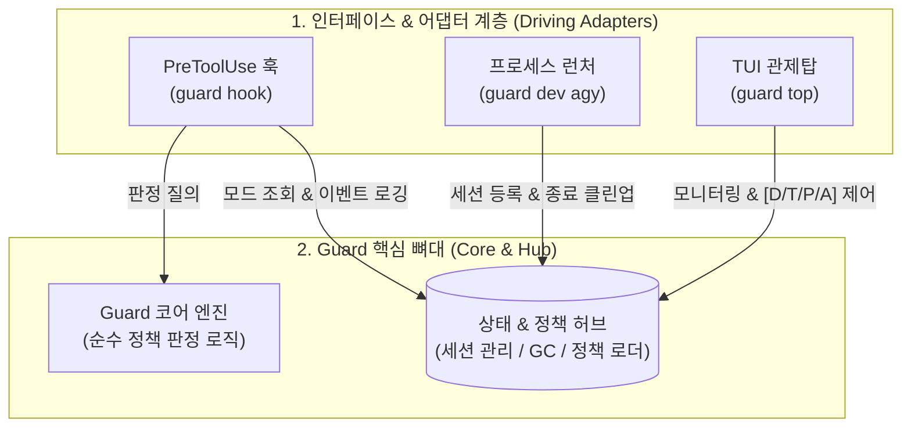

# 🛡️ Guard (agy-guard)

> **Antigravity CLI(`agy`)를 위한 Zero-Config AI 가드레일 & TUI 관제탑**

`guard`는 AI 에이전트(`agy`)의 도구 실행(PreToolUse)을 가로채어 작업 단계(모드)에 따라 **테스트 치팅, 소스 코드 임의 수정, 셸 명령어 우회 열람을 물리적으로 차단**하고, 작업자가 터미널 한 켠에서 모든 세션을 **"보고 ↔ 관찰 ↔ 제어"**할 수 있는 TUI 관제탑 콘솔을 제공하는 개발자 도구입니다.

---

## ✨ 핵심 기능 (Key Features)

- 🔒 **물리적 정책 가드레일 (Mode-based Guardrail)**
  - **DEV 모드 (Cleanroom)**: 테스트 파일(`*_test.go`, `*.spec.ts` 등) 열람을 차단하여 테스트 치팅 및 정답 하드코딩 방지.
  - **PLAN 모드 (설계/기획)**: 프로덕션 소스 코드(`src/internal/**` 등) 수정을 차단하고 문서 작성만 유도.
  - **TEST 모드 (TDD)**: 프로덕션 내부 구현을 은닉하고 인터페이스/계약(`contract`) 및 테스트 코드만 다루도록 격리.
  - **ALL 모드**: 필요 시 모든 제한을 일시 해제.
- 🚫 **셸 명령어 우회 원천 차단 (Bypass Prevention)**
  - 단순 파일 도구뿐만 아니라 `cat`, `head`, `tail`, 와일드카드 덤프, `git show/diff`, `python -c`, `bash -c`, 리다이렉션(`>`, `>>`) 등을 통한 우회 시도를 감지하여 차단.
- 🚀 **Zero-Config 런처 (`guard dev agy`)**
  - 복잡한 환경변수 설정(`export AGENT_MODE=...`) 없이 명령어 한 줄로 시각적 브리핑 배너와 함께 agy 세션 기동.
- 🎛️ **TUI 관제탑 (`guard top`)**
  - `lazygit`/`k9s` 스타일의 터미널 UI로 활성 세션 목록, 모드, 차단 통계, 실시간 이벤트 로그를 한눈에 조망.
  - `D`, `T`, `P`, `A` 단축키로 대화 맥락 중단 없이 세션 모드를 즉시 실시간 전환.
- ⚡ **초경량 무상태 아키텍처 (Zero-Daemon)**
  - 상주 데몬이나 소켓 찌꺼기 관리 없이, `~/.guard/sessions/<id>.json` 파일 기반의 독립 I/O 및 PID 생존 검사 기반 자동 GC 제공.
  - 훅 판정 소요 시간 **<0.5ms**.

---

## 🏛️ 시스템 아키텍처 (3-Layer Architecture)



---

## 🚀 빠른 시작 (Quick Start)

### 1. 빌드 및 설치

```bash
# 로컬 빌드
make build

# ~/.local/bin/guard 로 설치
make install
```

### 2. 가드레일 모드로 agy 실행 (런처)

```bash
# DEV(Cleanroom) 모드로 agy 기동
guard dev agy

# TEST(TDD) 모드로 agy 기동
guard test agy

# PLAN(설계) 모드로 agy 기동
guard plan agy
```

### 3. TUI 관제탑 실행

다른 터미널 창에서 다음 명령어를 실행하여 실행 중인 모든 세션을 모니터링하고 제어합니다:

```bash
guard top
```

#### TUI 단축키 안내
- `↑` / `↓` (또는 `k` / `j`): 모니터링할 세션 선택
- `D`: 선택 세션을 **DEV** 모드로 즉시 전환
- `T`: 선택 세션을 **TEST** 모드로 즉시 전환
- `P`: 선택 세션을 **PLAN** 모드로 즉시 전환
- `A`: 선택 세션을 **ALL**(제한 해제) 모드로 전환
- `C`: 해당 세션의 차단 카운트 리셋
- `Space`: 전체 차단 이벤트 상세 로그 모달 열기
- `Q`: TUI 관제탑 종료 (agy 세션은 계속 유지됨)

### 4. 기타 CLI 명령어

```bash
guard status          # 현재 활성 세션 목록 및 정책 상태 1회성 출력
guard clean           # 비정상 종료된 고아 세션 파일 수동 청소
guard clean --all     # 모든 세션 파일 강제 초기화
```

---

## ⚙️ Antigravity 훅 연동 (`.agents/hooks.json`)

프로젝트 루트의 `.agents/hooks.json`에 `guard`를 등록하면 agy가 도구를 실행할 때마다 자동으로 정책을 검증합니다:

```json
{
  "guard": {
    "PreToolUse": [
      {
        "matcher": "*",
        "hooks": [
          {
            "type": "command",
            "command": "guard"
          }
        ]
      }
    ]
  }
}
```

---

## 📋 정책 설정 예시 (`guard-policy.yaml`)

```yaml
version: "1.0"
rules:
  # 1. DEV 모드: 테스트 파일 열람 차단
  - name: "guard-test-files-read"
    mode: "DEV"
    type: "read"
    patterns:
      - "*_test.go"
      - "*.test.ts"
      - "**/tests/**"
    message: "[POLICY VIOLATION] DEV 모드에서는 테스트 파일 열람이 금지됩니다. 명세서와 테스트 stdout만 참조하세요."

  # 2. PLAN 모드: 소스 코드 수정 차단
  - name: "guard-source-code-write"
    mode: "PLAN"
    type: "write"
    patterns:
      - "src/internal/**"
      - "src/cmd/**"
    message: "[POLICY VIOLATION] PLAN 모드에서는 소스 코드를 수정할 수 없습니다. 문서만 작성하세요."

  # 3. TEST 모드: 프로덕션 코드 열람 차단 (테스트 및 계약 파일만 허용)
  - name: "guard-production-code-read"
    mode: "TEST"
    type: "read"
    patterns:
      - "src/internal/**"
    exclude_patterns:
      - "*_test.go"
      - "**/contract/**"
    message: "[POLICY VIOLATION] TEST 모드에서는 프로덕션 코드 열람이 금지됩니다. 인터페이스/계약만 참조하세요."
```

---

## 📚 상세 설계 문서

- [01_requirements.md](file:///mnt/data/mytask/kms/guard/doc/01_requirements.md): 기능 및 비기능 요구사항 명세서 (PRD)
- [02_architecture.md](file:///mnt/data/mytask/kms/guard/doc/02_architecture.md): 3계층 시스템 아키텍처 및 상세 컴포넌트 설계서
- [03_tui_control_tower.md](file:///mnt/data/mytask/kms/guard/doc/03_tui_control_tower.md): Bubbletea 기반 TUI 관제탑 상세 설계서
- [04_development_plan.md](file:///mnt/data/mytask/kms/guard/doc/04_development_plan.md): 4단계 점진적 개발 계획서
