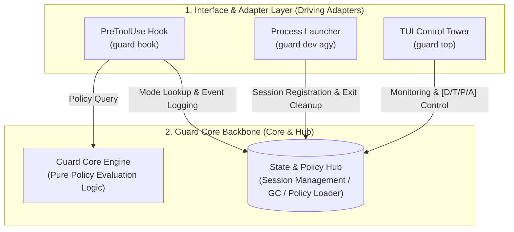

# 🛡️ Guard (agy-guard)

**English** | [한국어](README.ko.md)

> **Zero-Config AI Guardrail & TUI Control Tower for Antigravity CLI (`agy`)**

`guard` is a developer tool that intercepts AI agent (`agy`) tool executions (`PreToolUse`) to **physically block test cheating, unauthorized source code edits, and shell command bypasses** based on the current workflow mode. It also provides a TUI control tower console that lets you **view, observe, and control** all active sessions right from your terminal.

---

## ✨ Key Features

- 🔒 **Mode-Based Physical Guardrails**
  - **DEV Mode (Cleanroom)**: Blocks reading test files (`*_test.go`, `*.spec.ts`, etc.) to prevent test cheating and hardcoded answers.
  - **PLAN Mode (Design / Planning)**: Blocks modifying production source code (`src/internal/**`, etc.) so the agent focuses strictly on documentation and design.
  - **TEST Mode (TDD)**: Hides internal production implementations and restricts access to interfaces/contracts (`contract`) and test code.
  - **ALL Mode**: Temporarily lifts all restrictions when needed.
- 🚫 **Shell Bypass Prevention**
  - Detects and blocks bypass attempts not only through standard file tools, but also via `cat`, `head`, `tail`, wildcard dumps, `git show/diff`, `python -c`, `bash -c`, and shell redirections (`>`, `>>`).
- 🚀 **Zero-Config Launcher (`guard dev agy`)**
  - Starts an `agy` session with a visual briefing banner in a single command—no manual environment variable setup (`export AGENT_MODE=...`) required.
- 🎛️ **TUI Control Tower (`guard top`)**
  - A `lazygit`/`k9s`-style terminal UI showing active sessions, current modes, block statistics, and real-time event logs at a glance.
  - Switch session modes live with `D`, `T`, `P`, and `A` hotkeys without interrupting the conversation context.
- ⚡ **Ultra-Lightweight Stateless Architecture (Zero-Daemon)**
  - No background daemon or stale socket files—uses independent file-based I/O (`~/.guard/sessions/<id>.json`) with automatic PID-liveness garbage collection.
  - Hook evaluation latency **<0.5ms**.

---

## 🏛️ System Architecture (3-Layer Architecture)



---

## 🚀 Quick Start

### 1. Build and Install

```bash
# Local build
make build

# Install to ~/.local/bin/guard
make install
```

### 2. Launch `agy` in Guardrail Mode

```bash
# Start agy in DEV (Cleanroom) mode
guard dev agy

# Start agy in TEST (TDD) mode
guard test agy

# Start agy in PLAN (Design) mode
guard plan agy
```

### 3. Open the TUI Control Tower

Run the following command in another terminal window to monitor and control all active sessions:

```bash
guard top
```

#### TUI Keybindings
- `↑` / `↓` (or `k` / `j`): Select a session to monitor
- `D`: Immediately switch the selected session to **DEV** mode
- `T`: Immediately switch the selected session to **TEST** mode
- `P`: Immediately switch the selected session to **PLAN** mode
- `A`: Switch the selected session to **ALL** (unrestricted) mode
- `C`: Reset the block count for the selected session
- `Space`: Open the detailed block event log modal
- `Q`: Quit the TUI control tower (`agy` sessions continue running)

### 4. Workspace Initialization, Diagnostics, and Other CLI Commands

```bash
guard init            # Auto-detect stack and initialize hooks, policy, and workflow rules
guard init --dry-run  # Preview init changes without modifying files
guard doctor          # Diagnose workspace configuration and environment health
guard doctor --fix    # Automatically repair fixable configuration issues
guard status          # Print a one-shot summary of active sessions and policy state
guard clean           # Manually clean up orphaned session files from abnormal exits
guard clean --all     # Force-reset all session files
```

---

## ⚙️ Antigravity Hook Integration (`.agents/hooks.json`)

Register `guard` in `.agents/hooks.json` at the project root so policies are automatically enforced whenever `agy` invokes a tool:

```json
{
  "guard": {
    "PreToolUse": [
      {
        "matcher": "*",
        "hooks": [
          {
            "type": "command",
            "command": "guard"
          }
        ]
      }
    ]
  }
}
```

---

## 📋 Policy Configuration Example (`guard-policy.yaml`)

```yaml
version: "1.0"
rules:
  # 1. DEV mode: Block reading test files
  - name: "guard-test-files-read"
    mode: "DEV"
    type: "read"
    patterns:
      - "*_test.go"
      - "*.test.ts"
      - "**/tests/**"
    message: "[POLICY VIOLATION] Reading test files is forbidden in DEV mode. Refer only to specifications and test stdout."

  # 2. PLAN mode: Block modifying source code
  - name: "guard-source-code-write"
    mode: "PLAN"
    type: "write"
    patterns:
      - "src/internal/**"
      - "src/cmd/**"
    message: "[POLICY VIOLATION] Modifying source code is not allowed in PLAN mode. Write documentation only."

  # 3. TEST mode: Block reading production code (allow tests and contracts only)
  - name: "guard-production-code-read"
    mode: "TEST"
    type: "read"
    patterns:
      - "src/internal/**"
    exclude_patterns:
      - "*_test.go"
      - "**/contract/**"
    message: "[POLICY VIOLATION] Reading production code is forbidden in TEST mode. Refer only to interfaces and contracts."
```

---

## 📚 Detailed Design Documents

- [01_requirements.md](doc/01_requirements.md): Functional and non-functional requirements specification (PRD)
- [02_architecture.md](doc/02_architecture.md): 3-layer system architecture and detailed component design
- [03_tui_control_tower.md](doc/03_tui_control_tower.md): Bubbletea-based TUI control tower detailed design
- [04_development_plan.md](doc/04_development_plan.md): 4-phase incremental development plan
