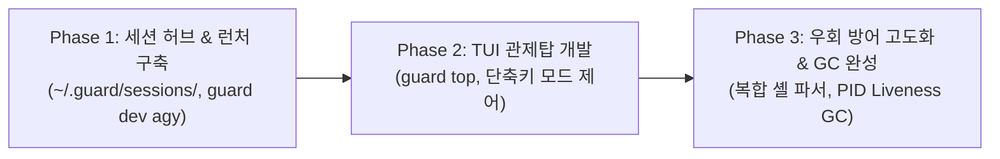

# [01_requirements.md] Antigravity CLI 가드레일 (Guard) 기능 요구사항 명세서

## 1. 개요 및 배경 (Overview)

### 1.1 배경 및 문제 정의
Antigravity CLI(`agy`)와 같은 LLM 기반 자율 에이전트는 코드 작성, 파일 열람, 셸 명령어 실행 등의 도구를 자율적으로 사용합니다. 그러나 다음과 같은 핵심 문제가 존재합니다:

1. **치팅 및 무결성 훼손 (Safety Risk)**
   - **Cleanroom 개발 훼손**: 개발(DEV) 모드에서 테스트 코드(`*_test.go` 등)를 미리 열람하여 정답을 하드코딩하거나 허위 통과를 유도.
   - **설계 훼손**: 설계/기획(PLAN) 모드에서 프로덕션 소스 코드를 임의로 수정하여 아키텍처 원칙 위반.
   - **TDD 원칙 훼손**: 테스트(TEST) 모드에서 프로덕션 내부 코드를 직접 참조하여 계약(Contract) 기반 테스트 작성 원칙 위반.
   - **셸 우회(Shell Bypass)**: `cat`, `git diff`, `python -c` 등의 셸 명령어로 제한된 파일을 우회 열람/수정.

2. **조율자(Orchestrator)의 인지 부하 및 관찰 불가 (UX/Observability Bottleneck)**
   - **블라인드 스팟 (Invisible State)**: 현재 세션이 어떤 모드로 동작 중인지, 어떤 가이드가 적용되고 있는지, 어디서 정책 위반이 발생했는지 대화창에서는 알 길이 없음.
   - **컨텍스트 스위칭의 피로**: 모드를 바꾸거나 권한을 조율하기 위해 대화창을 벗어나 다른 터미널에서 환경변수(`export AGENT_MODE=...`)를 세팅하거나 별도 CLI 명령을 찾아 헤매야 함.
   - **다중 세션 관리 불가**: 여러 작업 세션(DEV, PLAN, TEST 등)이 동시에 돌아갈 때 각 세션의 상태를 한눈에 조망하고 통제할 관제탑(Cockpit)이 부재함.

### 1.2 목적
`guard`는 agy의 `PreToolUse` 훅을 인터셉트하여 정책 위반을 물리적으로 차단함과 동시에, 작업자가 **"보고 ↔ 관찰 ↔ 제어"**할 수 있는 **Zero-Config 런처 및 TUI 관제탑(`guard top`)**을 제공하여 조율자로서의 인지 부하를 제로화하는 것을 목적으로 합니다.

---

## 2. 주요 개념 및 용어 정의

| 용어 | 정의 |
| :--- | :--- |
| **agy (Antigravity CLI)** | Google Deepmind 기반 AI 에이전트 CLI 환경 |
| **PreToolUse Hook** | 에이전트가 도구(Tool)를 실행하기 직전에 호출되는 가로채기(Intercept) 이벤트 |
| **DEV 모드 (Cleanroom)** | 테스트 파일 열람이 물리 차단되며 명세서와 테스트 결과만으로 구현하는 모드 |
| **PLAN 모드 (설계)** | 소스 코드 및 인프라 파일 수정이 차단되며 문서 작성만 허용되는 모드 |
| **TEST 모드 (TDD)** | 내부 구현 코드는 은닉되고 계약(Contract) 및 테스트 파일만 열람/작성 가능한 모드 |
| **ALL 모드 (전체 허용)** | 모든 가드레일 제약이 일시 해제되는 모드 |
| **TUI 관제탑 (`guard top`)** | 실행 중인 모든 agy 세션을 조망하고 단축키로 권한을 즉시 제어하는 터미널 콘솔 |

---

## 3. 기능 요구사항 (Functional Requirements)

### FR-0: 조율자 관찰 및 제어 인터페이스 (P0 - Highest Priority)
- **FR-0.1 (TUI 관제탑 렌더링)**: `guard top` (또는 `guard ui`) 실행 시 실행 중인 전체 agy 세션 목록, 각 세션별 활성 모드, PID, 워크스페이스, 최근 활동 시각, 차단 횟수를 테이블 형태로 실시간 출력해야 한다.
- **FR-0.2 (원클릭 모드 스위칭)**: TUI 환경에서 세션을 선택하고 단축키(`D`, `T`, `P`, `A`) 입력 시 타겟 세션의 가드레일 모드를 실시간으로 전환할 수 있어야 한다.
- **FR-0.3 (이벤트 가시화)**: 각 세션별로 최근 도구 호출 결정(`allow`/`deny`), 대상 파일/명령어, 차단 사유를 최대 50건까지 TUI 및 CLI에서 실시간 조회할 수 있어야 한다.
- **FR-0.4 (CLI 상태 요약)**: `guard status` 실행 시 TUI를 켜지 않고도 현재 워크스페이스 및 전체 세션의 상태 테이블을 1회성 텍스트로 즉시 출력해야 한다.
- **FR-0.5 (세션 차단 카운트 리셋)**: 작업자는 TUI 단축키(`C`) 또는 CLI 명령으로 특정 세션의 위반 카운트를 초기화할 수 있어야 한다.

### FR-1: Zero-Config 런처 인터페이스
- **FR-1.1 (간편 기동)**: 사용자는 `guard <mode> [command]` (예: `guard dev agy`) 형태로 환경변수 수동 설정 없이 지정된 모드로 agy를 실행할 수 있어야 한다.
- **FR-1.2 (시각적 상태 브리핑)**: 런처는 agy 프로세스를 띄우기 직전에 현재 활성 모드, 차단 대상 패턴, 허용 작업 범위를 요약한 배너를 터미널 화면에 출력해야 한다.
- **FR-1.3 (세션 라이프사이클 바인딩)**: 런처는 agy 기동 시 세션 상태 파일을 생성하고, agy 프로세스가 정상 종료(`exit`)되면 해당 세션 파일을 즉시 정리(Cleanup)해야 한다.

### FR-2: 선언적 정책 관리 (`guard-policy.yaml`)
- **FR-2.1 (YAML 스키마)**: 정책 파일은 버전(`version`)과 규칙 목록(`rules`)을 지원해야 한다.
- **FR-2.2 (규칙 필드)**: 각 규칙은 이름(`name`), 대상 모드(`mode`), 행위 유형(`type`: `read`/`write`/`command`), 대상 패턴(`patterns`), 예외 패턴(`exclude_patterns`), 위반 메시지(`message`)를 지원해야 한다.
- **FR-2.3 (패턴 매칭 지원)**: 접미사(`*_test.go`), 기본 Glob(`*.ts`), 다중 디렉터리 와일드카드(`**/tests/**`, `src/internal/**`) 및 셸 명령어 패턴(`go test*`, `make test*`)을 완벽히 지원해야 한다.
- **FR-2.4 (다중 경로 탐색)**: 정책 파일은 다음 우선순위로 로드되어야 한다:
  1. 환경변수 `GUARD_POLICY_PATH`
  2. 현재 작업 디렉터리의 `./guard-policy.yaml`
  3. 워크스페이스 루트의 `.agents/guard-policy.yaml`
  4. 사용자 홈 디렉터리 `~/.config/guard/guard-policy.yaml`
  5. 파일이 없을 경우 내장 기본 정책(Built-in Fallback) 사용

### FR-3: 도구 및 셸 명령어 인터셉트 (Hook Engine)
- **FR-3.1 (PreToolUse 입출력)**: stdin으로 agy 도구 호출 JSON 페이로드를 받아 0.5ms 이내에 `{"decision": "allow"}` 또는 `{"decision": "deny", "reason": "..."}` JSON을 stdout으로 반환해야 한다.
- **FR-3.2 (파일 도구 검사)**: `read_file`, `write_file`, `edit_file` 호출 시 경로를 검사하여 활성 모드 정책에 따라 차단/허용을 판정해야 한다.
- **FR-3.3 (안전 명령어 화이트리스트)**: `git status`, `git branch`, `go build`, `go vet` 등 안전한 조회/빌드 명령은 불필요한 차단 없이 항상 통과시켜야 한다.
- **FR-3.4 (셸 뷰어 우회 차단)**: DEV 모드에서 `cat`, `head`, `tail`, `more`, `less`, `strings` 및 와일드카드 전개(`cat test/*`)를 통한 테스트 파일 열람을 차단해야 한다.
- **FR-3.5 (Git 및 인라인 스크립트 차단)**: `git show/diff`, `python -c`, `node -e`, `bash -c` 등을 통해 차단 대상 파일을 조회하려는 시도를 차단해야 한다.
- **FR-3.6 (PLAN 쓰기 차단)**: PLAN 모드에서 리다이렉션(`>`, `>>`), `tee`, `sed -i` 등을 통한 소스 코드 수정 시도를 차단해야 한다.
- **FR-3.7 (모드별 명령어 실행 차단)**: `type: "command"` 규칙 지정 시 체이닝(`&&`, `;`), 서브셸(`bash -c`, `$(...)`), 래퍼(`env`, `sudo`, `timeout`), 서브커맨드 앞단 플래그(`go -C dir test`)를 포함한 명령어 실행 시도를 차단해야 한다.

### FR-4: 세션 상태 관리 및 자동 수거 (Session GC)
- **FR-4.1 (세션 파일 분리)**: 동시성 충돌 방지를 위해 각 세션은 독립 파일(`~/.guard/sessions/<sessionId>.json`)로 격리 관리되어야 한다.
- **FR-4.2 (비정상 종료 자동 수거)**: TUI 구동 시 또는 새 세션 기동 시, PID 생존 검사를 수행하여 비정상 종료된 고아 세션 파일을 자동으로 청소해야 한다.
- **FR-4.3 (수동 청소 명령어)**: `guard clean` 명령으로 종료된 세션을 일괄 정리하고, `guard clean --all`로 전체 세션을 리셋할 수 있어야 한다.

---

## 4. 비기능 요구사항 (Non-Functional Requirements)

- **NFR-1 (초저지연 판정)**: 훅(`guard hook`)의 페이로드 파싱, 세션 모드 조회, 정책 평가 완료까지의 소요 시간은 **0.5ms 이내**여야 한다.
- **NFR-2 (단일 바이너리 배포)**: 외부 런타임 의존성 없이 단일 정적 Go 바이너리로 빌드되어 `~/.local/bin/guard`에 배포 가능해야 한다.
- **NFR-3 (무상태 인프라 및 데몬 불필요)**: 상주 시스템 데몬이나 소켓 찌꺼기 관리 없이, 파일 시스템 기반으로 완결되어야 한다.
- **NFR-4 (장애 격리 및 안전 실패)**: 상태 파일 손상이나 JSON 파싱 오류 시 기본 안전 모드(DEV)로 동작하며, 에이전트 세션을 강제 크래시시키지 않아야 한다.

---

## 5. 단계별 개발 로드맵 (Roadmap)

1. **Phase 1: 세션 허브 및 런처 구축 (Core)**
   - 디렉토리 기반 세션 파일 I/O 및 Atomic Write 구현
   - `guard <mode> agy` 런처 및 브리핑 배너 렌더링
   - `guard hook`과 세션 파일 모드 연동
2. **Phase 2: TUI 관제탑 개발 (Observability & Control)**
   - Go `bubbletea` 기반 `guard top` 구현
   - 실시간 세션 모니터링 테이블 및 이벤트 로그 패널 구축
   - 단축키(`D`, `T`, `P`, `A`) 즉시 모드 스위칭 연동
3. **Phase 3: 우회 방어 고도화 및 세션 GC 완성 (Hardening)**
   - 복합 셸 구문(`;`, `&&`, 서브셸) 분리 파서 탑재
   - PID Liveness 검사 기반 자동 GC 엔진 완성
   - 정책 파일 다중 탐색 경로 및 `make install` 배포 자동화
