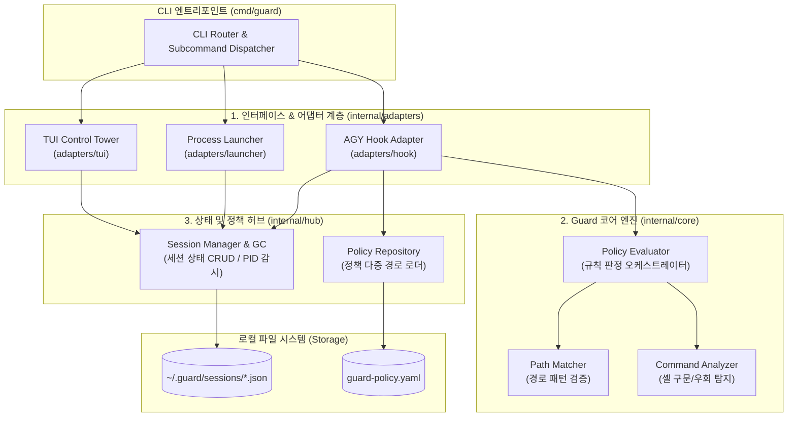
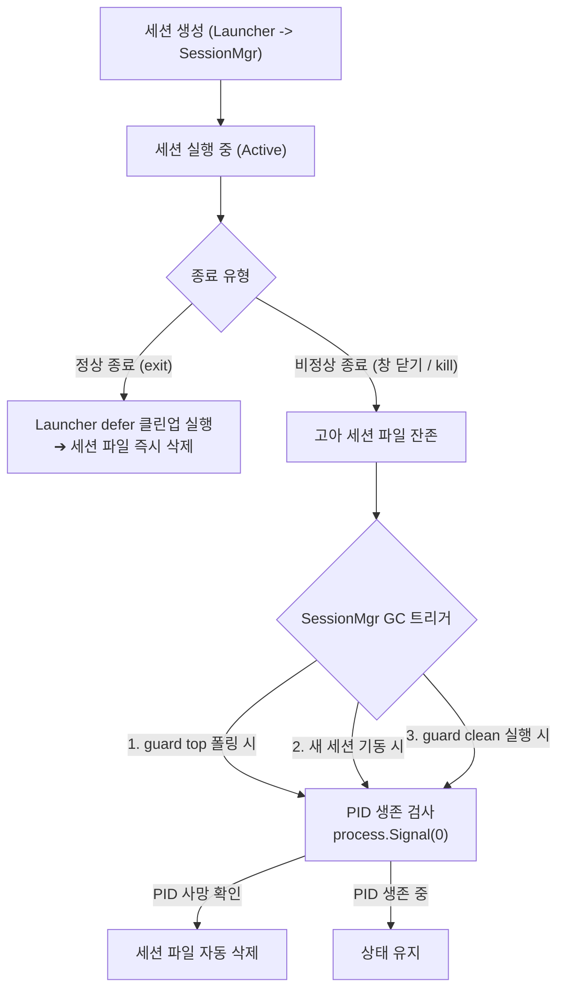

# [02_architecture.md] Antigravity CLI 가드레일 (Guard) 시스템 아키텍처 및 상세 설계서

## 1. 시스템 아키텍처 개요 (System Overview)

`guard`는 상시 데몬 관리의 복잡함과 소켓 누수 문제를 원천 차단하고, 유지보수성과 확장성을 극대화하기 위해 **코어 도메인(Core Engine)과 상태 허브(State Hub)를 중심 뼈대로 두고, TUI·런처·훅을 외곽 어댑터(Adapters)로 분리한 3계층 클린 아키텍처**를 채택합니다.

### 아키텍처 설계 핵심 원칙
1. **관심사 분리 (Separation of Concerns)**: 화면 표시(`TUI`), 프로세스 구동(`Launcher`), 프로토콜 파싱(`Hook`)은 외곽 어댑터로 분리하여 코어 로직을 오염시키지 않습니다.
2. **순수 도메인 코어 (Pure Core Engine)**: 판정 엔진(`Evaluator`, `PathMatcher`, `CmdAnalyzer`)은 파일 I/O나 UI 의존성이 전혀 없는 순수 로직으로 구성하여 고속 단위 테스트와 높은 확장성을 보장합니다.
3. **단방향 의존성 (Unidirectional Dependency)**: 모든 의존성은 `외곽 어댑터 (Adapters)` ➔ `코어 엔진 (Core) / 상태 허브 (Hub)` 방향으로만 흐릅니다.

---

## 2. 주요 컴포넌트 구성 다이어그램 및 기능 정의

### 2.1 컴포넌트 다이어그램 (3-Layer Component Diagram)



---

### 2.2 그룹별 컴포넌트 기능 정의 (Component Definitions)

#### 그룹 1: 인터페이스 & 어댑터 계층 (`internal/adapters`)
> 외부(작업자 또는 에이전트 런타임)와 소통하며 코어와 허브를 구동하는 외곽 모듈입니다. 추후 Web UI나 타 에이전트(Claude Code 등) 지원 시 이 계층에 어댑터만 추가하면 됩니다.

| 컴포넌트 | 패키지 경로 | 주요 역할 및 상세 기능 |
| :--- | :--- | :--- |
| **CLI Router** | `cmd/guard/main.go` | • CLI 인자(`dev`, `test`, `plan`, `top`, `hook`, `clean`, `status`)를 분석하여 각 어댑터로 명령 디스패치<br>• stdin 파이프 입력 감지 시 `HookAdapter`로 자동 분기 |
| **TUI Control Tower** | `internal/adapters/tui` | • Go `bubbletea` 기반 실시간 관제 콘솔 (`guard top`)<br>• `SessionMgr`를 통해 활성 세션 목록, 모드, 차단 통계 및 이벤트 로그를 실시간 시각화<br>• 단축키(`D`, `T`, `P`, `A`) 입력 시 타겟 세션의 가드레일 모드를 즉시 전환 (상세 설계: [03_tui_control_tower.md](file:///mnt/data/mytask/kms/guard/doc/03_tui_control_tower.md)) |
| **Process Launcher** | `internal/adapters/launcher` | • `guard <mode> agy` 실행 시 환경변수 수동 설정 없이 세션을 격리하여 에이전트 구동<br>• 기동 즉시 터미널에 시각적 상태 배너(현재 모드, 차단/허용 범위) 브리핑 출력<br>• 자식 프로세스 종료(`exit`) 감지 시 `SessionMgr`를 호출하여 세션 파일 즉시 정리(Graceful Cleanup) |
| **AGY Hook Adapter** | `internal/adapters/hook` | • Antigravity CLI의 `PreToolUse` 이벤트 JSON 페이로드(stdin)를 파싱하는 프로토콜 어댑터<br>• `SessionMgr`에서 현재 모드를 읽고 `PolicyRepo`의 정책과 함께 `Evaluator`에 판정 요청<br>• 판정 결과(`allow`/`deny`)를 0.5ms 이내에 stdout JSON으로 출력하고 차단 이벤트를 기록 |

#### 그룹 2: Guard 코어 엔진 (`internal/core`)
> 파일 I/O나 외부 UI에 전혀 의존하지 않는 **Guard의 핵심 비즈니스 로직(Pure Domain)**입니다.

| 컴포넌트 | 패키지 경로 | 주요 역할 및 상세 기능 |
| :--- | :--- | :--- |
| **Policy Evaluator** | `internal/core/evaluator.go` | • 입력받은 `(모드, 정책 규칙셋, 도구명, 대상 경로/명령어)`를 평가하여 최종 허용/차단(`Decision`) 및 위반 메시지를 결정하는 코어 오케스트레이터 |
| **Path Matcher** | `internal/core/matcher.go` | • 파일 경로 패턴 매칭 엔진<br>• 접미사(`*_test.go`), 기본 Glob(`*.ts`), 다중 디렉터리 와일드카드(`**/tests/**`, `src/internal/**`) 및 예외 패턴(`exclude_patterns`)을 정규식 및 경로 트리로 정밀 검증 |
| **Command Analyzer** | `internal/core/command.go` | • 셸 명령어 파싱 및 우회 공격 탐지 엔진<br>• 안전 명령어 화이트리스트(`git status`, `go build`, `go vet`) 판별<br>• 파일 뷰어(`cat`, `head`, `tail` 및 와일드카드 전개), Git 조회(`git show`, `git diff`), 인라인 스크립트(`python -c`, `node -e`), 파일 덮어쓰기(`>`, `tee`, `sed -i`) 분석 |

#### 그룹 3: 상태 및 정책 허브 (`internal/hub`)
> 모든 어댑터가 공유하는 **단일 진실 공급원(Single Source of Truth)** 인프라 계층입니다.

| 컴포넌트 | 패키지 경로 | 주요 역할 및 상세 기능 |
| :--- | :--- | :--- |
| **Session Manager & GC** | `internal/hub/session` | • 동시성 충돌 방지를 위한 세션별 독립 파일(`~/.guard/sessions/<id>.json`) Atomic Read/Write 관리<br>• 전체 세션 상태 취합(Aggregator) 및 최근 도구 호출 이벤트(최대 50건) 증분 로깅<br>• PID 생존 검사(`Signal(0)`)를 통해 비정상 종료된 고아 세션 파일을 자동 청소하는 Self-Healing GC 엔진 |
| **Policy Repository** | `internal/hub/policy` | • 선언적 정책 파일(`guard-policy.yaml`) 로더 및 스키마 검증기<br>• 다중 탐색 경로(환경변수 `GUARD_POLICY_PATH` ➔ CWD ➔ `.agents/` ➔ `~/.config/guard/` ➔ 내장 Fallback) 우선순위 처리 |

---

## 3. 세부 동작 시나리오 및 데이터 흐름

### 3.1 Zero-Config 런처 시나리오 (`guard dev agy`)
1. 작업자가 `guard dev agy` 실행.
2. `Launcher` 어댑터가 `SessionMgr`를 호출하여 `~/.guard/sessions/<sessionId>.json` 파일 생성 (모드: `DEV`, PID 바인딩).
3. 터미널에 시각적 상태 배너 출력:
   ```text
   🛡️ [Guardrail] Active Mode: DEV (Cleanroom)
      • 차단 대상: *_test.go, tests/** 열람 금지 (우회 시도 자동 차단)
      • 허용 범위: 요구사항 명세서, 구현 코드, 'go test' 실행 stdout
   🚀 Antigravity CLI(agy)를 시작합니다...
   ```
4. `exec.Command`로 자식 프로세스 `agy` 실행.
5. `agy` 프로세스가 종료(`exit`)되면 `Launcher`의 `defer` 루틴이 `SessionMgr.Delete(sessionId)`를 호출하여 세션 파일 자동 삭제.

### 3.2 초경량 훅 판정 시나리오 (`guard hook`)
1. agy가 도구(`read_file`, `run_command` 등) 실행 직전 `guard hook`을 stdin 파이프로 호출.
2. `HookAdapter`가 JSON 페이로드 파싱 (`sessionId`, `tool_name`, `Path`, `CommandLine`).
3. `SessionMgr`에서 해당 세션 파일(`sessions/<sessionId>.json`)을 읽어 현재 활성 모드 조회.
4. `CoreEngine (Evaluator)`에 판정 요청:
   - 위반 시: `{"decision": "deny", "reason": "..."}` stdout 반환, stderr 경고 출력, `SessionMgr`에 차단 카운트 및 이벤트 기록.
   - 통과 시: `{"decision": "allow"}` stdout 반환.
5. 전체 과정은 데몬이나 네트워크 대기 없이 **0.5ms 이내 완료**.

### 3.3 TUI 관제탑 연동 (`guard top`)
- `TUI Control Tower` 어댑터는 `SessionMgr`만을 바라보며 전체 세션을 모니터링하고 제어합니다.
- 구체적인 화면 레이아웃, Elm 아키텍처 상태 모델, 단축키 매핑(`D`, `T`, `P`, `A`, `C`, `Space`)은 전용 설계서인 **[03_tui_control_tower.md](file:///mnt/data/mytask/kms/guard/doc/03_tui_control_tower.md)**를 참조합니다.

---

## 4. 세션 수명 관리 및 가비지 컬렉션 (Session Lifecycle & GC)



---

## 5. 애플리케이션 개발 디렉토리 구조 (3-Layer Go Project Layout)

3대 그룹핑 아키텍처(`core`, `hub`, `adapters`)가 코드 디렉토리 구조에 1:1로 명확히 투영됩니다.

```text
guard/
├── cmd/
│   └── guard/
│       └── main.go                     # CLI 엔트리포인트 및 서브커맨드 라우터
│
├── internal/
│   │
│   ├── core/                           # [그룹 2: Guard 코어 엔진] 순수 판정 도메인 로직 (I/O 없음)
│   │   ├── evaluator.go                # Evaluate(mode, policy, req) -> Decision 오케스트레이터
│   │   ├── matcher.go                  # 파일 경로 패턴 매칭 (Glob, **, 접미사, 예외 패턴)
│   │   ├── command.go                  # 셸 명령어 파서 (뷰어, Git, 인라인 스크립트, 리다이렉션 탐지)
│   │   └── evaluator_test.go           # 코어 판정 엔진 고속 유닛 테스트
│   │
│   ├── hub/                            # [그룹 3: 상태 및 정책 허브] 데이터 단일 진실 공급원
│   │   ├── session/                    # 세션 상태 파일 관리 및 GC
│   │   │   ├── model.go                # Session, Event 데이터 모델
│   │   │   ├── manager.go              # 세션 파일 Atomic Read/Write 및 목록 취합(Aggregator)
│   │   │   └── gc.go                   # PID Liveness 검사 및 고아 세션 파일 자동 수거
│   │   └── policy/                     # 정책 파일 관리
│   │       ├── model.go                # Policy, Rule 데이터 모델 및 내장 Fallback 규칙
│   │       └── loader.go               # guard-policy.yaml 다중 경로 탐색 및 파서
│   │
│   └── adapters/                       # [그룹 1: 인터페이스 & 어댑터 계층] 외부 접점 모듈
│       ├── hook/                       # Antigravity PreToolUse 훅 어댑터
│       │   ├── handler.go              # stdin 파싱 -> Core/Hub 호출 -> stdout JSON 반환
│       │   └── payload.go              # PreToolUse 입출력 DTO
│       ├── launcher/                   # Zero-Config 프로세스 런처 (guard dev agy)
│       │   ├── launcher.go             # 자식 프로세스(agy) 스폰 및 세션 라이프사이클 바인딩
│       │   └── banner.go               # 기동 시 시각적 상태 브리핑 배너 출력
│       └── tui/                        # TUI 관제탑 어댑터 (guard top)
│           ├── app.go                  # Bubbletea 프로그램 진입점
│           ├── model.go                # TUI 상태 모델
│           ├── view.go                 # 테이블 및 이벤트 로그 패널 렌더링
│           ├── update.go               # 단축키(D/T/P/A/C) 핸들러 및 주기 틱 갱신
│           └── styles.go               # Lipgloss 컬러 테마 및 레이아웃 스타일
│
├── doc/                                # 기획 및 아키텍처 설계 문서
│   ├── 01_requirements.md              # 기능 및 비기능 요구사항 명세서 (PRD)
│   ├── 02_architecture.md              # 시스템 아키텍처 및 상세 설계서 (본 문서)
│   ├── 03_tui_control_tower.md         # TUI 관제탑 전용 상세 설계서
│   └── guard-analysis-and-improvements.md
│
├── chat/                               # 실시간 대화 기록 (chatlog)
│   └── guard.md
│
├── guard-policy.yaml                   # 기본 정책 정의 파일
├── Makefile                            # 빌드, 설치, 테스트 자동화 스크립트
├── go.mod                              # Go 모듈 의존성 정의
└── go.sum
```
