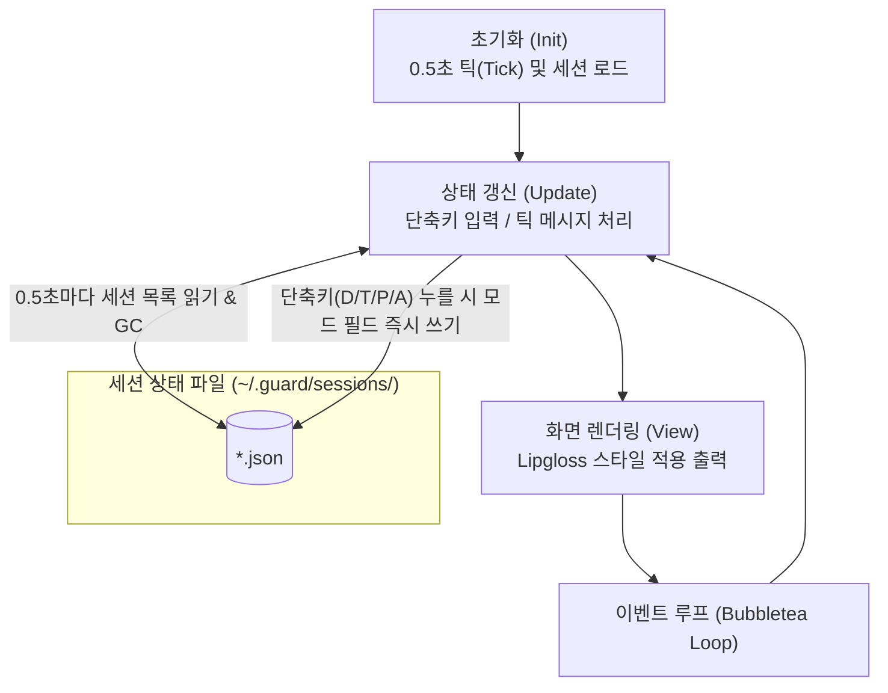

# [03_tui_control_tower.md] Antigravity CLI 가드레일 TUI 관제탑 상세 설계서

## 1. 개요 및 목적 (Overview)

### 1.1 배경
자율 AI 에이전트(`agy`)를 여러 터미널이나 백그라운드에서 동시에 운용할 때, 작업자는 각 세션이 어떤 모드로 동작 중인지, 어디서 정책 위반(차단)이 발생했는지 알 수 없는 **블라인드 스팟(Blind Spot)**에 직면합니다. 또한 권한을 변경하려면 대화창을 벗어나 다른 터미널에서 명령을 쳐야 하는 **인지 부하**가 큽니다.

### 1.2 목적
`guard top` (또는 `guard ui`)은 Go의 현대적 TUI 프레임워크인 **Bubbletea**를 기반으로, 작업자가 터미널 한 켠에서 모든 agy 세션을 **"한눈에 조망(보고·관찰)"**하고 **"단축키로 즉각 권한을 조율(제어)"**할 수 있는 실시간 관제탑 콘솔을 제공합니다.

---

## 2. 기술 스택 및 아키텍처 패턴

### 2.1 기술 스택
- **TUI 프레임워크**: [Charmbracelet Bubbletea](https://github.com/charmbracelet/bubbletea) (The Elm Architecture 기반)
- **컴포넌트 라이브러리**: [Charmbracelet Bubbles](https://github.com/charmbracelet/bubbles) (테이블, 뷰포트, 스피너 등)
- **스타일링/레이아웃**: [Charmbracelet Lipgloss](https://github.com/charmbracelet/lipgloss) (터미널 ANSI 컬러 및 테두리 레이아웃)

### 2.2 Elm 아키텍처 구조



- **Model**: 현재 세션 목록, 선택된 세션 인덱스, 상세 이벤트 로그, 터미널 너비/높이.
- **Update**: 단축키 입력(`D`, `T`, `P`, `A`, `C`, 방향키) 또는 백그라운드 0.5초 주기 틱 메시지 처리.
- **View**: 터미널 크기에 맞게 헤더, 세션 테이블, 이벤트 로그 패널, 푸터 단축키 바를 조합하여 렌더링.

---

## 3. 화면 레이아웃 명세 (UI Layout Specification)

### 3.1 메인 관제 콘솔 화면 (4단 수직 구조)

```text
🛡️ GUARD CONTROL TOWER   세션: 3  │  총 차단: 3  │  01:52:10             [?: 도움말] [Q: 종료]
╭─ 활성 세션 목록 (Active Sessions: 3) ───────────────────────────────────────────────────────╮
│    ID         모드     워크스페이스                      최근 활동    차단                  │
│  ● 0cb2c58e  [DEV ]    .../kms/guard                     방금 전      2회                   │
│    a8f12c90  [TEST]    .../stagefive/poc                 3분 전       0회                   │
│    f3b019e2  [PLAN]    .../infra/gateway                 12분 전      1회                   │
╰─────────────────────────────────────────────────────────────────────────────────────────────╯
╭─ 선택 세션 상세: 0cb2c58e (/home/yundream/mytask/kms/guard)  [최근 이벤트 4/50] ────────────╮
│  • 01:51:04 [DENY ] read_file   -> internal/core/evaluator_test.go                          │
│             └ 사유: [POLICY VIOLATION] DEV 모드에서는 테스트 파일 열람이 금지됩니다.        │
│  • 01:50:42 [ALLOW] write_file  -> doc/05_qa_e2e_guide.md                                   │
│  • 01:50:19 [DENY ] run_command -> git status && cat pkg/auth_test.go                       │
│             └ 사유: [POLICY VIOLATION] DEV 모드에서는 테스트 파일 열람이 금지됩니다.        │
│  • 01:49:55 [ALLOW] read_file   -> cmd/guard/main.go                                        │
╰─────────────────────────────────────────────────────────────────────────────────────────────╯
  ✅ 0cb2c58e 세션 모드가 TEST로 변경되었습니다.   (조작 직후 2초간 표시되는 상태 토스트)
  [↑/↓] 선택 │ [D] DEV │ [T] TEST │ [P] PLAN │ [A] ALL │ [C] 차단리셋 │ [Space] 전체로그 │ [Q] 종료
```

### 3.2 영역별 세부 명세 및 반응형 높이 배분

| 영역 | 높이 배분 | 주요 표시 내용 |
| :--- | :--- | :--- |
| **1. 헤더 바 (Header)** | 고정 1~2줄 | 타이틀(`🛡️ GUARD CONTROL TOWER`), 총 세션 수, 누적 차단 수, 현재 시각(0.5초 갱신), 우측 단축키 힌트(`[?: 도움말] [Q: 종료]`) |
| **2. 활성 세션 테이블 (Session Table)** | 가변 (최대 화면의 40%) | 선택 커서(`●`), 세션 ID(8자리), 모드 컬러 배지, 워크스페이스(긴 경로는 앞쪽 `.../` 축약), 최근 활동(상대 시간), 차단 횟수(1회 이상 빨강 강조). `lipgloss.Width` 기반 한글/영문 표시 폭 정렬. 세션이 0건일 때 *"활성 세션 없음 — 다른 터미널에서 `guard agy` 또는 `guard dev agy`로 세션을 시작하세요"* 안내 표시 |
| **3. 실시간 이벤트 로그 (Event Log)** | 나머지 가용 높이 | 선택된 세션의 최근 도구 호출 이벤트 최대 50건을 **최신순(역순)**으로 출력. `[ALLOW]` 녹색 배지, `[DENY]` 빨간색 배지 및 바로 아래 줄에 `└ 사유: ...` 1줄 인덴트 출력 |
| **4. 푸터 (Footer)** | 고정 2줄 | 상단 1줄: 모드 전환·카운트 리셋 직후 2초간 자동 소멸하는 상태 토스트 메시지 / 하단 1줄: 핵심 단축키 바 |

### 3.3 모달 및 오버레이 화면 (3종)
1. **핸드오프 원키 승인 모달 (Handoff Gatekeeper Modal — `modal.go`)**
   - 세션 간 핸드오프(`guard handoff send`) 도착 시 TUI 상단에 자동 팝업.
   - 핵심 3줄 압축 요약(발신/수신 세션, 결함 요약, 수정 대상 파일 목록) 표시.
   - 단축키: `[Enter]` 승인 및 인박스 적재 / `[V]` 리포트 전문 뷰어 오버레이 / `[Esc]` 반려.
2. **전체 이벤트 로그 모달 (`Space` / `bubbles/viewport`)**
   - 메인 화면 하단 패널에 다 보이지 않는 전체 이벤트(최대 50건)와 긴 차단 사유 전문을 위/아래 스크롤(`↑`/`↓`, `PgUp`/`PgDn`)로 열람 (`Space` 또는 `Esc`로 닫기).
3. **도움말 오버레이 (`?`)**
   - 전체 단축키 목록과 4가지 모드(`DEV`, `TEST`, `PLAN`, `ALL`)의 차단/허용 범위 요약 표시 (`?` 또는 `Esc`로 닫기).

### 3.4 컬러 테마 규칙 (Lipgloss)
- **모드 배지**: `DEV` 노랑 (`#F5C211`) / `TEST` 청록 (`#2EC4B6`) / `PLAN` 파랑 (`#4EA8DE`) / `ALL` 회색 (`#8D99AE`)
- **판정 배지**: `[ALLOW]` 초록 (`#57CC99`) / `[DENY]` 빨강 (`#E63946`)
- **선택 행 강조**: 포커스된 세션 행 배경 하이라이트 + 좌측 `●` 마커

---

## 4. 인터랙션 및 키 바인딩 명세 (Keybindings & Actions)

| 키 바인딩 | 동작 (Action) | 상세 동작 설명 |
| :--- | :--- | :--- |
| **`↑` / `k`** | 이전 세션 선택 | 세션 목록 커서를 위로 이동 |
| **`↓` / `j`** | 다음 세션 선택 | 세션 목록 커서를 아래로 이동 |
| **`d` / `D`** | **DEV 모드 전환** | 선택된 세션 파일의 `mode` 필드를 `"DEV"`로 갱신 (테스트 파일 열람 차단) |
| **`t` / `T`** | **TEST 모드 전환** | 선택된 세션 파일의 `mode` 필드를 `"TEST"`로 갱신 (프로덕션 코드 열람 차단) |
| **`p` / `P`** | **PLAN 모드 전환** | 선택된 세션 파일의 `mode` 필드를 `"PLAN"`로 갱신 (프로덕션 코드 수정 차단) |
| **`a` / `A`** | **ALL 모드 전환** | 선택된 세션 파일의 `mode` 필드를 `"ALL"`로 갱신 (모든 가드레일 일시 해제) |
| **`c` / `C`** | **차단 카운트 리셋** | 선택된 세션의 `violationCount`를 `0`으로 초기화 |
| **`Space`** | **상세 로그 팝업** | 뷰포트(Viewport) 모달 창을 띄워 해당 세션의 전체 이벤트 로그 스크롤 열람 (`Space`/`Esc`로 닫기) |
| **`?`** | **도움말 오버레이** | 전체 단축키 및 4가지 모드(`DEV`/`TEST`/`PLAN`/`ALL`) 요약 표시 (`?`/`Esc`로 닫기) |
| **`Enter`** | **핸드오프 원키 승인** | 핸드오프 모달 활성 시: 대상 세션으로 지시문 전달 승인 및 인박스 적재 |
| **`v` / `V`** | **리포트 전문 보기** | 핸드오프 모달 활성 시: 전달된 마크다운 보고서 전문을 뷰포트 오버레이로 열람 |
| **`Esc`** | **모달 닫기 / 반려** | 핸드오프 모달: 요청 반려(Reject) / 로그·도움말 모달: 창 닫기 |
| **`r`** | **즉시 새로고침** | 0.5초 틱을 기다리지 않고 세션 목록 및 GC 즉시 갱신 |
| **`q` / `Ctrl+C`** | **관제탑 종료** | TUI 프로그램을 안전하게 종료 (각 agy 세션에는 전혀 영향 없음) |

---

## 5. 데이터 동기화 및 생명주기 메커니즘

### 5.1 주기적 폴링 및 자동 수거 (Polling & Auto-GC)
- TUI는 **0.5초 주기(`tea.Tick`)**로 `CleanAndList()`를 호출해 `~/.guard/sessions/` 디렉토리를 단일 스캔합니다.
- 스캔 과정에서 각 세션 파일의 `pid`에 대해 프로세스 생존 검사(`Signal(0)`)를 수행합니다:
  - **프로세스가 사망했거나 `PID <= 0`(미바인딩/유효하지 않음)인 경우**: 디스크에서 즉시 삭제(GC)합니다.
  - **새로운 활성 세션 파일이 추가된 경우**: 세션 목록에 자동으로 추가되어 화면에 렌더링됩니다.

### 5.2 단축키 입력 시 원자적 갱신 (Atomic Write)
- 사용자가 `T` 키를 누르면:
  1. 선택된 세션 파일(`~/.guard/sessions/<id>.json`)을 메모리로 읽음.
  2. `mode = "TEST"`로 변경 및 `updatedAt` 갱신.
  3. 임시 파일(`sessions/<id>.json.tmp`)에 기록 후 `os.Rename`으로 원자적 덮어쓰기 수행.
  4. 다음 번 해당 agy의 `guard hook` 호출 시, 변경된 모드가 즉시 감지되어 적용됨.

---

## 6. 개발 패키지 구조 (`internal/adapters/tui`)

```text
internal/adapters/tui/
├── app.go            # Bubbletea Program 초기화 및 실행 진입점 (Start)
├── model.go          # TUI 상태 모델 구조체 (Model, SessionItem, EventItem)
├── update.go         # 단축키 및 주기 틱 메시지 처리 핸들러 (Update)
├── view.go           # Lipgloss 기반 테이블 및 패널 화면 렌더링 (View)
├── styles.go         # 테마 컬러, 배지, 테두리 스타일 정의 (Lipgloss Styles)
└── modal.go          # Space 키 입력 시 표시되는 상세 로그 팝업 뷰포트
```
