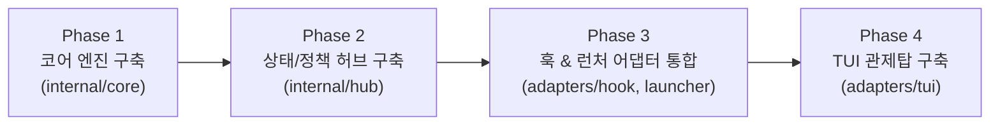

# [04_development_plan.md] Antigravity CLI 가드레일 (Guard) 단계적 개발 계획서

## 1. 개발 전략 개요 (Development Strategy)

[02_architecture.md](file:///mnt/data/mytask/kms/guard/doc/02_architecture.md)에서 정의한 **3계층 아키텍처(Core Engine / State & Policy Hub / Driving Adapters)**의 장점을 극대화하기 위해, 의존성이 없는 내부 핵심 뼈대부터 외곽 어댑터 순서로 쌓아 올리는 **Bottom-Up 점진적 개발 전략**을 적용합니다.

### 핵심 개발 원칙
1. **선(先) 코어 검증, 후(後) 어댑터 연결**: 파일 I/O나 UI가 없는 `internal/core`와 `internal/hub`를 먼저 구현하고 단위 테스트로 무결성을 확보한 뒤 외곽 어댑터를 붙입니다.
2. **매 단계 실행 가능한 산출물 유지**: 각 Phase가 끝날 때마다 `go test ./...`와 빌드가 항상 통과하는 상태를 유지합니다.
3. **기존 코드의 안전한 마이그레이션**: 현재 루트에 있는 단일 [main.go](file:///mnt/data/mytask/kms/guard/main.go)의 검증된 로직을 유실 없이 3계층 패키지로 리팩토링 및 고도화합니다.

---

## 2. 단계별 상세 개발 계획 (Phased Implementation Plan)

### Phase 1: Guard 코어 엔진 구축 (`internal/core`)
> **목표**: 외부 파일 시스템이나 UI 의존성이 전혀 없는 순수 정책 판정 엔진을 분리·고도화하고 단위 테스트를 완비합니다.

- **주요 개발 태스크**:
  1. **`internal/core/matcher.go` (Path Matcher)**
     - 파일 접미사(`*_test.go`), 기본 Glob, 다중 와일드카드(`**/tests/**`, `src/internal/**`), 예외 패턴(`exclude_patterns`) 매칭 로직 구현.
  2. **`internal/core/command.go` (Command Analyzer)**
     - 안전 명령어 화이트리스트(`git status`, `git branch`, `go build`, `go vet`) 판별.
     - 파이프(`|`)뿐만 아니라 복합 제어 연산자(`;`, `&&`, `||`) 분리 파싱.
     - DEV 모드 뷰어(`cat`, `head`, `tail` 등), Git(`git show/diff`), 인라인 스크립트(`python -c`, `node -e`) 우회 탐지.
     - PLAN 모드 리다이렉션(`>`, `>>`), `tee`, `sed -i` 쓰기 우회 탐지.
  3. **`internal/core/evaluator.go` (Policy Evaluator)**
     - `Evaluate(mode, policy, toolName, targetPath, cmdLine) -> Decision` 오케스트레이터 구현.
  4. **`internal/core/evaluator_test.go`**
     - 모드별(`DEV`, `PLAN`, `TEST`, `ALL`) 허용/차단 시나리오 및 셸 우회 패턴에 대한 테이블 기반 단위 테스트(Table-Driven Tests) 작성.
- **완료 기준 (DoD)**:
  - `go test -v ./internal/core/...` 100% 통과.

---

### Phase 2: 상태 및 정책 허브 구축 (`internal/hub`)
> **목표**: 모든 어댑터가 공유할 단일 진실 공급원(세션 파일 매니저, PID 기반 GC, 다중 경로 정책 로더)을 완성합니다.

- **주요 개발 태스크**:
  1. **`internal/hub/policy/` (`model.go`, `loader.go`)**
     - `guard-policy.yaml` 스키마 파싱 및 다중 탐색 경로 우선순위 구현:
       1) `GUARD_POLICY_PATH` 환경변수 ➔ 2) `./guard-policy.yaml` ➔ 3) `.agents/guard-policy.yaml` ➔ 4) `~/.config/guard/guard-policy.yaml` ➔ 5) 내장 기본 정책(Fallback).
  2. **`internal/hub/session/` (`model.go`, `manager.go`)**
     - `~/.guard/sessions/<sessionId>.json` 디렉토리 기반 세션 상태 CRUD 구현.
     - 임시 파일 작성 후 `os.Rename`을 수행하는 **Atomic Write** 적용 (동시성 파일 깨짐 방지).
     - 도구 실행 결과(`allow`/`deny`) 및 차단 카운트를 기록하는 `AppendEvent` (최대 50건 회전) 구현.
  3. **`internal/hub/session/gc.go` (Self-Healing GC)**
     - `process.Signal(syscall.Signal(0))` 기반 PID 생존 검사 구현.
     - 사망한 프로세스의 고아 세션 파일을 자동 정리하는 `CleanStaleSessions()` 구현.
  4. **단위 테스트 작성 (`policy_test.go`, `session_test.go`)**
     - 임시 디렉토리(`t.TempDir()`)를 활용한 세션 생성, Atomic 모드 변경, 죽은 PID 자동 수거 테스트.
- **완료 기준 (DoD)**:
  - `go test -v ./internal/hub/...` 100% 통과.

---

### Phase 3: 훅 & 런처 어댑터 및 CLI 라우터 통합 (`internal/adapters`, `cmd/guard`)
> **목표**: 코어와 허브를 `agy` 훅 및 런처와 연결하여 실제 터미널에서 Zero-Config로 가드레일이 동작하도록 통합합니다.

- **주요 개발 태스크**:
  1. **`internal/adapters/hook/` (`payload.go`, `handler.go`)**
     - `agy` PreToolUse stdin JSON 파싱 ➔ `SessionMgr`에서 세션 모드 조회 ➔ `Evaluator` 판정 ➔ `SessionMgr`에 이벤트 기록 ➔ stdout JSON(`allow`/`deny`) 출력.
  2. **`internal/adapters/launcher/` (`banner.go`, `launcher.go`)**
     - `guard <mode> [cmd...]` 실행 시 시각적 브리핑 배너 출력.
     - 세션 파일 자동 생성(PID 바인딩) 및 자식 프로세스(`agy`) 실행.
     - 자식 프로세스 종료 시 `defer`를 통한 세션 파일 즉시 삭제(Graceful Cleanup).
  3. **`cmd/guard/main.go` & 루트 정리**
     - 서브커맨드 라우터 구현:
       - `guard dev|test|plan|all [cmd...]` (인자 있으면 런처 실행, 없으면 현재 워크스페이스/세션 모드 전환)
       - `guard status` (활성 세션 목록 및 정책 상태 요약 테이블 출력)
       - `guard clean [--all]` (고아 세션 수동 청소)
       - `guard hook` 또는 `stdin` 파이프 감지 시 Hook Adapter 실행
     - 기존 루트 `main.go` 제거 및 `Makefile` 빌드 경로를 `./cmd/guard`로 업데이트.
- **완료 기준 (DoD)**:
  - `make build` 성공 및 파이프라인 모의 입력(`echo '{...}' | ./guard`) 시 0.5ms 이내 판정 및 `~/.guard/sessions/` 파일 갱신 확인.

---

### Phase 4: TUI 관제탑 어댑터 구축 (`internal/adapters/tui`)
> **목표**: [03_tui_control_tower.md](file:///mnt/data/mytask/kms/guard/doc/03_tui_control_tower.md) 설계에 따라 전체 세션을 실시간 조망하고 단축키로 즉시 제어하는 `guard top` 콘솔을 완성합니다.

- **주요 개발 태스크**:
  1. **의존성 추가**:
     - `github.com/charmbracelet/bubbletea`, `github.com/charmbracelet/lipgloss`, `github.com/charmbracelet/bubbles` 모듈 추가.
  2. **`internal/adapters/tui/` 구현**:
     - `model.go`: 세션 목록, 선택 커서, 최근 이벤트 로그, 0.5초 주기 폴링 Ticker 정의.
     - `update.go`: 방향키(`↑`/`↓`, `j`/`k`) 탐색, 단축키(`D`, `T`, `P`, `A`) 입력 시 `SessionMgr.UpdateMode()` 즉시 호출, `C` 차단 카운트 리셋, `Space` 상세 모달 토글.
     - `view.go` & `styles.go`: 상단 세션 테이블 패널 + 하단 실시간 이벤트 로그 패널 + 단축키 푸터 렌더링.
  3. **`cmd/guard/main.go` 라우팅 연결**:
     - `guard top` (및 `guard ui`) 명령을 TUI 어댑터에 연결.
  4. **최종 배포 및 통합 검증**:
     - `make install`로 `~/.local/bin/guard` 배포 및 `.agents/hooks.json`에 `PreToolUse` 가드 훅 연동 확인.
- **완료 기준 (DoD)**:
  - `guard top` 실행 시 활성 세션 테이블과 차단 로그가 정상 렌더링되고, `D/T/P/A` 키 입력 시 세션 모드가 실시간 전환되는지 확인.

---

## 3. 단계별 산출물 및 요약 마일스톤

| 단계 | 대상 패키지 | 핵심 산출물 | 검증 방법 |
| :--- | :--- | :--- | :--- |
| **Phase 1** | `internal/core` | `evaluator.go`, `matcher.go`, `command.go`, `evaluator_test.go` | 코어 단위 테스트 (`go test ./internal/core/...`) |
| **Phase 2** | `internal/hub` | `session/{model,manager,gc}.go`, `policy/{model,loader}.go` | 허브 I/O 및 GC 단위 테스트 (`go test ./internal/hub/...`) |
| **Phase 3** | `internal/adapters/{hook,launcher}`, `cmd/guard` | `handler.go`, `launcher.go`, `banner.go`, `cmd/guard/main.go` | CLI 런처 기동 및 Hook stdin/stdout 통합 검증 |
| **Phase 4** | `internal/adapters/tui` | `app.go`, `model.go`, `update.go`, `view.go`, `styles.go` | `guard top` 실행 및 실시간 모드 스위칭 확인 |
