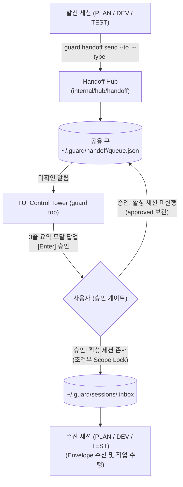
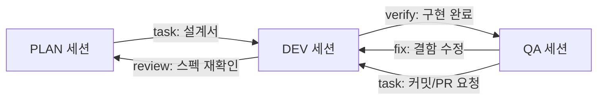
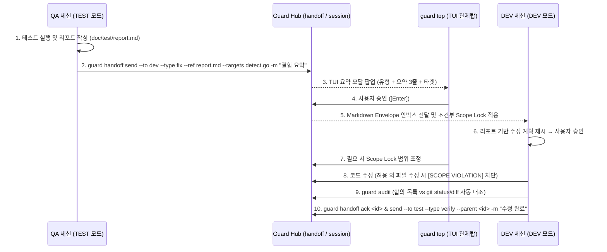

# [08_handoff_protocol.md] 범용 핸드오프 프로토콜 상세 설계서 (`guard handoff`)

> **상태**: Planned (설계 확정)  
> **관련 문서**: [02_architecture.md](./02_architecture.md), [03_tui_control_tower.md](./03_tui_control_tower.md)

---

## 1. 개요 및 설계 철학

### 1.1 목적
- 다중 에이전트(`PLAN`, `DEV`, `TEST` 등)를 병행 운용할 때 발생하는 **세션 간 수동 정보 전달**(복사·붙여넣기, 장문 프롬프트 반복 입력)의 인지 부하와 수작업을 줄입니다.
- 통제되지 않은 에이전트 간 자동 반복(오탐 전파, 컨텍스트 오염)을 방지하기 위해, 데이터 패키징과 전달은 시스템이 자동화하되 최종 작업 승인은 사용자가 직접 통제하는 **Human-in-the-loop 승인 게이트**를 제공합니다.

### 1.2 핵심 설계 원칙: 파이프라인 엔진이 아닌 범용 핸드오프 프로토콜
`guard`는 단일 바이너리, 파일 기반 무상태(Stateless) 구조, 저지연 정책 판정을 지향하는 경량 가드레일 도구입니다. 따라서 Airflow나 Temporal 같은 DAG 워크플로우 엔진이나 상태 머신 오케스트레이터를 내부에 구축하지 않고, **모드와 작업 유형에 구애받지 않는 범용 비동기 핸드오프 프로토콜**로 설계합니다.

- **지양하는 범위**: `PLAN → DEV → QA → CI/CD` 순서를 강제하는 고정형 파이프라인 엔진, 복잡한 자동 분기·재시도·롤백 상태 머신.
- **지향하는 범위**: 임의의 발신 노드에서 수신 노드로 산출물·요약·작업 대상을 전달하는 **표준 티켓 교환 프로토콜(인박스 큐 + 사용자 승인 게이트 + 조건부 Scope Lock)**.
- 이를 통해 `PLAN ↔ DEV ↔ QA ↔ CI/CD`를 포함한 다양한 협업 흐름을 유연하게 수용하면서도 시스템 복잡도를 낮게 유지합니다.

---

## 2. UX 문제 분석 및 표준 인터랙션 모델

### 2.1 기존 작업 흐름의 문제점 (As-Is)
1. **다중 터미널 간 컨텍스트 스위칭**:
   - 에이전트 창과 관제탑 TUI 창이 분리되어 있어, 작업 완료 여부를 확인하기 위해 창을 수시로 오가야 하는 피로가 발생합니다.
2. **검토 단계의 정보 과부하**:
   - QA 리포트나 설계 문서가 길 경우, 다음 세션에 넘겨도 되는지 판단하기 위해 파일을 직접 열어 처음부터 훑어봐야 합니다. 빠르게 승인 여부를 결정하려면 유형, 요약, 대상 파일 등 핵심 정보만 추린 요약이 필요합니다.
3. **수신 세션으로의 자동 입력 전달 부재**:
   - 큐에 메시지가 도착해도 대기 중인 수신 세션에 작업 지시가 자동으로 전달되지 않으면, 결국 사용자가 창을 전환해 프롬프트를 다시 입력해야 합니다.

### 2.2 표준 인터랙션 모델: `guard top` 중심의 단축키 승인 및 세션 전환
사용자의 인지 부하와 반복 타이핑을 줄이고 단일 관제 화면에서 통제권을 유지하기 위해 **`guard top`(TUI 관제탑) 중심의 단축키 승인 모델**을 채택합니다.

1. **요약 모달 알림 (Modal Summary View)**: 핸드오프가 등록되면 TUI 상단에 핵심 3줄 요약 모달이 팝업됩니다.

   > [!info] 🔔 [Handoff: FIX] TEST → DEV (`#hnd-001`)
   > - **요약**: DEF-005 (1건 발견, 언어 폴백 로직 오류)
   > - **타겟**: `internal/i18n/detect.go` *(Scope Lock 예정)*
   >
   > `[Enter]` 승인 및 전달 &nbsp;|&nbsp; `[V]` 참조 문서 보기 &nbsp;|&nbsp; `[Esc]` 반려
2. **`Enter` 승인 시 동작**:
   - 수신 세션이 실행 중이면 `~/.guard/sessions/<to-id>.inbox`에 표준 Markdown Envelope을 기록하고, 조건에 따라 Scope Lock을 자동 적용합니다.
   - 수신 모드의 세션이 아직 실행 중이 아니면 `approved` 상태로 큐에 보관했다가 다음 런처 실행 시 자동 전달합니다.
   - 필요 시 `guard top`이 해당 세션으로 포커스 전환을 안내하거나 tmux/zellij 연동을 통해 바로 이동합니다.
3. **전문 확인(`V`) 및 반려(`Esc`)**:
   - `[V]` 키로 참조 문서(리포트/설계서) 전문을 오버레이 뷰어에서 바로 확인합니다.
   - 스펙 변경 등 잘못된 요청인 경우 `[Esc]` 키로 반려(Reject)합니다.

### 2.3 개선 전후 비교 (As-Is vs To-Be)

| 평가 항목 | 기존 수동 방식 (As-Is) | TUI 관제탑 중심 모델 (To-Be) |
| :--- | :--- | :--- |
| **프롬프트 입력 횟수** | 세션마다 장문의 지시문 반복 입력 (4~5회 이상) | **최초 작업 지시 1회** |
| **인지 부하** | 높음 (창 이동 및 리포트 전문 확인 필요) | **낮음 (3줄 요약 확인 후 즉시 판단)** |
| **세션 간 전환 작업** | 창 이동 → 경로 복사 → 프롬프트 작성 (4~5단계) | **`guard top`에서 `Enter` 키 1회로 승인** |
| **수정 범위 이탈 방지** | "합의된 파일만 수정하라"고 매번 프롬프팅 | **조건부 `Scope Lock` 자동 적용** |
| **협업 통제권** | 수동 통제 (운영 피로도 높음) | **Human-in-the-loop (최소 조작으로 완전한 통제권 유지)** |

---

## 3. 범용 데이터 모델 및 프로토콜 규격

### 3.1 데이터 모델 (`HandoffItem`)
특정 모드 간 결함 수정에 종속되지 않도록 **작업 유형(`Type`)**, **스레드 연결(`ParentID`)**, **참조/수정 경로 분리(`References` vs `Targets`)**를 포함하는 표준 메시지(Envelope) 스키마를 사용합니다.

```go
type HandoffItem struct {
    ID         string        `json:"id"`                   // 고유 식별자 (예: hnd-20261121-001)
    ParentID   string        `json:"parent_id,omitempty"`  // 이전 핸드오프 ID (반복 수정·질의응답 스레드 추적)
    Type       HandoffType   `json:"type"`                 // 핸드오프 유형
    From       HandoffNode   `json:"from"`                 // 발신 노드 (Mode, SessionID)
    To         HandoffNode   `json:"to"`                   // 수신 노드 (Mode, SessionID)
    Summary    string        `json:"summary"`              // TUI 모달 표시용 핵심 요약
    References []string      `json:"references,omitempty"` // 참조 문서/리포트 목록 (Read-Only 컨텍스트)
    Targets    []string      `json:"targets,omitempty"`    // 수정/작업 대상 경로 목록 (Scope Lock 후보)
    Payload    string        `json:"payload,omitempty"`    // 파일 외 인라인 지시문/질의 내용
    Status     HandoffStatus `json:"status"`               // pending | approved | rejected | acked
    CreatedAt  time.Time     `json:"created_at"`
}

type HandoffNode struct {
    Mode      string `json:"mode,omitempty"`       // plan | dev | test | all
    SessionID string `json:"session_id,omitempty"` // 특정 세션 지정 시 사용
}

type HandoffType string
const (
    TypeTask   HandoffType = "task"   // 신규 구현/작업 위임 (예: PLAN -> DEV)
    TypeVerify HandoffType = "verify" // 검증 요청 (예: DEV -> TEST)
    TypeFix    HandoffType = "fix"    // 결함 수정 요청 (예: TEST -> DEV)
    TypeReview HandoffType = "review" // 설계 검토·질의 (예: DEV -> PLAN)
)

type HandoffStatus string
const (
    StatusPending  HandoffStatus = "pending"
    StatusApproved HandoffStatus = "approved"
    StatusRejected HandoffStatus = "rejected"
    StatusAcked    HandoffStatus = "acked"
)
```

### 3.2 에이전트 인박스 표준 포맷 (Markdown Envelope)
승인된 티켓이 `~/.guard/sessions/<target-id>.inbox`에 저장될 때는 에이전트가 일관되게 파싱하고 완료 처리(`ack`)할 수 있도록 표준 마크다운 포맷을 사용합니다.

```markdown
<!-- GUARD_HANDOFF_ENVELOPE: START (ID: hnd-20261121-001, Type: fix, Parent: hnd-20261121-000) -->
### 🔔 [Handoff: FIX] from TEST (sess-qa-01)

**요약**: DEF-005 언어 폴백 결함 1건 발견

**참조 문서 (Read-Only)**:
- @doc/test/qa-phase4-report.md

**수정 허용 대상 (Scope Locked)**:
- `internal/i18n/detect.go`

> 작업 완료 후 `guard handoff ack hnd-20261121-001`을 실행하세요.
<!-- GUARD_HANDOFF_ENVELOPE: END -->
```

---

## 4. 아키텍처, 라우팅 및 라이프사이클

### 4.1 데이터 흐름


### 4.2 핵심 동작 규칙

1. **Scope Lock과의 조건부 결합 (Loose Coupling)**:
   - 모든 핸드오프가 파일 쓰기 잠금을 동반하지는 않습니다.
   - **`Type`이 `fix` 또는 `task`이고 `Targets`가 지정되어 있으며, 수신 모드가 쓰기 가능 세션(`DEV` 등)일 때만** 승인 시점에 `AllowedWritePaths`를 자동 설정합니다.
   - `review`(설계 질의), `verify`(블랙박스 검증)에서는 별도의 Scope Lock을 걸지 않고 해당 모드의 기본 정책을 유지합니다.
2. **미실행 세션 대기 큐 (Offline Buffering)**:
   - `guard handoff send --to dev` 승인 시점에 실행 중인 `DEV` 세션이 없다면, 티켓을 `approved` 상태로 공용 큐에 보관합니다.
   - 이후 사용자가 `guard dev agy`를 실행하면 **런처 초기화 단계에서 해당 모드 앞으로 대기 중인 승인 티켓을 감지해 인박스로 자동 전달**합니다.
3. **실행과 통제의 책임 분리**:
   - 커밋·푸시·PR 생성 등 문맥 판단이 필요한 마무리 작업도 `guard`가 직접 실행하지 않고 `agy` 세션(예: `DEV` 또는 `ALL`)으로 핸드오프하여 수행합니다. `guard`는 가드레일 감시·중계·승인·감사 역할에만 집중합니다.
4. **런처의 역할 경계**:
   - 런처는 자식 프로세스 실행, 세션 라이프사이클 관리, 워크플로우 Rule 설치 및 대기 중인 인박스 로드에 집중하며, 환경 의존성이 큰 터미널 PTY 키 주입 로직은 사용하지 않습니다.

### 4.3 CLI 및 TUI 인터페이스

- **CLI 서브커맨드**:
  - `guard handoff send --to <plan|dev|test|all|sessionId> [--type <task|verify|fix|review>] [--ref <file>...] [--targets <glob>...] [--parent <id>] [-m "요약"]`
  - `guard handoff inbox [--all]`: 현재 세션/모드 앞으로 도착한 미확인 핸드오프 목록 조회
  - `guard handoff watch [--session <id>] [--mode <mode>] [--timeout <dur>]`: 승인된 핸드오프가 도착할 때까지 블로킹 대기 후 Markdown Envelope을 stdout으로 출력하고 종료 (Reactive Wakeup 자동 수신용)
  - `guard handoff approve <id>`: 티켓 승인 및 인박스 전달 / 오프라인 대기 (TUI 및 CLI 공용)
  - `guard handoff reject <id> [-m "사유"]`: 티켓 반려
  - `guard handoff ack <id>`: 수신 세션의 작업 완료 처리
- **TUI 관제탑 (`internal/adapters/tui/modal.go`)**:
  - 미확인 핸드오프 도착 시 3줄 요약 모달 팝업 (`[Enter]` 승인, `[V]` 참조 문서 뷰어, `[Esc]` 반려).
  - 세션 테이블 하단 `Handoff Queue` 패널에 최근 티켓 목록(`ID`, `Type`, `From -> To`, `Summary`, `Status`)과 스레드(`ParentID`) 표시.

---

## 5. 멀티 에이전트 협업 시나리오 (`PLAN ↔ DEV ↔ QA ↔ CI/CD`)



> 모든 전환 지점에는 TUI 사용자 승인 게이트(`guard top`)가 배치됩니다.

| 흐름 | Type | CLI 발행 예시 | 승인 시 자동 동작 |
| :--- | :--- | :--- | :--- |
| **PLAN → DEV** | `task` | `guard handoff send --to dev --type task --ref doc/05_api.md --targets "internal/auth/*" -m "인증 API 구현 요청"` | DEV 인박스 전달 + `internal/auth/*` Scope Lock |
| **DEV → PLAN** | `review` | `guard handoff send --to plan --type review --ref internal/auth/lock.go -m "동시성 이슈로 Redis 락 스펙 보완 질의"` | PLAN 인박스 전달 (Scope Lock 미적용) |
| **DEV → QA** | `verify` | `guard handoff send --to test --type verify --ref doc/06_i18n_design.md --targets "internal/i18n/*" -m "i18n 폴백 구현 완료, 블랙박스 검증 요청"` | QA 인박스 전달 (TEST 모드 정책 유지) |
| **QA → DEV** | `fix` | `guard handoff send --to dev --type fix --parent hnd-001 --ref doc/test/qa-report.md --targets "internal/i18n/detect.go" -m "DEF-005 언어 폴백 결함 1건 발견"` | DEV 인박스 전달 + `detect.go` Scope Lock |
| **QA → DEV/ALL** | `task` | `guard handoff send --to dev --type task --ref doc/test/final-report.md -m "회귀 테스트 통과, 변경 내용 정리 후 커밋 및 PR 생성 요청"` | DEV 인박스 전달 (에이전트가 diff 검토 후 커밋/PR 수행) |

### 5.1 End-to-End 워크플로우 시퀀스 (QA ↔ DEV 결함 수정 루프 예시)



---

## 6. 자동화 트리거 및 신뢰 경계

### 6.1 Rule 기반 자동화와 Hook 기반 보완
- **Rule 방식 (`.agents/rules/guard-workflow.md`)**: Antigravity CLI가 세션 시작 시 자동으로 로드하는 규칙 파일에 *"산출물 작성 완료 시 `guard handoff send` 실행 / 수신 작업 완료 시 `guard audit` + `ack` + 역방향 `send` 실행"*을 정의합니다. LLM이 문맥에 맞는 요약(`-m`)과 유형(`--type`)을 작성하며, `guard` 런처 초기화 시 자동 설치됩니다.
- **Hook 방식 (`PostToolUse` / `Stop` 보완)**: LLM이 규칙 호출을 누락해서는 안 되는 핵심 산출물(`doc/test/*.md` 생성 등)은 훅에서 누락 없이 항상 핸드오프가 발행되도록 보완할 수 있습니다.

### 6.2 신뢰 경계 (Trust Boundary)
- **Human-in-the-loop 승인 게이트**: 에이전트가 발행한 모든 핸드오프는 기본적으로 `pending` 상태로 큐에 저장되며, 사용자가 `guard top` 또는 `guard handoff approve`로 명시적으로 승인하기 전에는 수신 세션의 인박스에 전달되거나 외부 액션이 실행되지 않습니다.
- **승인 명령어 격리**: 에이전트가 `run_command`로 `guard handoff approve`를 직접 실행해 승인 게이트를 우회하지 못하도록 **`guard hook`에서 에이전트의 `guard handoff approve` 실행을 차단**합니다.

### 6.3 수신 자동화: 무프롬프트 인박스 주입 및 유휴 세션 자동 기상 (Auto-Receive)
기존 방식에서는 사용자가 `guard top`에서 승인한 뒤에도 수신 세션 창으로 이동해 *"도착한 핸드오프 확인해줘"*라고 직접 프롬프팅해야 했습니다. `guard`는 PTY/터미널 멀티플렉서(`tmux`) 의존성 없이 Antigravity 네이티브 기능만으로 수신을 자동화하는 **2계층 수신 모델**을 채택합니다.

#### 계층 1 (기본): `SessionStart` / `PreInvocation` 훅 기반 자동 주입 (`injectSteps`)
- `.agents/hooks.json`에 `PreToolUse` 외에 `SessionStart` 및 `PreInvocation` 훅(`guard hook`)을 등록합니다.
- 훅 실행 시 현재 세션/모드 앞으로 `approved`(미-`ack`, 미주입) 상태의 핸드오프가 있으면, 훅 응답의 `injectSteps`로 Markdown Envelope을 자동 주입합니다:
  ```json
  {
    "injectSteps": [
      {
        "systemMessage": {
          "systemMessage": "<!-- GUARD_HANDOFF_ENVELOPE: START ... -->\n승인된 핸드오프가 도착했습니다. 참조 문서를 검토하고 지시된 작업을 수행한 뒤 `guard handoff ack <id>`를 실행하세요."
        }
      }
    ]
  }
  ```
- **중복 주입 방지**: 한 번 주입된 티켓 ID는 세션 상태(`DeliveredHandoffIDs`)에 기록해 동일 티켓이 매 턴 반복 주입되지 않도록 합니다.
- **특징**: 새 세션을 열면(`guard dev agy`) 첫 턴부터 즉시 컨텍스트가 로드되며, 기존 세션에서도 다음 턴이 시작되는 순간 별도 조회 명령 없이 인박스가 주입됩니다.

#### 계층 2 (고급): `guard handoff watch` + Reactive Wakeup (유휴 세션 완전 자동 기상)
- `hooks.json` 이벤트는 턴이 시작되어야 발동하므로, 이미 유휴(Idle) 상태로 대기 중인 대화창을 **사용자 입력 0회로 자동 기상**시키려면 Antigravity의 **백그라운드 태스크 완료 알림(Reactive Wakeup)**을 활용합니다.
- **동작 흐름**:
  ```mermaid
  sequenceDiagram
      participant Target as 수신 agy 세션 (유휴 대기)
      participant Watch as guard handoff watch (백그라운드 태스크)
      participant Hub as Guard Hub (~/.guard)
      participant Top as guard top (사용자 승인)

      Target->>Watch: 1. 백그라운드 실행 (guard handoff watch)
      Watch->>Hub: 2. 인박스/큐 감시 (블로킹 대기, CPU ~0%)
      Top->>Hub: 3. 사용자 [Enter] 승인 → approved & 인박스 기록
      Hub-->>Watch: 4. 신규 approved 티켓 감지
      Watch-->>Target: 5. Envelope stdout 출력 후 종료 (Exit 0)
      Note over Target: 6. Reactive Wakeup 자동 기상
      Target->>Target: 7. 참조 문서 자동 검토 및 작업 수행 → ack
  ```
- **주의사항**:
  - Human-in-the-loop 신뢰 경계를 유지하기 위해 `watch`는 오직 **`approved` 상태**의 티켓에만 반응합니다(`pending` 티켓에는 반응하지 않음).
  - 작업 1건을 완료(`ack`)한 뒤 계속 자동 수신을 유지하려면 `guard handoff watch`를 백그라운드로 재실행합니다.

#### 수신 자동화 방식 비교 (설계 결정 근거)

| 방식 | 유휴 세션 자동 기상 | 기존 대화 맥락 유지 | 외부 의존성 | 채택 여부 |
| :--- | :---: | :---: | :---: | :--- |
| **1. `SessionStart` / `PreInvocation` (`injectSteps`)** | ❌ (다음 턴/새 세션 시 주입) | ✅ | 없음 | **기본 표준 채택** |
| **2. `guard handoff watch` + Reactive Wakeup** | ✅ (완전 무프롬프트) | ✅ | 없음 | **고급 표준 채택** |
| **3. 승인 시 `agy -p` 원샷 프로세스 기동** | ✅ (신규 프로세스) | ❌ | 없음 | 선택적 확장(추후 검토) |
| **4. `tmux` / `zellij` `send-keys` 키 주입** | ✅ | ✅ | `tmux`/`zellij` 필수 | 미채택 (4.2절 원칙 유지) |

---

## 7. 기존 3계층 아키텍처 통합 매핑

| 계층 | 추가/확장 모듈 | 책임 |
| :--- | :--- | :--- |
| **Core (`internal/core`)** | `command.go` 차단 규칙 확장 | 에이전트의 `guard handoff approve` 자체 승인 차단 |
| **Hub (`internal/hub`)** | `internal/hub/handoff` (`model.go`, `queue.go`, `envelope.go`, `watch.go`) | `HandoffItem` CRUD(`Flock` 동시성 보호), 미실행 세션 대기 큐, Markdown Envelope 생성, `approved` 티켓 감시(`watch`) |
| **Adapters (`internal/adapters`)** | `hook`, `launcher`, `tui` (`modal.go`) | `SessionStart`/`PreInvocation` 훅 인박스 자동 주입(`injectSteps`), 런처 초기화 시 워크플로우 Rule 설치 및 대기 티켓 로드, TUI 요약 모달 및 큐 패널 렌더링 |
| **CLI (`cmd/guard`)** | `guard handoff` (`send`, `inbox`, `watch`, `approve`, `reject`, `ack`) | 서브커맨드 라우팅 및 외부 액션 훅 실행 |
