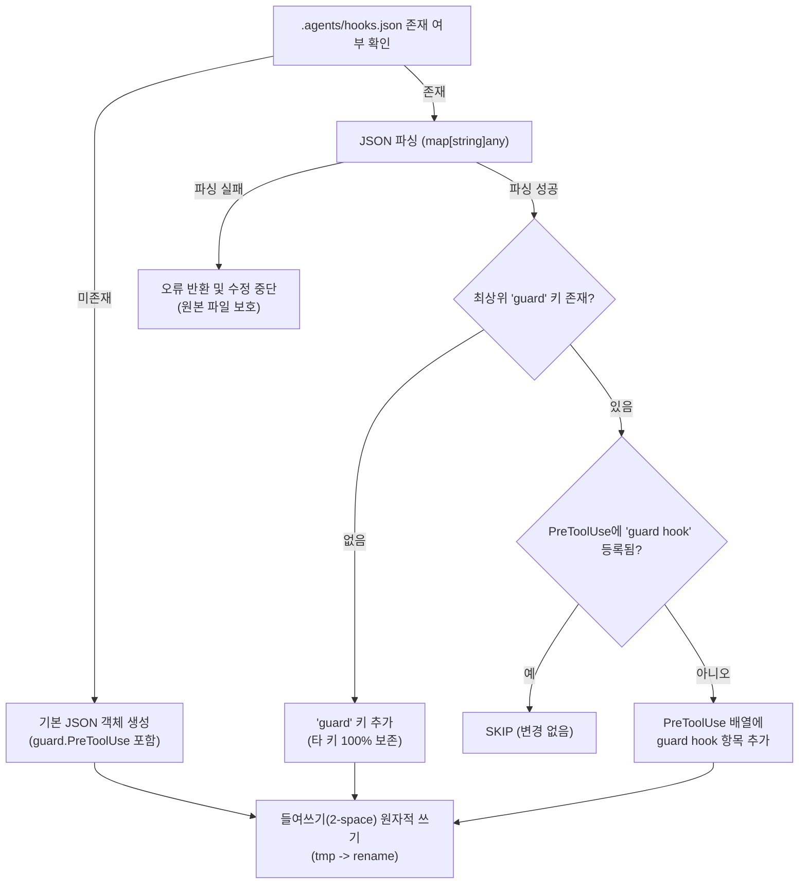

# [09_init_automation_design.md] 초기 설정 자동화 및 자가 진단 설계서 (`guard init` / `guard doctor`)

> **상태**: Proposed (설계 초안)  
> **관련 문서**: [02_architecture.md](./02_architecture.md), [06_i18n_design.md](./06_i18n_design.md), [08_handoff_protocol.md](./08_handoff_protocol.md)

---

## 사용자 경험(UX) 개선 효과

이 작업의 핵심 목적은 **`guard` 도입부터 일상적인 에이전트 협업, 문제 해결까지의 모든 마찰을 제거하는 것**입니다. 기능 구현 후 사용자가 실제로 체감하게 될 변화는 다음과 같습니다.

### Before / After 한눈에 보기

| 사용자 상황 | 기존 경험 (As-Is) | 개선된 경험 (To-Be) |
| :--- | :--- | :--- |
| **새 프로젝트에 `guard` 도입** | `.agents/hooks.json`, `guard-policy.yaml`, `guard-workflow.md`, `current_mode` 4개 파일을 문서를 보며 수동 생성·편집 | `guard init` 명령어 **한 줄로 즉시 완료** (프로젝트 언어 자동 감지 포함) |
| **기존 훅 설정(`obsidian-chatlog` 등) 유지** | JSON 파일을 직접 열어 병합하다 괄호 오타나 기존 설정 덮어쓰기 위험 존재 | 기존 키를 **100% 보존하는 비파괴 병합** + `--dry-run`으로 변경 내역 사전 확인 가능 |
| **에이전트 세션 시작 시 반응성** | `trigger: always_on` 누락 시 에이전트가 매 세션마다 `ls/find`, `guard --help`를 반복 호출하며 **시간과 토큰을 낭비** | Always-On 룰과 CLI 치트시트가 기본 주입되어 **첫 턴부터 탐색 없이 즉시 작업 수행** |
| **언어별 보안 정책 작성** | Go, Node, Python 등 프로젝트 구조에 맞춰 `DEV/PLAN` 차단 패턴을 매번 직접 작성 | `go.mod`, `package.json`, `pyproject.toml` 등을 자동 감지해 **실무에 바로 쓸 수 있는 프리셋 생성** |
| **동작 이상 시 원인 파악** | 훅이 안 걸리거나 핸드오프가 안 될 때 경로·권한·YAML 문법·심볼릭 링크 문제를 직접 추적 | `guard doctor`로 **6가지 핵심 항목을 즉시 진단**하고, `guard doctor --fix`로 **자동 복구** |
| **반복 실행 및 실수 방지** | 설정을 다시 맞추다 기존 커스텀 정책이나 작업 중인 모드가 초기화될까 봐 불안 | 여러 번 실행해도 안전한 **멱등성 보장** (`SKIP` 처리 및 `--force` 시 `.bak` 자동 백업) |

### 구체적인 사용자 시나리오별 체감 효과

1. **"설치 후 1분 안에 바로 작업 시작" (온보딩 장벽 제거)**
   - 새로운 저장소를 열었을 때 설정 문서를 뒤지며 파일을 하나씩 만들 필요가 없습니다. `guard init` 한 번으로 현재 프로젝트 스택에 맞는 정책과 훅, 워크플로우 규칙이 한꺼번에 준비되며, 오프라인 단일 바이너리로 즉시 동작합니다.
2. **"에이전트가 헛돌지 않고 바로 일함" (세션 체감 속도 및 토큰 효율 개선)**
   - 기존에는 `.agents/rules/guard-workflow.md`의 `trigger: always_on` 헤더를 깜빡하면 에이전트가 `guard` 사용법을 매번 스스로 찾아다니며 불필요한 턴을 소비했습니다. 이제는 `init` 시점에 올바른 frontmatter와 정확한 CLI 문법이 자동 배치되어, 에이전트가 첫 응답부터 곧바로 `guard handoff` 등을 정확히 실행합니다.
3. **"기존 환경을 망가뜨리지 않는 안심감" (심리적 부담 해소)**
   - 이미 다른 도구(`obsidian-chatlog` 등)의 훅이나 직접 다듬은 `guard-policy.yaml`이 있더라도 덮어쓰기 걱정 없이 명령어를 실행할 수 있습니다. 궁금하면 `--dry-run`으로 미리 보고, 강제 재생성이 필요해도 `.bak` 백업이 남습니다.
4. **"왜 안 되지? → `guard doctor --fix`로 끝" (디버깅 스트레스 해소)**
   - `PATH` 미등록, 깨진 JSON, `trigger: always_on` 누락, 고아 세션 잔류, 심볼릭 링크 경로 불일치처럼 초보자가 혼자 찾기 까다로운 환경 문제를 명확한 진단 코드(`DOC-001`~`DOC-006`)와 해결 가이드로 알려주며, 자동 수정 가능한 문제는 `--fix` 하나로 즉시 고쳐줍니다.

---

## 1. 개요 및 문제 정의

### 1.1 배경 (As-Is)
현재 새로운 프로젝트에 `guard`를 도입하려면 사용자가 여러 설정 파일을 직접 생성·수정하고 형식을 맞춰야 합니다.

1. **`.agents/hooks.json`**: `PreToolUse`에 `guard hook` 등록 (단, `obsidian-chatlog` 등 기존 타 도구의 훅 설정을 덮어쓰지 않고 JSON 병합 필요).
2. **`guard-policy.yaml`**: 프로젝트 언어·디렉토리 구조에 맞는 `DEV / PLAN / TEST` 정책 작성.
3. **`.agents/rules/guard-workflow.md`**: 에이전트가 `guard handoff` 명령을 탐색 없이 즉시 실행하도록 워크플로우 규칙 작성 — 특히 상단에 **`trigger: always_on` YAML frontmatter가 누락되면** 세션 컨텍스트에 주입되지 않아, 에이전트가 매 세션마다 `ls/find`와 `guard --help`를 반복 호출하는 UX 저하가 발생합니다.
4. **`.agents/current_mode`**: 워크스페이스 기본 모드 초기화.
5. **실행 환경 검증**: `guard` 바이너리의 `PATH` 등록 여부, 세션 디렉토리(`~/.guard/sessions`) 접근 권한, 워크스페이스 심볼릭 링크 경로 불일치 등.

### 1.2 목표 (To-Be)
- **원커맨드 온보딩 (`guard init`)**: 단일 명령어로 프로젝트에 필요한 모든 `guard` 연동 설정을 **안전하고 멱등하게(Idempotent)** 초기화합니다.
- **자가 진단 및 자동 복구 (`guard doctor`)**: 현재 워크스페이스의 설정 누락·포맷 오류·`trigger: always_on` 미설정·바이너리 경로 문제를 즉시 진단하고 `--fix` 옵션으로 자동 교정합니다.
- **기존 설정 무손실 보장**: 타 도구의 훅(`.agents/hooks.json`)이나 사용자가 커스터마이징한 `guard-policy.yaml`을 절대 임의로 덮어쓰지 않습니다.

---

## 2. 핵심 설계 원칙

1. **멱등성 (Idempotency)**: `guard init`을 여러 번 실행해도 동일한 최종 상태를 유지하며, 이미 정상 구성된 항목은 `SKIP` 처리합니다.
2. **비파괴 병합 (Non-Destructive Merge)**: `.agents/hooks.json`은 전체 덮어쓰기가 아니라 루트 JSON 객체의 `"guard"` 키만 안전하게 추가·갱신(Upsert)합니다.
3. **스택 자동 감지 (Stack Auto-Detection)**: 프로젝트 루트의 마커 파일(`go.mod`, `package.json`, `pyproject.toml`, `Cargo.toml` 등)을 탐지하여 적합한 `guard-policy.yaml` 기본 프리셋을 자동 선택합니다.
4. **시맨틱 룰 자동 주입 보장 (Always-On Rule)**: `.agents/rules/guard-workflow.md` 생성 시 `trigger: always_on` frontmatter와 정확한 `guard handoff` CLI 문법을 기본 포함하여 에이전트의 불필요한 탐색 턴을 제거합니다.
5. **Zero-Daemon & 단일 바이너리 유지**: 외부 템플릿 파일이나 네트워크 요청 없이 `guard` 바이너리 내장 템플릿만으로 오프라인 동작합니다.

---

## 3. CLI 인터페이스 설계

### 3.1 `guard init`

```bash
guard init [flags]
```

| 플래그 | 기본값 | 설명 |
| :--- | :--- | :--- |
| `--preset <type>` | `auto` | 정책 프리셋 지정 (`auto`, `go`, `node`, `python`, `generic`) |
| `--mode <mode>` | `DEV` | `.agents/current_mode` 초기 모드 (`DEV`, `PLAN`, `TEST`, `ALL`) |
| `--dry-run` | `false` | 실제 파일을 쓰지 않고 생성·병합될 변경 계획만 출력 |
| `--force` | `false` | 기존 `guard-policy.yaml` / `guard-workflow.md`를 `.bak` 백업 후 재생성 |
| `--no-policy` | `false` | `guard-policy.yaml` 생성 생략 |
| `--no-rules` | `false` | `.agents/rules/guard-workflow.md` 생성 생략 |
| `--no-hooks` | `false` | `.agents/hooks.json` 병합 생략 |

#### 실행 결과 출력 예시
```text
🛡️  [guard init] 워크스페이스 초기화를 시작합니다: /path/to/project
   • 감지된 스택    : go (go.mod)
   ✅ .agents/hooks.json           병합 완료 (기존 키 보존: obsidian-chatlog)
   ✅ guard-policy.yaml            생성 완료 (preset: go)
   ✅ .agents/rules/guard-workflow.md 생성 완료 (trigger: always_on)
   ⏭️  .agents/current_mode        유지됨 (현재값: DEV)

🎉 초기화가 완료되었습니다. 'guard doctor'로 상태를 검증하거나 'guard dev agy'로 시작하세요.
```

### 3.2 `guard doctor`

```bash
guard doctor [flags]
```

| 플래그 | 기본값 | 설명 |
| :--- | :--- | :--- |
| `--fix` | `false` | 자동 복구 가능한 항목(누락된 `trigger: always_on`, 훅 누락 등)을 즉시 수정 |
| `--json` | `false` | CI/스크립트 연동을 위한 JSON 형식 진단 리포트 출력 |

#### 종료 코드 (Exit Code)
- `0`: 모든 필수 항목 통과 (Warning만 있는 경우 포함)
- `1`: 하나 이상의 `ERROR` 항목 발견 (훅 미등록, 정책 파싱 오류, 바이너리 미발견 등)

---

## 4. 생성 및 병합 대상 상세 설계

### 4.1 `.agents/hooks.json` (안전 병합 알고리즘)



- **표준 등록 블록**:
  ```json
  {
    "guard": {
      "PreToolUse": [
        {
          "matcher": "*",
          "hooks": [
            {
              "type": "command",
              "command": "guard hook"
            }
          ]
        }
      ]
    }
  }
  ```
- **원자적 쓰기(Atomic Write)**: 임시 파일(`.agents/hooks.json.tmp`)에 기록 후 `os.Rename`으로 교체하여 중간 장애 시 파일 손상을 방지합니다.

### 4.2 `guard-policy.yaml` (스택 자동 감지 & 프리셋)

프로젝트 루트에서 다음 순서로 마커 파일을 탐색해 프리셋을 결정합니다.

| 우선순위 | 마커 파일 | 프리셋 | `DEV` 차단(테스트) 예시 | `PLAN` 차단(소스) 예시 |
| :---: | :--- | :--- | :--- | :--- |
| 1 | `go.mod` | `go` | `*_test.go`, `**/testutil/**`, `**/tests/**` | `cmd/**`, `internal/**`, `pkg/**` |
| 2 | `package.json` | `node` | `*.test.ts`, `*.spec.ts`, `*.test.js`, `**/__tests__/**` | `src/**`, `app/**`, `lib/**` |
| 3 | `pyproject.toml`, `requirements.txt` | `python` | `test_*.py`, `*_test.py`, `**/tests/**` | `src/**`, `app/**` |
| 4 | 기타 / 미감지 | `generic` | `*_test.*`, `*.test.*`, `*.spec.*`, `**/tests/**` | `src/**`, `cmd/**`, `internal/**` |

- 이미 `guard-policy.yaml`이 존재하면 기본 동작은 **보존(`SKIP`)**합니다.
- `--force` 지정 시 기존 파일을 `guard-policy.yaml.bak`으로 백업한 뒤 새 프리셋을 생성합니다.

### 4.3 `.agents/rules/guard-workflow.md` (Always-On 시맨틱 룰)

에이전트가 별도 탐색(`find`, `--help`) 없이 첫 턴부터 `guard` CLI를 정확히 호출할 수 있도록 다음 요소를 **필수 포함**합니다.

1. **YAML Frontmatter (`trigger: always_on`)**: 매 턴 시스템 프롬프트 `<user_rules>`에 자동 주입되도록 보장.
2. **관리 마커 (`<!-- guard-managed: v1 -->`)**: 추후 `guard doctor --fix` 또는 업그레이드 시 사용자가 직접 작성한 파일과 자동 생성 파일을 구분하는 기준.
3. **핵심 CLI 치트시트**:
   - 인박스 확인: `guard handoff inbox --json`
   - 활성 세션 확인: `guard status`
   - 완료 처리: `guard handoff ack <id>`
   - 위임/회신: `guard handoff send --to <plan|dev|test|all|sessionId> --type <task|verify|fix|review> [--ref <file>] [--targets <glob>] [--parent <id>] -m "<summary>" [--payload "<text>"]`
   - 권한 경계: `guard handoff approve`는 사용자 전용 명령(에이전트 실행 금지).

### 4.4 `.agents/current_mode`
- 파일이 없을 때만 `--mode` 값(기본 `DEV`)으로 생성합니다.
- 이미 존재하면 현재 작업 중인 모드를 보존(`SKIP`)합니다.

---

## 5. 자가 진단 (`guard doctor`) 검사 매트릭스

| 코드 | 검사 항목 | 심각도 | 자동 복구(`--fix`) 지원 | 검사 기준 |
| :--- | :--- | :---: | :---: | :--- |
| `DOC-001` | `guard` 바이너리 PATH 등록 | `ERROR` | 불가 (안내 출력) | `exec.LookPath("guard")` 성공 여부 및 실행 버전 확인 |
| `DOC-002` | `.agents/hooks.json` 등록 | `ERROR` | **지원** | JSON 유효성 및 `guard.PreToolUse`에 `guard hook` 포함 여부 |
| `DOC-003` | `guard-policy.yaml` 유효성 | `ERROR` / `WARN` | 부분 지원 (미존재 시 생성) | `policy.LoadDetailed()` 파싱 성공 및 경고(Warnings) 유무 |
| `DOC-004` | `guard-workflow.md` 존재 및 `trigger: always_on` | `WARN` | **지원** | 파일 존재 여부 및 상단 YAML frontmatter에 `trigger: always_on` 포함 여부 |
| `DOC-005` | 세션 저장소(`~/.guard/sessions`) 상태 | `ERROR` / `WARN` | **지원** (디렉토리 생성 / 고아 청소) | 디렉토리 쓰기 권한 및 Stale PID 세션 수 점검 |
| `DOC-006` | 워크스페이스 경로 심볼릭 링크 일관성 | `WARN` | 불가 (안내 출력) | `os.Getwd()`와 `filepath.EvalSymlinks()` 불일치 여부 확인 |

> **참고 (`DOC-006`)**: 심볼릭 링크 경로(`/home/...` vs `/mnt/data/...`)가 혼용되면 `guard status` 및 핸드오프 라우팅에서 동일 프로젝트가 서로 다른 워크스페이스로 보일 수 있습니다. 추후 `findWorkspaceRoot()` 단계에서 `filepath.EvalSymlinks()` 정규화를 함께 적용하는 것을 권장합니다.

---

## 6. 아키텍처 및 패키지 배치

기존 3-Layer Architecture([02_architecture.md](./02_architecture.md))를 유지하며 `Hub` 계층에 `setup` 패키지를 추가합니다.

```text
cmd/guard/
├── main.go              # 'init', 'doctor' 서브커맨드 라우팅 추가
└── init.go              # CLI 플래그 파싱, 결과 포맷팅 출력

internal/hub/setup/      # [신규] 초기 설정 자동화 및 진단 모듈
├── detector.go          # 프로젝트 스택 마커 파일 감지 (go/node/python/generic)
├── hooks_merge.go       # .agents/hooks.json 비파괴 JSON 병합기
├── templates.go         # 프리셋별 guard-policy.yaml 및 guard-workflow.md 템플릿
├── initializer.go       # guard init 오케스트레이션 (dry-run / force / 멱등성 처리)
└── doctor.go            # guard doctor 진단 규칙(DOC-001~006) 및 --fix 복구 로직
```

- **의존성 방향**: `cmd/guard/init.go` → `internal/hub/setup` → `internal/hub/policy`, `internal/hub/session`, `internal/core` (기존 코어 엔진에 대한 침습 없음).
- **다국어(i18n) 연동**: 출력 메시지는 [06_i18n_design.md](./06_i18n_design.md)의 규칙을 따라 `cli.init.*`, `cli.doctor.*` 키로 `internal/i18n`에 등록합니다.

---

## 7. 테스트 및 검증 전략

### 7.1 단위 테스트 (`internal/hub/setup/*_test.go`)
1. **비파괴 JSON 병합 테스트**: `obsidian-chatlog` 등 기존 키가 있는 `.agents/hooks.json`에 `init` 실행 후 기존 키가 바이트/구조 손실 없이 유지되는지 검증.
2. **멱등성 테스트**: `guard init`을 2회 연속 실행했을 때 2회차에 모든 항목이 `SKIP`되고 파일 내용이 변하지 않는지 검증.
3. **잘못된 JSON 보호 테스트**: 문법이 깨진 `.agents/hooks.json`이 있을 때 원본을 덮어쓰지 않고 오류를 반환하는지 검증.
4. **스택 감지 테스트**: `go.mod`, `package.json`, `pyproject.toml`, 빈 디렉토리 각각에 대해 올바른 프리셋이 선택되는지 검증.
5. **`guard doctor` frontmatter 감지 및 `--fix` 테스트**: `trigger: always_on`이 누락된 `guard-workflow.md`에서 `DOC-004` 경고가 발생하고, `--fix` 실행 후 frontmatter가 자동 삽입되어 통과하는지 검증.
6. **`--dry-run` 무변경 테스트**: `--dry-run` 실행 후 임시 워크스페이스에 어떤 파일도 생성·수정되지 않았는지 검증.

### 7.2 E2E 테스트 (`test/e2e/init_doctor_test.go`)
- 빈 임시 디렉토리에서 `guard init` → `guard doctor` → `guard status` 순으로 실행하여 종료 코드 `0` 및 훅·정책·룰 파일의 실제 동작 검증.

---

## 8. 단계별 구현 로드맵

- **Phase 1 (Core Init)**: `internal/hub/setup` 패키지 구현 (`detector`, `hooks_merge`, `templates`, `initializer`) 및 `guard init` CLI 연결.
- **Phase 2 (Doctor & Fix)**: `guard doctor` 진단 매트릭스(`DOC-001`~`DOC-006`), `--fix` 자동 복구, `--json` 출력 구현.
- **Phase 3 ( polish & Docs )**: `findWorkspaceRoot()` 심볼릭 링크 정규화 적용, `internal/i18n` 한/영 메시지 추가, `README.md` / `README.ko.md` 빠른 시작 섹션에 `guard init` 반영.
