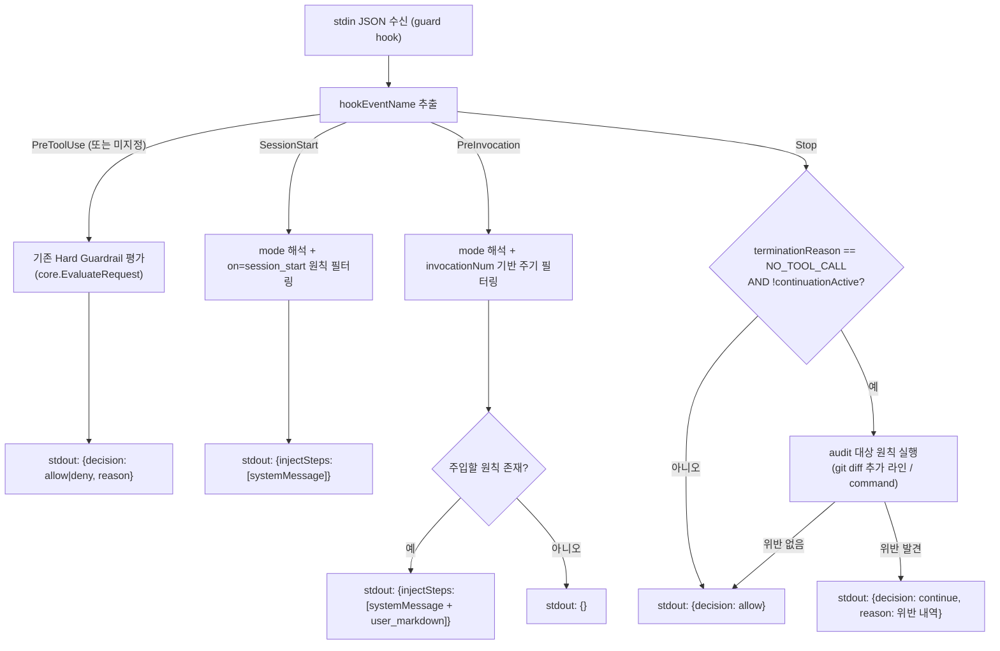
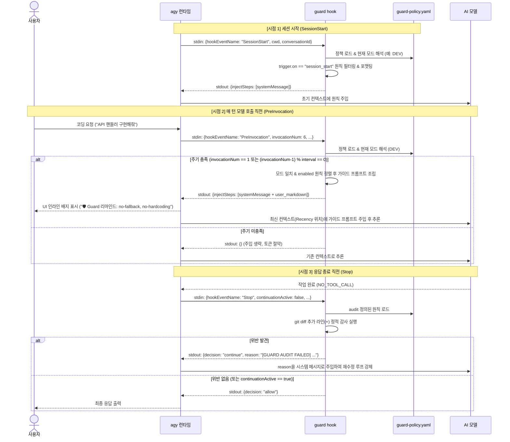
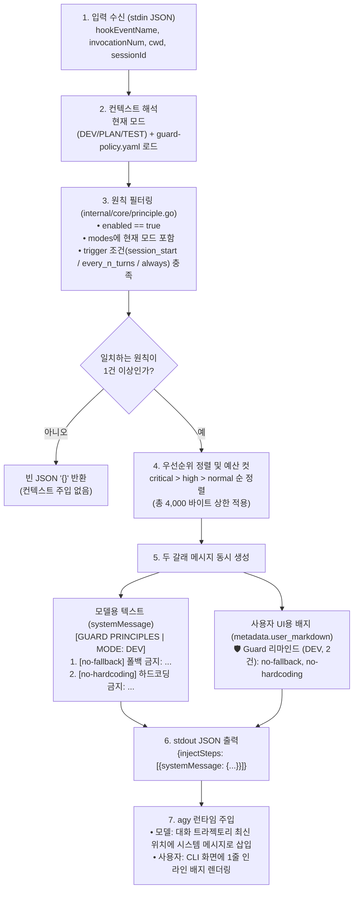

# [10_prompt_guardrail_design.md] 통합 리마인더 및 프롬프트 가드레일 관리 설계서

> **상태**: Proposed (설계 초안)  
> **관련 문서**: [02_architecture.md](./02_architecture.md), [03_tui_control_tower.md](./03_tui_control_tower.md), [06_i18n_design.md](./06_i18n_design.md), [09_init_automation_design.md](./09_init_automation_design.md)

---

## 사용자 경험(UX) 개선 효과

이 설계의 핵심 목적은 **`AGENTS.md`에 적어 두어도 대화가 길어지면 AI가 잊어버리는 개발 원칙(폴백 금지, 하드코딩 금지 등)을 `guard`의 1급 가드레일 정책으로 승격하여, 사용자가 매번 프롬프트에 반복 입력하지 않아도 자동으로 리마인드·검증·관리할 수 있게 만드는 것**입니다.

### Before / After 한눈에 보기

| 사용자 상황 | 기존 경험 (As-Is) | 개선된 경험 (To-Be) |
| :--- | :--- | :--- |
| **핵심 개발 원칙 유지** | `AGENTS.md`에 적어 두어도 긴 세션에서 AI가 잊어버려 매 턴마다 프롬프트에 직접 반복 입력 | `guard-policy.yaml`에 한 번 선언하면 **`PreInvocation` 훅이 주기적으로 최신 컨텍스트에 자동 리마인드** |
| **원칙 위반 여부 확인** | AI가 폴백이나 하드코딩을 몰래 넣었는지 사람이 diff를 눈으로 일일이 검수 | **`Stop` 훅이 종료 직전 `git diff`를 자동 감사**해 위반 의심 패턴 발견 시 종료를 막고 수정 유도 |
| **가드레일 설정 관리** | `AGENTS.md`, `.agents/rules/`, `.agents/hooks.json`, 글로벌 설정이 제각각 숨어 있어 파악·수정 불가 | **`guard-policy.yaml` 단일 파일**에서 Hard(경로 차단) + Soft(원칙/리마인더) + Audit(diff 검사)를 통합 관리 |
| **현재 적용 상태 파악** | 지금 세션에 어떤 규칙이 살아서 동작 중인지 전혀 보이지 않음 (Black-box) | `guard principle list`, `guard status`, 그리고 리마인드 시 UI 인라인 한 줄 표시(`user_markdown`)로 즉시 가시화 |
| **규칙 동작 테스트** | 실제 `agy` 세션을 돌려봐야 규칙이 잘 들어가는지 알 수 있음 | `guard principle test`로 주입될 메시지와 `git diff` 감사 결과를 **오프라인 즉시 시뮬레이션** |

---

## 1. 개요 및 문제 정의

### 1.1 배경 (As-Is)
현재 `guard`는 `PreToolUse` 훅을 기반으로 파일 읽기/쓰기 및 셸 명령어를 차단하는 **Hard Guardrail**을 성공적으로 제공하고 있습니다. 그러나 실제 AI 페어 프로그래밍 현장에서는 경로 차단만큼이나 **행동·설계 원칙(Prompt Guardrail)**이 중요합니다.

- 예: *"1. 폴백하지 말라"*, *"2. 하드코딩하지 말라"*, *"3. 불명확하면 임의 추정하지 말고 질문하라"*

현재 이러한 프롬프트 가드레일을 관리할 때 두 가지 구조적 문제가 발생합니다.

1. **컨텍스트 희석으로 인한 망각**: `AGENTS.md`는 세션 시작 시 상단에 주입되므로, 툴 출력과 로그가 쌓이면 주의력(Attention)이 급격히 떨어져 모델이 기존 습관(임의 폴백, 매직 넘버 하드코딩)으로 회귀합니다.
2. **도구 커스터마이징의 은닉성과 파편화**: `agy` 자체는 `PreInvocation`, `Stop` 등 강력한 라이프사이클 훅을 제공하지만, 사용자가 JSON 훅 스펙과 셸 스크립트를 직접 작성·관리해야 하므로 진입 장벽이 높고 현재 활성화된 규칙을 한눈에 파악하기 어렵습니다.

### 1.2 목표 (To-Be)
- **통합 정책 선언**: `guard-policy.yaml`에 `principles` 섹션을 확장하여, 기존 `rules`(Hard Guardrail)와 함께 리마인더·개발 원칙·종료 전 감사를 단일 파일로 관리합니다.
- **훅 배관(Plumbing) 완전 은닉**: `.agents/hooks.json`에는 `guard hook` 단일 명령만 각 이벤트(`PreToolUse`, `SessionStart`, `PreInvocation`, `Stop`)에 연결하고, `guard` 내부에서 `hookEventName`에 따라 자동 분기합니다.
- **가시성 우선(Visibility-First)**: CLI(`guard principle`, `guard status`), 인라인 알림(`user_markdown`), TUI(`guard top`)를 통해 어떤 원칙이 언제 주입·검증되었는지 투명하게 노출합니다.
- **단계적 강제(Remind → Audit)**: 단순 주기적 리마인드부터 `Stop` 시점의 결정론적 `git diff` 정적 검사까지 하나의 모델로 연결합니다.

---

## 2. 핵심 설계 원칙

1. **Single Source of Truth**: 모든 가드레일(경로 차단 + 프롬프트 원칙 + 종료 감사)은 `guard-policy.yaml` 한 곳에서 선언하며, 기존 `version: "1.0"` 파일과 100% 하위 호환됩니다.
2. **Hook 단일 진입점**: 외부 훅 설정은 `guard hook` 하나로 통일하고, stdin 페이로드의 `hookEventName` 필드로 이벤트 핸들러를 디스패치합니다.
3. **토큰 효율성 및 노이즈 최소화**: 매 턴마다 장문을 무조건 주입하지 않고 `session_start` / `every_n_turns` 주기를 지원하며, 원칙 텍스트는 짧고 밀도 높게 유지합니다.
4. **무한 루프 방지 및 Fail-Open**: `Stop` 훅 감사는 `continuationActive` 플래그와 `max_retries` 상한으로 무한 루프를 원천 차단하며, 파싱 오류나 git 미초기화 환경에서는 에이전트 실행을 깨뜨리지 않도록 Fail-Open으로 동작합니다.
5. **Zero-Daemon & 오프라인 단일 바이너리**: 외부 데몬이나 LLM API 호출 없이 순수 Go 바이너리만으로 밀리초 단위로 동작합니다.

---

## 3. 정책 스키마 설계 (`guard-policy.yaml` 확장)

기존 `rules:`(Hard Guardrail)를 그대로 유지하면서 최상위에 `principles:` 섹션을 추가합니다.

### 3.1 스키마 정의

```yaml
version: "1.0"

# [기존] Hard Guardrail (PreToolUse 차단 규칙)
rules:
  - name: "guard-test-files-read"
    mode: "DEV"
    type: "read"
    patterns: ["*_test.go"]
    message: "..."

# [신규] Prompt Guardrail & Reminder 정책 (SessionStart / PreInvocation / Stop)
principles:
  defaults:
    remind_every: 5          # 기본 리마인드 주기 (턴 수). 0이면 session_start 시 1회만 주입
    show_inline_notice: true # PreInvocation 주입 시 UI에 1줄 요약(user_markdown) 표시 여부
    max_audit_retries: 1     # Stop 훅 감사 실패 시 턴당 최대 재수정 강제 횟수

  items:
    - id: "no-fallback"
      modes: ["DEV"]         # 적용 모드 목록 (생략 또는 ["ALL"]이면 전체 모드)
      enabled: true          # 기본값 true. 삭제 없이 비활성화 토글 가능
      priority: "critical"   # critical | high | normal (출력/정렬 순서)
      trigger:
        on: "every_n_turns"  # session_start | every_n_turns | always | on_stop
        interval: 5          # 생략 시 defaults.remind_every 상속
      instruction: >-
        폴백 금지: 값이 누락되거나 예외가 발생해도 임의 기본값으로 넘기지 말고
        즉시 명시적인 에러를 반환/throw하라.
      audit:                 # [선택] Stop 훅에서 종료 직전 자동 검증 수행
        type: "diff_regex"   # diff_regex | command
        patterns:
          - 'catch\s*\([^)]*\)\s*\{\s*\}'       # 빈 catch 블록
          - 'except(\s+\w+)?\s*:\s*pass'        # Python silent except
        exclude_paths:
          - "*_test.go"
          - "doc/**"
        message: "diff에서 silent fallback 패턴이 감지되었습니다. 명시적 에러 처리로 수정하세요."

    - id: "no-hardcoding"
      modes: ["DEV"]
      enabled: true
      priority: "critical"
      trigger:
        on: "every_n_turns"
        interval: 5
      instruction: >-
        하드코딩 금지: URL, 타임아웃, 환경 설정값은 config/env 또는 상수로 분리하라.
        필요한 값이 불명확하면 임의 값을 넣지 말고 작업을 멈추고 사용자에게 질문하라.
      audit:
        type: "diff_regex"
        patterns:
          - 'https?://(localhost|127\.0\.0\.1|\d+\.\d+\.\d+\.\d+)'
        exclude_paths:
          - "*_test.go"
          - "doc/**"
          - "*.md"
        message: "diff에 하드코딩된 호스트/URL이 포함되어 있습니다. 설정값으로 분리하세요."

    - id: "plan-no-guess"
      modes: ["PLAN"]
      enabled: true
      priority: "high"
      trigger:
        on: "session_start"
      instruction: >-
        설계 원칙: 요구사항이 모호하거나 트레이드오프가 큰 결정은 임의로 확정하지 말고
        선택지와 권장안을 정리해 사용자에게 확인받아라.
```

### 3.2 필드 명세 요약

| 필드 | 필수 | 기본값 | 설명 |
| :--- | :---: | :--- | :--- |
| `id` | Y | - | 정책 내 고유 식별자 (`a-z0-9-_`). CLI 토글·로그 추적 기준 |
| `modes` | N | `["ALL"]` | 적용 모드 배열 (`DEV`, `PLAN`, `TEST`, `ALL`). 대소문자 정규화 |
| `enabled` | N | `true` | `false` 설정 시 리마인드 및 감사에서 제외 (설정 보존) |
| `priority` | N | `"normal"` | `critical` > `high` > `normal` 순으로 주입 메시지 상단 배치 |
| `trigger.on` | N | `"every_n_turns"` | `session_start`, `every_n_turns`, `always`, `on_stop` |
| `trigger.interval` | N | `defaults.remind_every` | `every_n_turns`일 때 주입 주기 (`invocationNum % interval == 1` 시점 주입) |
| `instruction` | Y | - | 모델에게 주입할 원칙 문장 (**금지 + 구체적 대안** 형태 권장) |
| `audit.type` | N | - | `diff_regex` (`git diff` 추가 라인 정규식 매칭) 또는 `command` (외부 린터/스크립트 실행, exit code != 0 시 위반) |
| `audit.patterns` | 조건부 | - | `type: diff_regex`일 때 필수. Go `regexp` 문법 |
| `audit.command` | 조건부 | - | `type: command`일 때 필수. 타임아웃 기본 10초 |
| `audit.exclude_paths` | N | `[]` | 감사 제외 경로 글롭 패턴 |

---

## 4. Hook 라이프사이클 통합 설계 (`guard hook`)

### 4.1 멀티 이벤트 디스패치 흐름

Antigravity CLI는 모든 훅 호출의 stdin JSON에 `hookEventName`을 전달합니다. 기존 `internal/adapters/hook/handler.go`를 확장해 이벤트별로 분기합니다.



> **하위 호환성**: `hookEventName`이 비어 있는 기존 테스트 페이로드나 수동 파이프 입력(`echo '{...}' | guard`)은 기존과 동일하게 `PreToolUse`로 처리합니다.

### 4.2 가이드 프롬프트 생성 및 주입 흐름

#### 1) 전체 라이프사이클 (언제 만들어지고 주입되는가)



#### 2) 내부 조립 파이프라인 (어떻게 생성되어 주입되는가)



### 4.3 이벤트별 입출력 계약

#### 1) `SessionStart` / `PreInvocation`
- **입력 (stdin)**: `conversationId`, `cwd`, `workspacePaths`, `hookEventName`, `invocationNum` (PreInvocation)
- **주입 조건 (`PreInvocation`)**:
  - `trigger.on == "always"`: 매 호출 주입
  - `trigger.on == "every_n_turns"`: `invocationNum == 1` 또는 `(invocationNum - 1) % interval == 0`일 때 주입 (예: `interval: 5` → 1, 6, 11, 16턴)
- **출력 (stdout)**:
  ```json
  {
    "injectSteps": [
      {
        "systemMessage": {
          "systemMessage": "[GUARD PRINCIPLES | MODE: DEV]\n다음 프로젝트 핵심 원칙을 반드시 준수하십시오:\n1. [no-fallback] 폴백 금지: 값이 누락되거나 예외가 발생해도 임의 기본값으로 넘기지 말고 즉시 명시적인 에러를 반환/throw하라.\n2. [no-hardcoding] 하드코딩 금지: URL, 타임아웃, 환경 설정값은 config/env 또는 상수로 분리하라.",
          "metadata": {
            "user_markdown": "🛡️ **Guard 리마인드** (`DEV`, 2건): `no-fallback`, `no-hardcoding`"
          }
        }
      }
    ]
  }
  ```
- **UX 포인트**: `metadata.user_markdown`을 통해 사용자에게는 깔끔한 1줄 상태 배지로 표시되고, 모델 컨텍스트에는 구조화된 원칙 본문이 정확히 주입됩니다. (설정의 `show_inline_notice: false`로 끌 수 있음)

#### 2) `Stop` (종료 직전 자동 감사)
- **입력 (stdin)**: `hookEventName`, `terminationReason`, `continuationActive`, `executionNum`, `cwd`, `workspacePaths`
- **실행 가드 조건**:
  1. `terminationReason == "NO_TOOL_CALL"` (정상 완료 시점에만 검사; 에러·취소·토큰초과 시에는 검사 생략)
  2. `continuationActive == false` (이미 `Stop` 훅이 1회 수정을 요청해 이어진 턴이라면 무한 루프 방지를 위해 재차 차단하지 않음; 추후 세션 상태에 카운트를 저장하면 `max_audit_retries > 1`도 지원 가능)
  3. 현재 모드에 `enabled: true`이고 `audit`이 정의된 원칙이 1개 이상 존재
- **감사 수행 (`diff_regex`)**:
  - 워크스페이스에서 `git diff --unified=0 --no-color` 실행 (변경 파일이 없으면 즉시 통과)
  - 변경된 파일 경로가 `exclude_paths`에 매칭되면 스킵
  - **새로 추가된 라인(`+`로 시작, `+++` 헤더 제외)**에 대해서만 정규식 매칭 수행 → 기존 레거시 코드 때문에 오탐(False Positive)이 발생하는 문제 방지
- **출력 (stdout)**:
  - 통과 시: `{"decision": "allow"}`
  - 위반 발견 시:
    ```json
    {
      "decision": "continue",
      "reason": "[GUARD AUDIT FAILED]\n종료 전 자동 감사에서 다음 원칙 위반 의심 항목이 발견되었습니다. 수정 후 다시 완료하세요:\n- [no-fallback] internal/service/user.go:42 -> catch (e) {} (diff에서 silent fallback 패턴이 감지되었습니다.)\n- [no-hardcoding] internal/client/api.go:18 -> http://localhost:8080 (diff에 하드코딩된 호스트/URL이 포함되어 있습니다.)"
    }
    ```

### 4.4 `.agents/hooks.json` 자동 병합 확장 (`guard init` / `guard doctor`)

`internal/hub/setup/hooks_merge.go`의 `standardGuardHookBlock()`을 확장해 `guard init` 시 아래 3개 이벤트를 비파괴 병합으로 등록합니다.

```json
{
  "guard": {
    "PreToolUse": [
      {
        "matcher": "*",
        "hooks": [{ "type": "command", "command": "guard hook" }]
      }
    ],
    "PreInvocation": [
      { "type": "command", "command": "guard hook" }
    ],
    "Stop": [
      { "type": "command", "command": "guard hook" }
    ]
  }
}
```

- **주의 (`hooks.json` 스키마 차이)**: `PreToolUse`는 `matcher` + `hooks` 래퍼 구조이고, `PreInvocation`과 `Stop`은 Flat 배열 구조입니다. `hooks_merge.go`는 두 구조를 정확히 구분해 병합·검사합니다.
- **`guard doctor` 항목 추가 (`DOC-007`)**:
  - `guard-policy.yaml`에 `principles.items`가 존재하는데 `.agents/hooks.json`에 `PreInvocation` 또는 `Stop` 훅이 미등록된 경우 `WARN` 발생 및 `--fix`로 자동 보강.
  - `audit.patterns` 정규식 컴파일 오류 또는 중복 `id` 존재 시 `ERROR` 보고.

---

## 5. CLI 및 TUI 관리 인터페이스 설계

### 5.1 `guard principle` (별칭: `guard p`, `guard remind`)

사용자가 YAML을 직접 편집하지 않고도 원칙을 조회·추가·토글·테스트할 수 있는 전용 서브커맨드를 제공합니다.

```bash
# 1. 현재 적용 중인 원칙 목록 및 상태 조회
guard principle list [--mode DEV] [--all] [--json]

# 2. 원칙 추가 (guard-policy.yaml에 안전하게 반영)
guard principle add \
  --id no-fallback \
  --mode DEV \
  --every 5 \
  --priority critical \
  --text "폴백 금지: 실패 시 기본값으로 넘기지 말고 명시적 에러를 반환하라."

# 3. 삭제 없이 활성/비활성 토글
guard principle disable no-fallback
guard principle enable no-fallback

# 4. 오프라인 시뮬레이션 (실제 agy 실행 없이 결과 검증)
guard principle test --event PreInvocation --mode DEV --turn 6
guard principle test --event Stop --mode DEV
```

#### `guard principle list` 출력 예시
```text
🛡️  [guard principles] 정책 소스: ./guard-policy.yaml (현재 모드: DEV)

ID              STATE    MODES   TRIGGER          AUDIT        PRIORITY   SUMMARY
------------------------------------------------------------------------------------------------
no-fallback     ON       DEV     every 5 turns    diff_regex   critical   폴백 금지: 값이 누락되거나...
no-hardcoding   ON       DEV     every 5 turns    diff_regex   critical   하드코딩 금지: URL, 타임아웃...
plan-no-guess   ON       PLAN    session_start    -            high       설계 원칙: 요구사항이 모호...
```

### 5.2 `guard status` 및 `guard top` (TUI) 연동

- **`guard status` 확장**: 기존 정책 라인에 프롬프트 원칙 요약 추가
  - 예: `정책 파일: ./guard-policy.yaml (Hard 규칙 4건, 프롬프트 원칙 3건 [현재 모드 활성: 2건])`
- **세션 이벤트 기록 (`session.Event`)**:
  - `Decision` 값에 기존 `"allow"`, `"deny"` 외에 `"remind"`, `"audit_fail"`, `"audit_pass"` 추가
  - `guard top` TUI의 실시간 이벤트 스트림에서 "언제 리마인드가 주입되었는지", "언제 Stop 감사에 걸려 재수정되었는지" 한눈에 추적 가능

---

## 6. 아키텍처 및 패키지 배치

기존 3-Layer Architecture([02_architecture.md](./02_architecture.md))를 유지하며 코어 평가 로직과 I/O(git/YAML)를 명확히 분리합니다.

```text
cmd/guard/
├── main.go                    # 'principle' ('p', 'remind') 서브커맨드 라우팅, status 출력 확장
└── principle.go               # [신규] list / add / enable / disable / test CLI 핸들러

internal/core/
├── evaluator.go               # 기존 Hard Guardrail 평가 (유지)
└── principle.go               # [신규] Principle 모델, 모드/턴 매칭, 주입 프롬프트 포맷터 (순수 로직)

internal/hub/policy/
├── model.go                   # Policy 구조체에 Principles 필드 추가
├── loader.go                  # YAML 로드 + principles 유효성 검증(중복 ID, 정규식 문법 경고)
└── writer.go                  # [신규] 원칙 추가/토글 시 원자적 YAML 갱신

internal/hub/audit/            # [신규] Stop 훅 종료 감사 모듈
├── diff_parser.go             # git diff --unified=0 출력 파싱 (파일명, 라인번호, 추가 라인 추출)
└── auditor.go                 # diff_regex 및 command(타임아웃 포함) 감사 실행기

internal/adapters/hook/
├── payload.go                 # HookEventName, InvocationNum, TerminationReason, ContinuationActive, InjectStep 확장
└── handler.go                 # hookEventName 멀티 이벤트 디스패치 (PreToolUse / SessionStart / PreInvocation / Stop)

internal/hub/setup/
├── hooks_merge.go             # PreInvocation, Stop 훅 비파괴 병합 추가
└── doctor.go                  # DOC-007 (프롬프트 가드레일 훅 및 정책 검증) 추가
```

- **의존성 규칙 준수**: `internal/core/principle.go`는 파일시스템·git·환경변수에 의존하지 않는 순수 함수로 유지하여 단위 테스트 용이성을 극대화합니다.

---

## 7. 엣지 케이스 및 불변식 (Invariants)

1. **무한 루프 방지 (Stop Audit Invariant)**:
   - `Stop` 훅에서 `continuationActive == true`인 경우 무조건 `{"decision": "allow"}`를 반환하여 에이전트가 영원히 종료되지 못하는 상황을 원천 차단합니다.
2. **레거시 코드 오탐 방지**:
   - `diff_regex` 감사는 전체 파일이 아닌 **현재 워크트리 `git diff`의 추가된 라인(`+`)**만 검사합니다. 기존 코드에 남아 있던 패턴 때문에 현재 작업이 막히지 않습니다.
3. **Fail-Open 안전성**:
   - `git` 저장소가 아니거나, `git diff` 실행이 실패하거나, `audit.command`가 타임아웃(기본 10초)을 초과하면 에러를 stderr(`GUARD_DEBUG=1`)에만 기록하고 `allow`로 통과시켜 에이전트 중단을 방지합니다.
4. **컨텍스트 오염 및 예산 보호**:
   - `PreInvocation`에서 주입하는 총 텍스트는 최대 4,000 바이트 상한을 두고 초과 시 `priority` 순으로 잘라 경고 로그를 남깁니다.
   - `enabled: true` 원칙이 0건이거나 현재 턴이 주기에 해당하지 않으면 빈 JSON `{}`만 반환해 불필요한 시스템 메시지를 생성하지 않습니다.
5. **완벽한 하위 호환성**:
   - `principles` 필드가 없는 기존 `guard-policy.yaml`과 기존 `PreToolUse` 전용 `.agents/hooks.json` 환경에서도 경고나 동작 변화 없이 100% 동일하게 동작합니다.

---

## 8. 테스트 전략 및 단계별 구현 로드맵

### 8.1 테스트 전략
- **단위 테스트**:
  - `internal/core/principle_test.go`: 모드 매칭, `every_n_turns` 주기 계산(1, 5, 6, 11턴 경계값), 우선순위 정렬, 메시지 포맷 검증
  - `internal/hub/audit/auditor_test.go`: `git diff --unified=0` 파서(삭제 라인 무시, 추가 라인 번호 정확성, `exclude_paths` 제외, 정규식 매칭, 커맨드 타임아웃 Fail-Open)
  - `internal/adapters/hook/handler_test.go`: `hookEventName`별 디스패치, `continuationActive=true` 시 Stop 루프 차단 검증, 잘못된 JSON Fail-Open 검증
- **E2E 테스트 (`test/e2e/principle_cli_test.go`)**:
  - 임시 git 저장소에서 `guard init` → `guard principle add` → `guard principle test --event PreInvocation` → 의도적 폴백 코드 작성 → `guard principle test --event Stop` (`decision: "continue"` 확인) → 수정 후 재실행 (`decision: "allow"` 확인).

### 8.2 단계별 구현 로드맵

| 단계 | 범위 | 핵심 산출물 |
| :---: | :--- | :--- |
| **Phase 1** | 스키마 확장 + 리마인더 주입 | `core/principle.go`, `policy` 스키마 확장, `hook`의 `SessionStart`/`PreInvocation` 디스패치, `guard principle list/test`, `guard status` 요약 |
| **Phase 2** | 종료 전 자동 감사 (`Stop`) | `internal/hub/audit` (`diff_parser`, `diff_regex`, `command`), `Stop` 훅 디스패치 및 `continuationActive` 루프 방지 |
| **Phase 3** | 관리 자동화 및 UX 고도화 | `guard principle add/enable/disable`, `guard init` / `guard doctor`(`DOC-007`) 자동 병합·진단, `guard top` TUI 이벤트 표시 및 i18n 한/영 메시지 추가 |
