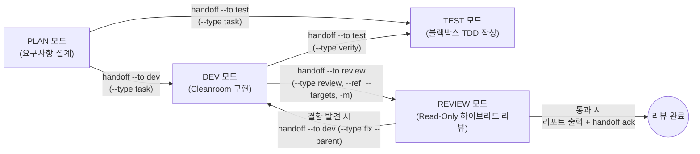

# [11_review_mode_design.md] REVIEW 모드 및 하이브리드 AI 코드 리뷰 템플릿 설계서

> **상태**: Proposed (설계 초안)  
> **관련 문서**: [02_architecture.md](./02_architecture.md), [03_tui_control_tower.md](./03_tui_control_tower.md), [08_handoff_protocol.md](./08_handoff_protocol.md), [09_init_automation_design.md](./09_init_automation_design.md), [10_prompt_guardrail_design.md](./10_prompt_guardrail_design.md)

---

## 사용자 경험(UX) 개선 효과

이 설계의 핵심 목적은 **`TEST` 모드의 Cleanroom TDD(블랙박스 격리) 원칙을 훼손하지 않으면서, 결정론적 정적 검증(`Makefile`)과 시맨틱 AI 코드 리뷰(`git diff` + 비즈니스 명세)를 결합한 읽기 전용 `REVIEW` 모드와 표준 템플릿을 제공하여 명령어 한 줄(`guard review agy`)로 즉시 리뷰 세션을 Takeoff할 수 있게 만드는 것**입니다.

### Before / After 한눈에 보기

| 사용자 상황 | 기존 경험 (As-Is) | 개선된 경험 (To-Be) |
| :--- | :--- | :--- |
| **코드 리뷰 세션 격리** | `TEST` 모드는 프로덕션 코드·`git diff` 열람을 차단해 화이트박스 리뷰 불가. `ALL` 모드로 열면 에이전트가 코드를 임의 수정할 위험 존재 | **읽기 전용 `REVIEW` 모드**로 프로덕션 코드·`git diff`·명세서 열람과 정적 검증 실행은 허용하되 소스 수정을 물리적으로 차단 |
| **정적 분석 + AI 리뷰 결합** | 정적 분석 실행, diff 확인, 명세 대조를 매번 수동 프롬프트로 지시 | `guard init`이 제공하는 **표준 리뷰 템플릿(`.agents/rules/guard-review.md`)**에 따라 정적 검증 → 시맨틱 리뷰 → 리포팅을 일관되게 수행 |
| **비즈니스 맥락 전달** | 리뷰할 때마다 변경 의도·명세·대상 범위를 프롬프트에 수동 복사 | **`guard handoff`**의 `--ref`(명세서), `--targets`(범위), `-m`(의도)이 리뷰 세션 인박스로 자동 전달 |
| **리뷰 → 수정 피드백 루프** | 리뷰 결과를 사람이 복사해 `DEV` 세션에 전달 | 결함 발견 시 `REVIEW` 세션이 `guard handoff send --to dev --type fix --parent <id>`로 구조화된 수정 티켓 발행 |

---

## 1. 개요 및 문제 정의

### 1.1 배경 (As-Is)
현재 `guard`는 `PLAN`, `TEST`, `DEV`, `ALL` 4개 모드를 제공합니다.
- **`DEV` (Cleanroom 구현)**: 테스트 파일 열람 차단 (`*_test.go` 등)
- **`TEST` (Cleanroom TDD)**: 프로덕션 구현 코드 및 `git diff`/`git show` 우회 열람 차단, `doc/**`와 테스트 파일만 허용
- **`PLAN` (설계)**: 소스 코드 수정 차단, 문서 작성만 허용

이 구조에서 AI 기반 코드 리뷰를 수행하려 할 때 두 가지 구조적 딜레마가 발생합니다.
1. **`TEST` 모드와의 충돌**: 화이트박스 코드 리뷰는 변경된 프로덕션 코드(`git diff`)와 주변 원본 코드를 읽어야 합니다. 이를 `TEST` 모드에서 허용하면 Cleanroom TDD의 핵심인 **구현 은닉 원칙**이 깨집니다.
2. **표준화되지 않은 리뷰 프롬프트와 오탐**: 별도 템플릿 없이 LLM에 리뷰를 맡기면 린트·타입·복잡도처럼 정적 도구가 100% 잡는 항목을 중복 지적하거나, 변수명 취향 같은 저신뢰 노이즈(False Positive)가 쏟아집니다.

### 1.2 목표 (To-Be)
- **읽기 전용 `REVIEW` 모드 신설**: `PLAN` → `TEST` → `DEV` → **`REVIEW`** 4단계 격리 워크플로우 완성.
- **하이브리드 리뷰 아키텍처 내재화**:
  - **1단계 (결정론적 게이트)**: `Makefile`(테스트, 린트, 순환/인지복잡도, 타입 체크, 에러 무시 검사 등)을 실행하고 결과를 구조화 리포팅.
  - **2단계 (시맨틱 AI 리뷰)**: `guard handoff`로 전달된 비즈니스 명세(`--ref`, `-m`)와 `git diff`·원본 코드를 대조해 로직·동시성·보안·명세 누락 결함을 탐지.
- **Zero-Config 템플릿 및 Takeoff**: `guard init` 시 `REVIEW` 정책과 표준 리뷰 프로토콜 템플릿을 자동 배포하고, `guard review agy` 한 줄로 즉시 리뷰 세션을 기동.

---

## 2. 핵심 설계 원칙

1. **Read-Only 물리 격리**: `REVIEW` 세션은 어떤 프로덕션 코드나 테스트 코드도 수정할 수 없으며, 수정이 필요한 결함은 반드시 `guard handoff send --to dev --type fix`로 위임합니다.
2. **정적 도구와 LLM의 명확한 역할 분리**:
   - **정적 도구 (`Makefile`)**: 컴파일, 테스트, 린트, 순환/인지복잡도, 타입, 에러 무시 등 100% 결정론적 규칙 검증.
   - **LLM 에이전트**: 정적 도구가 잡지 못하는 비즈니스 로직 오류, 경계값 누락, 동시성(Thread-safety), 보안 취약점, 명세 불일치 추론.
3. **Precision 우선 (오탐 억제)**: 모든 사소한 스타일 취향을 나열하기보다, 개발자가 실제로 수정해야 할 고신뢰 결함만 선별해 보고합니다.
4. **Handoff 기반 컨텍스트 자동화**: 외부 리뷰 도구처럼 `--background` 플래그를 수동 입력하는 대신, 기존 `guard handoff` 봉투(`References`, `Targets`, `Summary`, `Payload`)를 리뷰 입력 계약으로 재사용합니다.
5. **현장 커스터마이징 친화적 템플릿**: `guard init`이 80% 완성된 기본 템플릿을 제공하고, 사용자는 프로젝트별 검증 커맨드(`make verify` 등)와 도메인 체크리스트만 손쉽게 확장합니다.

---

## 3. 4단계 격리 워크플로우 (`PLAN` → `TEST` → `DEV` → `REVIEW`)

### 3.1 전체 흐름



### 3.2 모드별 권한 매트릭스

| 모드 | 프로덕션 코드 읽기 | 테스트 코드 읽기 | `git diff` / `git show` | 프로덕션 코드 쓰기 | 테스트 코드 쓰기 | 문서(`doc/**`) 쓰기 |
| :--- | :---: | :---: | :---: | :---: | :---: | :---: |
| **`PLAN`** | 허용 | 허용 | 허용 | **차단** | **차단** | 허용 |
| **`TEST`** | **차단** | 허용 | **차단** | **차단** | 허용 | 허용 |
| **`DEV`** | 허용 | **차단** | 테스트 경로 차단 | 허용 | **차단** | 허용 |
| **`REVIEW`** | **허용** | **허용** | **허용** | **차단** | **차단** | 리포트 경로만 선택 허용 |
| **`ALL`** | 허용 | 허용 | 허용 | 허용 | 허용 | 허용 |

---

## 4. 정책 및 훅 설계 (`guard-policy.yaml` & `internal/core`)

### 4.1 `guard-policy.yaml` 기본 정책 (스택 프리셋 공통)

`REVIEW` 모드는 **모든 쓰기(`write`)를 차단**하고, 리포트 파일 저장이 필요한 경우에만 `exclude_patterns`로 특정 경로(`doc/review/**` 등)를 선택적으로 열어둡니다. 민감 파일(`.env`, `secrets`) 읽기 차단은 기존 공통 규칙(`mode: ""`)을 그대로 상속합니다.

```yaml
  # REVIEW 모드 (Read-Only): 프로덕션/테스트 코드 수정 전면 차단
  - name: "guard-review-mode-write"
    mode: "REVIEW"
    type: "write"
    patterns:
      - "**"
    exclude_patterns:
      - "doc/review/**"
    message: "[POLICY VIOLATION] REVIEW 모드에서는 소스 및 테스트 코드를 수정할 수 없습니다. 리뷰 리포트 작성(doc/review/**)과 'guard handoff send --to dev --type fix' 위임만 허용됩니다."
```

### 4.2 셸 명령어 평가 및 우회 방지 (`internal/core/command.go`)
- **허용되는 읽기/검증 명령**:
  - `git diff`, `git show`, `git log`, `git status`
  - `make verify`, `make test`, `go test`, `golangci-lint`, `pytest`, `npm test` 등 읽기·검증 실행 명령
  - `cat`, `head`, `tail` 등 파일 열람 (단, `.env`/`secrets` 등 공통 차단 패턴은 유지)
- **차단되는 쓰기/상태 변경 명령**:
  - 파일 리다이렉션(`>`, `>>`), `tee`, `sed -i`, `rm`, `mv`, `cp`(대상 경로가 `doc/review/**` 밖인 경우)
  - 워킹 트리를 변경하는 파괴적 git 명령(`git checkout --`, `git reset`, `git apply`, `git commit` 등)은 `REVIEW` 모드에서 차단 대상으로 검토
  - `guard handoff approve` 자가 승인 차단은 기존과 동일하게 모든 모드에서 강제

### 4.3 Handoff `Scope Lock` 처리 (`internal/hub/handoff/model.go`)
- `DEV` 모드에서는 핸드오프의 `Targets`가 **쓰기 허용 범위(Scope Lock)**로 바인딩됩니다.
- `REVIEW` 모드는 읽기 전용이므로 `ShouldApplyScopeLock(item, "REVIEW")`는 **`false`**를 반환하며, `Targets`는 에이전트가 집중적으로 리뷰할 **리뷰 범위(Review Scope)** 메타데이터로 인박스 봉투에 전달됩니다.

---

## 5. REVIEW 템플릿 설계 (`guard init` 자동 생성)

`guard init` 실행 시 `.agents/rules/guard-workflow.md`와 함께 **`.agents/rules/guard-review.md`**(또는 스킬 템플릿)를 자동 생성합니다. 사용자는 프로젝트의 정적 검증 커맨드와 도메인 규칙만 커스터마이징해 바로 사용할 수 있습니다.

### 5.1 표준 리뷰 템플릿 구조 (`.agents/rules/guard-review.md` 초안)

```markdown
---
trigger: manual # 또는 REVIEW 세션에서 활성화되는 조건/스킬
---

<!-- guard-managed: review-v1 -->

# Guard Hybrid Code Review Protocol (REVIEW Mode)

이 문서는 `REVIEW` 세션이 코드 리뷰를 수행할 때 따르는 표준 프로토콜입니다.

## 프로젝트 정적 검증 커맨드 (사용자 커스터마이징 영역)
- **통합 검증 명령**: `make verify` (예: 테스트 + 린트 + 순환/인지복잡도 + 타입 + 에러무시)
- **기본 비교 기준**: `git diff` (또는 핸드오프에 명시된 base/head 브랜치·커밋)

## 리뷰 수행 절차

### Step 1. 핸드오프 및 비즈니스 맥락 확인
1. `GUARD_INBOX_PATH` 또는 `guard handoff inbox --json`에서 수신한 티켓을 확인합니다.
2. 다음 3가지 입력을 확보합니다:
   - **비즈니스 맥락**: `References`(--ref 명세서) 및 `Summary`(-m 변경 의도)
   - **리뷰 범위**: `Targets`(--targets 대상 경로, 미지정 시 `git diff` 전체)
   - **변경 내용**: `git diff` 및 맥락 파악에 필요한 관련 원본 코드(호출부, 인터페이스 등)

### Step 2. 결정론적 정적 검증 실행 및 리포팅
1. 프로젝트 정적 검증 커맨드(`make verify` 등)를 실행합니다.
2. 실패 항목(테스트 실패, 린트 위반, 순환/인지복잡도 초과, 타입 오류, 에러 무시 등)을 파일·라인 단위로 요약합니다.

### Step 3. 시맨틱 코드 리뷰 (로직·동시성·보안·명세 대조)
정적 도구가 잡지 못하는 아래 항목에 집중하여 `git diff`와 원본 코드를 검토합니다:
- **명세 부합성**: `--ref` 요구사항 대비 누락된 조건, 경계값(Edge Case), 예외 흐름
- **로직 결함**: Null/Nil 역참조, 오프바이원, 상태 전이 오류, 잘못된 조건 분기
- **동시성 및 리소스**: 레이스 컨디션, 데드락, 파일/커넥션/락 누수
- **보안 및 신뢰성**: 입력 검증 누락, 인젝션, 권한 우회, 에러 삼킴(Silent Fallback)

### Step 4. 오탐 억제 기준 (Precision-First)
- 정적 도구(린트/포매터)가 처리할 사소한 스타일·네이밍 취향은 보고하지 않습니다.
- 이번 변경과 무관한 기존 레거시 코드의 단순 개선 제안은 본 리뷰에서 제외합니다(치명적 연관 결함만 별도 섹션에 참고 기재).
- 모든 지적에는 **파일 경로, 라인/코드 스니펫, 결함 근거, 구체적 수정 방향**을 포함합니다.

### Step 5. 리포트 출력 및 피드백 위임
1. 아래 표준 포맷으로 리뷰 리포트를 출력합니다(필요 시 `doc/review/`에 저장).
2. `Critical` 또는 `Major` 결함이 있으면 `DEV` 세션에 수정 티켓을 발행합니다:
   `guard handoff send --to dev --type fix --parent <id> --ref <명세경로> --targets <수정대상> -m "<핵심 결함 요약>"`
3. 리뷰 작업 완료 후 반드시 `guard handoff ack <id>`를 실행합니다.

## 표준 리포트 포맷
- **1. 종합 판정**: `APPROVE` | `REQUEST_CHANGES`
- **2. 정적 검증 결과 (`make verify`)**: 통과/실패 요약
- **3. 시맨틱 리뷰 결함 목록**: `[Critical | Major | Minor]` 파일:라인 / 근거 / 수정 제안
- **4. 명세 대조 체크리스트**: 요구사항 충족 여부
```

### 5.2 `Makefile` 통합 타깃 권장 패턴
각 프로젝트는 `Makefile`에 결정론적 검증을 한 번에 실행하는 타깃을 두어 `REVIEW` 세션의 1단계 입력을 표준화합니다.

```makefile
.PHONY: verify test lint complexity

verify: test lint complexity
	@echo "✅ All deterministic checks passed"
```

---

## 6. 컴포넌트별 변경 범위 (Implementation Blueprint)

| 계층 | 대상 파일 | 변경 내용 |
| :--- | :--- | :--- |
| **Core** | `internal/core/evaluator.go`<br>`internal/core/command.go` | `NormalizeMode`에 `"REVIEW"` 지원 추가.<br>`REVIEW` 모드에서 읽기 명령(`git diff`/`show`) 허용 및 쓰기/상태변경 명령 차단 검증. |
| **Session** | `internal/hub/session/model.go` | `Session.Mode` 허용값에 `REVIEW` 추가 (`DEV`, `TEST`, `PLAN`, `REVIEW`, `ALL`). |
| **Handoff** | `internal/hub/handoff/model.go` | `ModeReview = "review"` 상수 추가, `ValidAgentMode` 확장, `ShouldApplyScopeLock`에서 `REVIEW` 모드는 `false` 반환. |
| **Setup / Init** | `internal/hub/setup/templates.go`<br>`internal/hub/setup/initializer.go`<br>`internal/hub/setup/doctor.go` | 스택별 `guard-policy.yaml` 프리셋(`go`, `node`, `python`, `generic`)에 `guard-review-mode-write` 규칙 추가.<br>`guard-review.md` 템플릿 및 `EnsureReviewRule` 추가.<br>`guard-workflow.md`의 `--to` 대상 목록에 `review` 반영. |
| **CLI / Launcher** | `cmd/guard/main.go`<br>`internal/adapters/launcher/banner.go` | `case "dev", "test", "plan", "review", "all":` 분기 추가로 `guard review agy` Zero-Config Takeoff 지원.<br>`REVIEW` 모드 전용 브리핑 배너 추가. |
| **TUI** | `internal/adapters/tui/update.go`<br>`internal/adapters/tui/view.go`<br>`internal/adapters/tui/styles.go` | `guard top`에서 `R` 단축키로 선택 세션을 `REVIEW` 모드로 즉시 전환, 모드 배지 스타일 추가. |
| **i18n** | `internal/i18n/locales/ko.json`<br>`internal/i18n/locales/en.json` | `REVIEW` 모드 배너, 도움말, TUI 단축키 안내 메시지 추가. |

---

## 7. 단계별 구현 계획 및 검증 체크리스트

### Phase 1: 코어 모드 & 런처 & 핸드오프 라우팅
- [ ] `REVIEW` 모드 정규화 및 `guard review <cmd>` 런처 기동 지원
- [ ] `guard handoff send --to review --type review` 라우팅 및 인박스 전달 동작 확인
- [ ] `REVIEW` 모드에서 `ShouldApplyScopeLock == false` 보장

### Phase 2: `guard init` 템플릿 & TUI & i18n 통합
- [ ] `templates.go` 4개 프리셋(`go`/`node`/`python`/`generic`)에 `guard-review-mode-write` 룰 반영
- [ ] `.agents/rules/guard-review.md` 기본 템플릿 생성 및 `guard doctor` 진단 항목 추가
- [ ] TUI `R` 단축키 모드 전환 및 다국어(`ko`/`en`) 메시지 반영

### Phase 3: 블랙박스 & E2E 검증
- [ ] **쓰기 차단 테스트**: `REVIEW` 모드에서 프로덕션/테스트 파일 수정 및 `>` / `sed -i` 우회 쓰기 차단 확인
- [ ] **읽기·diff 허용 테스트**: `REVIEW` 모드에서 프로덕션 파일 읽기, `git diff`, `make test` 정상 허용 및 `.env` 읽기 차단 유지 확인
- [ ] **리포트 경로 예외 테스트**: `doc/review/**` 경로 쓰기만 허용되는지 확인
- [ ] **핸드오프 왕복 테스트**: `DEV` → `REVIEW` (`--type review`) → `DEV` (`--type fix --parent`) 전체 흐름 E2E 검증
