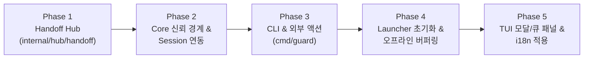
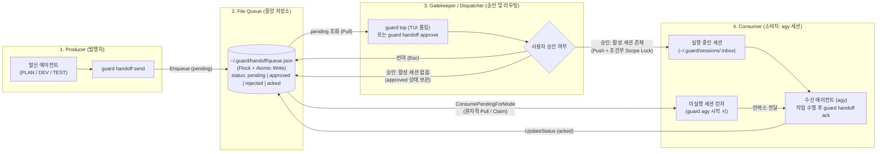

# [handoff_protocol_dev_plan.md] 범용 핸드오프 프로토콜 상세 개발 계획서

> **상태**: Ready for Development  
> **참고 아키텍처 문서**:
> - [08_handoff_protocol.md](../08_handoff_protocol.md) — 범용 핸드오프 프로토콜 상세 설계서 (기준 명세)
> - [02_architecture.md](../02_architecture.md) — Guard 3계층 시스템 아키텍처 및 통합 매핑
> - [03_tui_control_tower.md](../03_tui_control_tower.md) — TUI 관제탑(`guard top`) 설계서
> - [06_i18n_design.md](../06_i18n_design.md) — 다국어(`internal/i18n`) 적용 규격

---

## 1. 개발 전략 개요

기존 [02_architecture.md](../02_architecture.md)의 3계층 구조(`core` / `hub` / `adapters`)와 동일하게, **의존성이 없는 데이터·코어 계층부터 외곽 CLI·런처·TUI 순서로 쌓아 올리는 Bottom-Up 방식**으로 5단계(Phase)에 걸쳐 구현합니다.

### 구현 원칙
1. **기존 동시성·저장소 패턴 재사용**: `internal/hub/session/manager.go`에서 검증된 `syscall.Flock` + 임시 파일 `os.Rename`(Atomic Write) 패턴을 `internal/hub/handoff`에도 동일하게 적용합니다.
2. **Scope Lock과의 느슨한 결합**: 핸드오프 승인 로직은 `session.Session`의 `AllowedWritePaths`를 조건부(`Type == fix || task` && `len(Targets) > 0` && 쓰기 가능 모드)로만 호출합니다.
3. **기존 TUI·i18n 규격 준수**: TUI 문자열은 모두 `internal/i18n/locales/{ko,en}.json` 키로 등록해 `i18n.T(...)`를 통해 출력합니다.
4. **단계별 검증**: 매 Phase 종료 시 `go test ./...`가 100% 통과하는 상태를 유지합니다.

### 큐 중심 Producer / Consumer 구조
별도의 상주 데몬이나 외부 DB 없이 `~/.guard/handoff/queue.json` 파일을 중심으로 발행자(Producer), 승인·라우팅 계층(Gatekeeper/Dispatcher), 소비자(Consumer) 역할을 분리합니다.

---

## 2. 단계별 상세 개발 계획

### Phase 1: Handoff Hub 계층 구축 (`internal/hub/handoff`)
> **목표**: 파일 기반 공용 큐(`~/.guard/handoff/queue.json`), 인박스 기록(`~/.guard/sessions/<id>.inbox`), Markdown Envelope 생성 등 영속성·도메인 로직을 독립 패키지로 완성합니다.

#### 대상 파일 (신규 생성)
- `internal/hub/handoff/model.go`
- `internal/hub/handoff/envelope.go`
- `internal/hub/handoff/queue.go`
- `internal/hub/handoff/handoff_test.go`

#### 상세 태스크
1. **`model.go` — 데이터 모델 및 유효성 검증**
   - [08_handoff_protocol.md](../08_handoff_protocol.md#31-데이터-모델-handoffitem)에 정의된 `HandoffItem`, `HandoffNode`, `HandoffType` (`task`, `verify`, `fix`, `review`, `action`), `HandoffStatus` (`pending`, `approved`, `rejected`, `acked`) 정의.
   - `ParseTarget(raw string) (HandoffNode, error)`: `dev`, `test`, `plan`, `all`, `action:<name>`, `<sessionId>` 문자열을 구조체로 파싱.
   - `Validate() error`: 필수 필드(`To`, `Summary`, 유효한 `Type`) 검증 및 `action:<name>` 이름의 경로 탈출 문자(`..`, `/`, `\`) 차단.
   - `GenerateID() string`: 충돌 방지를 위한 타임스탬프 + 짧은 랜덤/해시 접미사 ID 생성 (예: `hnd-20261121-a1b2`).
2. **`envelope.go` — 표준 인박스 포맷 생성**
   - `FormatEnvelope(item HandoffItem, scopeLocked bool) string`: `<!-- GUARD_HANDOFF_ENVELOPE: START ... -->` ~ `<!-- GUARD_HANDOFF_ENVELOPE: END -->` 형식의 표준 마크다운 생성.
   - `References`, `Targets`, `Payload`, `ParentID` 유무에 따라 해당 섹션을 조건부 렌더링.
3. **`queue.go` — 큐 CRUD 및 인박스 저장소 (`Manager`)**
   - 기본 경로: `~/.guard/handoff/queue.json` (테스트 주입 가능하도록 `NewManager(handoffDir, sessionDir string)` 생성자 제공).
   - `syscall.Flock` 기반 `withQueueLock()` + Atomic Write(`writeFileAtomic`) 구현.
   - 핵심 메서드:
     - `Enqueue(item HandoffItem) (HandoffItem, error)`
     - `List(filter ListFilter) ([]HandoffItem, error)` — 상태(`pending`/`approved` 등), 수신 모드/세션ID 기준 필터링.
     - `Get(id string) (*HandoffItem, error)`
     - `UpdateStatus(id string, status HandoffStatus, reason string) (*HandoffItem, error)`
     - `DeliverToInbox(sessionID string, item HandoffItem, scopeLocked bool) (string, error)` — `~/.guard/sessions/<sessionID>.inbox`에 Envelope 추가(Append + Lock).
     - `ConsumePendingForMode(mode, sessionID string) ([]HandoffItem, error)` — 미실행 세션 대기 큐(`approved` && `To.SessionID == ""` && `To.Mode == mode`)를 원자적으로 현재 `sessionID`에 할당(Claim)하고 인박스에 전달.
4. **`handoff_test.go` — 단위 테스트**
   - `t.TempDir()` 기반 큐 CRUD, 상태 전이(`pending → approved → acked`, `pending → rejected`), 동시 쓰기(goroutine) 무결성, `action:../evil` 경로 탈출 차단, `ConsumePendingForMode` 중복 소비 방지 검증.

#### 완료 기준 (DoD)
- `go test -race -v ./internal/hub/handoff/...` 100% 통과.

---

### Phase 2: Core 신뢰 경계 및 Session 연동 (`internal/core`, `internal/hub/session`)
> **목표**: 에이전트의 자체 승인 우회를 훅 코어에서 차단하고, 조건부 Scope Lock 바인딩을 위한 세션 필드를 준비합니다.

#### 대상 파일 (수정)
- `internal/core/command.go`
- `internal/core/evaluator_test.go`
- `internal/hub/session/model.go`
- `internal/hub/session/manager.go`
- `internal/hub/session/session_test.go`

#### 상세 태스크
1. **`internal/core/command.go` — 자체 승인 차단 규칙 추가**
   - `evaluateCommandRules`에서 세그먼트 토큰 검사 시, 현재 모드와 무관하게(또는 `ALL` 모드 제외/포함 정책 명시 — 기본은 모든 에이전트 훅에서 차단) `guard handoff approve` 실행을 탐지해 `deny` 반환.
   - 복합 명령(`echo ok && guard handoff approve hnd-1`, `bash -c "guard handoff approve ..."`) 우회도 함께 차단.
   - 규칙명: `handoff-self-approve-block`.
2. **`internal/hub/session/` — `AllowedWritePaths` 필드 및 헬퍼 추가**
   - `Session` 구조체에 `AllowedWritePaths []string \`json:"allowedWritePaths,omitempty"\`` 추가.
   - `Manager.UpdateScope(id string, paths []string) (*Session, error)` 추가 (`withSessionLock` 보호).
   - `Manager.FindActiveByMode(mode, workspace string) (*Session, error)` 추가: 수신 대상이 모드(`dev`, `test`, `plan`)로 지정되었을 때 현재 워크스페이스의 살아있는 대상 세션을 탐색.
3. **단위 테스트 보강**
   - `evaluator_test.go`: `guard handoff approve` 직접 호출 및 셸 체이닝 우회 차단 케이스 추가.
   - `session_test.go`: `UpdateScope` 및 `FindActiveByMode` 검증.

#### 완료 기준 (DoD)
- `go test -race -v ./internal/core/... ./internal/hub/session/...` 100% 통과.

---

### Phase 3: 승인 라우터 및 CLI 서브커맨드 (`internal/hub/handoff`, `cmd/guard`)
> **목표**: `guard handoff` CLI 명령어(`send`, `inbox`, `approve`, `reject`, `ack`)와 승인 시 라우팅(활성 세션 전달 / 오프라인 대기)을 구현합니다.

#### 대상 파일
- **신규 생성**: `internal/hub/handoff/router.go`, `cmd/guard/handoff.go`
- **수정**: `cmd/guard/main.go`

#### 상세 태스크
1. **`internal/hub/handoff/router.go` — 승인 오케스트레이션 및 세션 라우팅**
   - `ApproveAndRoute(handoffMgr, sessMgr, workspaceRoot, id string) (ApproveResult, error)`:
     1. `Flock` 임계 구역 내에서 티켓 상태 전이(`pending → approved`) 검증.
     2. `To.SessionID`가 지정되었거나 `sessMgr.FindActiveByMode`로 활성 세션을 찾은 경우:
        - 조건부 Scope Lock 판단: `(Type == fix || Type == task) && len(Targets) > 0 && isWritableMode(sess.Mode)`이면 `sessMgr.UpdateScope(sess.ID, item.Targets)` 호출.
        - `To.SessionID = sess.ID` 기록 및 `handoffMgr.DeliverToInbox(sess.ID, item, scopeLocked)` 실행.
     3. 활성 세션이 없는 경우(`session.ErrNoActiveSession`):
        - `approved` 상태로 공용 큐에 유지 (`Result.Buffered = true` 반환, 다음 런처 실행 시 자동 전달).
2. **`cmd/guard/handoff.go` — 서브커맨드 파서 및 출력**
   - `flag.NewFlagSet` 기반으로 서브커맨드 구현:
     - `guard handoff send --to <target> [--type <type>] [--ref <file>...] [--targets <glob>...] [--parent <id>] [-m "요약"] [--payload "본문"]`
       - 발신자 정보(`From.Mode`, `From.SessionID`)는 환경변수(`GUARD_SESSION_ID`, `AGENT_MODE`) 또는 현재 워크스페이스 활성 세션에서 자동 추론.
       - `--ref`, `--targets`는 반복 플래그 및 쉼표(`,`) 구분자 모두 지원.
     - `guard handoff inbox [--all] [--json]`: 미확인(`pending`/`approved`) 티켓 테이블 출력.
     - `guard handoff approve <id>`: `ApproveAndRoute` 호출 및 결과(전달 세션ID / 대기 큐 보관 / 액션 실행 결과) 출력.
     - `guard handoff reject <id> [-m "사유"]`: 상태 `rejected` 전환.
     - `guard handoff ack <id>`: 상태 `acked` 전환.
3. **`cmd/guard/main.go` — 라우팅 연결**
   - `cliApp`에 `handoffMgr *handoff.Manager` 필드 추가.
   - `switch cmd`에 `case "handoff": return a.runHandoff(args[1:])` 추가 및 `printHelp()` 갱신.

#### 완료 기준 (DoD)
- `go test -race -v ./cmd/guard/...` 통과 및 CLI로 `send → inbox → approve → ack` 전체 사이클 동작 확인.

---

### Phase 4: Launcher 초기화 및 오프라인 버퍼링 연동 (`internal/adapters/launcher`)
> **목표**: 세션 시작 시 워크플로우 규칙 파일을 자동 설치하고, 오프라인 상태에서 승인되어 대기 중이던 핸드오프 티켓을 새 세션 인박스로 자동 전달합니다.

#### 대상 파일 (수정)
- `internal/adapters/launcher/bootstrap.go`
- `internal/adapters/launcher/launcher.go`
- `internal/adapters/launcher/banner.go`
- `internal/adapters/launcher/bootstrap_test.go`

#### 상세 태스크
1. **`bootstrap.go` — 워크플로우 Rule 자동 설치**
   - `EnsureWorkflowRule(workspace string) (rulePath string, created bool, err error)` 추가.
   - `<workspace>/.agents/rules/guard-workflow.md`가 없을 때만 기본 규칙 파일 생성(기존 사용자 커스터마이징 보존, `EnsureAgentSkill`과 동일 패턴).
   - 규칙 내용: 산출물 완료 시 `guard handoff send` 호출 가이드, 수신 작업 완료 시 `guard handoff ack` 실행 가이드.
2. **`launcher.go` & `banner.go` — 오프라인 티켓 자동 소비 및 배너 안내**
   - `launcher.Run()`에서 새 세션 ID를 생성한 직후, `handoffMgr.ConsumePendingForMode(mode, sessionID)` 호출.
   - 소비된 티켓 중 조건부 Scope Lock 대상이 있으면 `sessMgr.UpdateScope` 적용.
   - 대기 티켓이 1건 이상 전달되었으면 `banner.go` 기동 브리핑 배너에 `"📬 전달된 핸드오프 N건 (인박스: ~/.guard/sessions/<id>.inbox)"` 요약 라인 출력.
   - 자식 프로세스 환경변수에 `GUARD_INBOX_PATH` 함께 주입.

#### 완료 기준 (DoD)
- `go test -race -v ./internal/adapters/launcher/...` 통과 (오프라인 승인 → 런처 기동 → 인박스 생성 및 배너 출력 검증).

---

### Phase 5: TUI 관제탑 모달·큐 패널 및 i18n 통합 (`internal/adapters/tui`, `internal/i18n`)
> **목표**: `guard top`에서 `pending` 핸드오프 도착 시 3줄 요약 모달을 팝업하고, `[Enter]` 승인 / `[V]` 참조 문서 전문 뷰어 / `[Esc]` 반려 및 하단 `Handoff Queue` 패널을 제공합니다.

#### 대상 파일
- **신규 생성**: `internal/adapters/tui/handoff_modal.go`
- **수정**: `internal/adapters/tui/model.go`, `internal/adapters/tui/update.go`, `internal/adapters/tui/view.go`, `internal/adapters/tui/styles.go`, `internal/adapters/tui/app.go`, `internal/adapters/tui/tui_test.go`
- **수정**: `internal/i18n/locales/ko.json`, `internal/i18n/locales/en.json`

#### 상세 태스크
1. **TUI 상태 모델 확장 (`model.go`, `app.go`)**
   - `tui.Start(sessMgr, handoffMgr)` (또는 기존 시그니처 호환을 위해 `StartWithHandoff` / 기본 매니저 자동 초기화) 확장.
   - `Model` 필드 추가:
     - `handoffs []handoff.HandoffItem` (0.5초 주기 폴링 틱에서 갱신)
     - `activeHandoff *handoff.HandoffItem` (현재 모달에 표시 중인 최상단 `pending` 티켓)
     - `handoffViewMode` (`none` | `summary_modal` | `ref_viewer`)
     - `dismissedHandoffIDs map[string]bool` (사용자가 모달을 잠시 닫았을 때 동일 티켓 무한 재팝업 방지)
2. **키 바인딩 및 상태 전이 (`update.go`)**
   - 기존 모달(이벤트 상세 `Space`, 도움말 `?`)이 열려 있지 않고 새로운 `pending` 티켓이 감지되면 `handoffViewMode = summary_modal` 자동 활성화.
   - `summary_modal` 상태 키 처리:
     - `Enter`: `handoff.ApproveAndRoute(...)` 실행 → 성공/대기/에러 상태를 하단 상태바 토스트로 표시.
     - `v` / `V`: 첫 번째 `References` 파일 내용을 읽어 `viewport`에 로드하고 `ref_viewer` 모드로 전환.
     - `Esc`: `handoffMgr.UpdateStatus(id, StatusRejected, "rejected via TUI")` 실행 후 모달 닫기.
   - `ref_viewer` 상태 키 처리:
     - `↑/↓`, `j/k`, `PgUp/PgDn`: 뷰포트 스크롤.
     - `Esc` / `v`: `summary_modal`로 복귀.
   - 메인 화면에서 `H` 단축키로 하단 패널을 `최근 이벤트 로그` ↔ `Handoff Queue` 간 전환(또는 분할 표시).
3. **렌더링 및 스타일 (`handoff_modal.go`, `view.go`, `styles.go`)**
   - `Type`별 컬러 뱃지(`TASK`, `VERIFY`, `FIX`, `REVIEW`, `ACTION`) 정의.
   - `renderHandoffSummaryModal(m Model)` 및 `renderHandoffQueuePanel(m Model)` 구현.
4. **다국어 키 등록 (`ko.json`, `en.json`)**
   - 모달 제목, 단축키 안내, 승인/반려/대기 토스트 메시지, CLI `handoff` 사용법·출력 메시지 키를 한/영 모두 추가.

#### 완료 기준 (DoD)
- `go test -race -v ./internal/adapters/tui/... ./internal/i18n/...` 100% 통과.
- `guard top`에서 `guard handoff send` 실행 시 0.5초 이내 요약 모달 팝업 및 `[Enter]`/`[V]`/`[Esc]` 동작 확인.

---

## 3. 파일 변경 목록 요약

| 구분 | 파일 경로 | 핵심 역할 |
| :--- | :--- | :--- |
| **신규** | `internal/hub/handoff/model.go` | `HandoffItem` 모델, 타겟 파서, 유효성 검증 |
| **신규** | `internal/hub/handoff/envelope.go` | 표준 Markdown Envelope 직렬화 |
| **신규** | `internal/hub/handoff/queue.go` | `Flock` 기반 큐 CRUD, 인박스 전달, 오프라인 소비 |
| **신규** | `internal/hub/handoff/action.go` | 승인 라우팅, 조건부 Scope Lock, 외부 액션 훅 실행 |
| **신규** | `internal/hub/handoff/handoff_test.go` | Hub 계층 단위·동시성 테스트 |
| **신규** | `cmd/guard/handoff.go` | `guard handoff` CLI 서브커맨드 구현 |
| **신규** | `cmd/guard/handoff_test.go` | CLI 핸드오프 통합 테스트 |
| **신규** | `internal/adapters/tui/handoff_modal.go` | TUI 요약 모달, 참조 문서 뷰어, 큐 패널 렌더링 |
| **수정** | `internal/core/command.go` | `guard handoff approve` 자체 승인 차단 |
| **수정** | `internal/hub/session/{model,manager}.go` | `AllowedWritePaths`, `UpdateScope`, `FindActiveByMode` |
| **수정** | `internal/adapters/launcher/{bootstrap,launcher,banner}.go` | 워크플로우 Rule 설치, 오프라인 티켓 소비 및 배너 표시 |
| **수정** | `internal/adapters/tui/{app,model,update,view,styles}.go` | 폴링 연동, 키 핸들러, 모달/패널 통합 |
| **수정** | `internal/i18n/locales/{ko,en}.json` | CLI·TUI 핸드오프 다국어 리소스 |
| **수정** | `cmd/guard/main.go` | `handoff` 서브커맨드 라우팅 연결 |

---

## 4. 주요 리스크 및 구현 시 주의사항

> [!warning] 구현 단계에서 반드시 방어해야 할 엣지 케이스
> 1. **동시 세션 기동 시 오프라인 티켓 중복 소비**: 같은 모드의 세션 2개가 동시에 실행될 때 `ConsumePendingForMode`가 동일 티켓을 중복 전달하지 않도록 반드시 `Flock` 임계 구역 내부에서 조회·할당(`To.SessionID` 기록)·저장을 원자적으로 처리합니다.
> 2. **외부 액션 훅 보안**: `--to action:<name>`의 `<name>`은 영문 소문자·숫자·하이픈(`^[a-z0-9-]+$`)만 허용해 디렉터리 탈출 공격(`../`)을 원천 차단합니다.
> 3. **대용량 참조 문서 뷰어**: `[V]` 키로 여는 참조 파일이 지나치게 클 경우 TUI 프리즈를 막기 위해 읽기 상한(예: 256KB)을 두고 초과 시 말줄임 안내를 표시합니다.
> 4. **기존 TUI 모달과의 충돌 방지**: 사용자가 이벤트 상세 모달(`Space`)이나 도움말(`?`)을 보고 있을 때는 새 핸드오프 모달이 화면을 강제로 덮어쓰지 않고, 기존 모달이 닫힌 뒤 표시되도록 우선순위를 제어합니다.

---

## 5. 최종 통합 검증 체크리스트

- [ ] `go test -race ./...` 전체 테스트 스위트 100% 통과
- [ ] `echo '{"tool_name":"run_command","tool_input":{"command":"guard handoff approve hnd-1"}}' | AGENT_MODE=DEV ./guard hook` 실행 시 `deny` 반환 확인
- [ ] 활성 세션 존재 시: `guard handoff send` → `guard top` 모달 팝업 → `[Enter]` 승인 → 대상 `.inbox` 생성 및 조건부 Scope Lock 확인
- [ ] 활성 세션 부재 시: `guard handoff send` → `guard handoff approve` → 이후 `guard dev agy` 실행 시 대기 티켓 자동 인박스 전달 확인
- [ ] 외부 액션 연동: `--to action:sample` 승인 시 `.agents/hooks/handoff-sample.sh` 실행 및 환경변수 전달 확인
