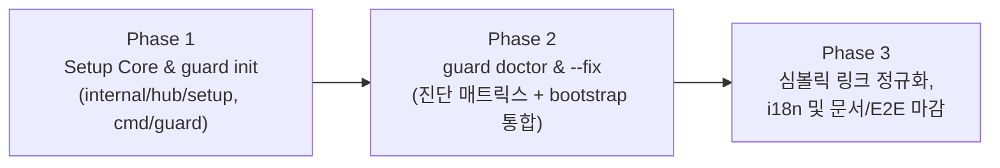

# [init_automation_dev_plan.md] 초기 설정 자동화 및 자가 진단 상세 개발 계획서 (`guard init` / `guard doctor`)

> **상태**: Ready for Development  
> **참고 설계 문서**:
> - [09_init_automation_design.md](../09_init_automation_design.md) — `guard init` / `guard doctor` 설계서 (기준 명세)
> - [02_architecture.md](../02_architecture.md) — Guard 3계층 시스템 아키텍처
> - [06_i18n_design.md](../06_i18n_design.md) — 다국어(`internal/i18n`) 적용 규격

---

## 1. 개발 전략 및 코드베이스 영향도 검토

### 1.1 비즈니스 로직 비침습 원칙
- 기존 핵심 비즈니스 로직(`internal/core` 평가·차단 엔진, `internal/hub/policy` 매칭 로직, `internal/hub/handoff` 프로토콜)은 **수정하지 않고 호출(소비)만** 합니다.
- 신규 기능은 `internal/hub/setup` 패키지로 완전히 격리하고, `cmd/guard`에서 CLI 서브커맨드(`init`, `doctor`)로만 연결합니다.

### 1.2 기존 코드 중복 방지 (`launcher/bootstrap.go` 통합)
코드베이스 점검 결과, `internal/adapters/launcher/bootstrap.go`에 이미 유사한 초기 설정 함수가 존재합니다.
- `EnsureWorkspaceHook(workspace)`: `.agents/hooks.json`에 `"guard"` 키를 병합하지만, **원자적 쓰기(Atomic Write)가 없고** `"guard"` 키 존재 여부만 확인(내부 `PreToolUse`의 `guard hook` 누락 미검사).
- `EnsureWorkflowRule(workspace)`: `.agents/rules/guard-workflow.md`를 생성하지만, 상단에 **`trigger: always_on` YAML frontmatter와 관리 마커가 누락**되어 있음.

따라서 `internal/hub/setup`을 **단일 진실 공급원(Single Source of Truth)** 으로 구현하고, `launcher/bootstrap.go`의 두 함수가 기존 공개 시그니처를 유지한 채 `setup` 패키지를 위임 호출하도록 리팩터링합니다. 이를 통해 `guard init`과 `guard dev agy` 부트스트랩 간의 설정 불일치(Drift)를 원천 차단합니다.

### 1.3 심볼릭 링크 정규화 분리 전략
- `cmd/guard/main.go`의 `findWorkspaceRoot()`에 `filepath.EvalSymlinks()`를 적용하는 작업은 `guard status` 및 핸드오프 라우팅 등 **기존 공통 경로 판별 로직에 직접 영향**을 줍니다.
- 따라서 신규 기능(`Phase 1 ~ 2`)과 분리해 **`Phase 3`에서 별도 회귀 검증과 함께 적용**합니다.

---

## 2. 전체 파일 변경 매트릭스

### 2.1 신규 생성 파일

| 파일 경로 | 계층 | 역할 및 주요 구현 내용 |
| :--- | :---: | :--- |
| `internal/hub/setup/detector.go` | Hub | 프로젝트 루트 마커 파일(`go.mod`, `package.json`, `pyproject.toml`, `requirements.txt`) 탐색 및 스택 프리셋(`go`/`node`/`python`/`generic`) 결정 |
| `internal/hub/setup/hooks_merge.go` | Hub | `.agents/hooks.json` 비파괴 JSON 병합, `PreToolUse` 내 `guard hook` 존재 검증, 2-space 들여쓰기 + 임시 파일 `os.Rename` 원자적 쓰기 |
| `internal/hub/setup/templates.go` | Hub | 프리셋별 `guard-policy.yaml` 템플릿, `trigger: always_on` + `<!-- guard-managed: v1 -->` 포함 `guard-workflow.md` 템플릿 및 frontmatter 검사/보정 유틸 |
| `internal/hub/setup/initializer.go` | Hub | `guard init` 오케스트레이터(`InitOptions`, `InitResult`, `StepResult`): `--preset`, `--mode`, `--dry-run`, `--force`(`.bak` 백업), `--no-*` 플래그 및 멱등성(`CREATED`/`MERGED`/`SKIPPED`/`PLANNED`) 처리 |
| `internal/hub/setup/doctor.go` | Hub | `guard doctor` 진단 엔진(`DOC-001`~`DOC-006`), 심각도(`OK`/`WARN`/`ERROR`), `--fix` 자동 복구 로직, JSON 직렬화 모델 |
| `internal/hub/setup/setup_test.go` | Test | 비파괴 JSON 병합, 깨진 JSON 보호, 멱등성, 스택 감지, `--dry-run`, `--force` 백업, `DOC-001`~`DOC-006` 진단 및 `--fix` 단위 테스트 |
| `cmd/guard/init.go` | CLI | `runInit(args []string) int`, `runDoctor(args []string) int`: `flag.FlagSet` 파싱, 다국어 포맷팅 출력, `--json` 출력 및 Exit Code(`0`/`1`) 반환 |

> **참고 (QA 역할 분리)**: 블랙박스 E2E 및 계약 검증 테스트(`test/e2e/init_doctor_test.go` 등)는 개발자(DEV)가 아닌 **전문 QA(TEST 세션)**가 [06_init_automation_contract.md](../spec/06_init_automation_contract.md)를 기준으로 독립 작성·수행합니다.

### 2.2 기존 수정 파일

| 파일 경로 | 수정 범위 | 상세 수정 내용 |
| :--- | :---: | :--- |
| `cmd/guard/main.go` | 소 (라우팅 + Phase 3 경로 정규화) | 1. `run()` `switch cmd`에 `case "init": return a.runInit(args[1:])`, `case "doctor": return a.runDoctor(args[1:])` 추가 2. *(Phase 3)* `findWorkspaceRoot()` 반환 경로에 `filepath.EvalSymlinks()` 정규화 적용 (실패 시 원본 경로 fallback) |
| `internal/adapters/launcher/bootstrap.go` | 소 (내부 위임) | 1. `EnsureWorkspaceHook()` 내부를 `setup.MergeWorkspaceHook()` 호출로 위임 (원자적 쓰기 + `PreToolUse` 정밀 검사 확보) 2. `EnsureWorkflowRule()` 내부를 `setup.EnsureWorkflowRule()` 호출로 위임 (`trigger: always_on` 자동 반영) 3. 기존 함수 시그니처 100% 유지 (`bootstrap_test.go` 호환) |
| `internal/i18n/locales/ko.json` | 중 (키 추가) | `cli.help`에 `guard init`, `guard doctor` 항목 추가 및 `cli.init.*`, `cli.doctor.*` 메시지 키 등록 |
| `internal/i18n/locales/en.json` | 중 (키 추가) | `ko.json`과 1:1 대칭되는 영문 `cli.help`, `cli.init.*`, `cli.doctor.*` 키 등록 |
| `README.md` / `README.ko.md` | 소 (문서 갱신) | 빠른 시작(Quick Start) 섹션에 `guard init` / `guard doctor` 사용법 반영 |

---

## 3. 단계별 상세 개발 계획

### Phase 1: Setup 코어 및 `guard init` 구현
> **목표**: `internal/hub/setup`의 스택 감지·안전 병합·템플릿·초기화 오케스트레이터와 `guard init` CLI를 완성합니다.

#### 대상 파일
- **신규**: `internal/hub/setup/detector.go`, `hooks_merge.go`, `templates.go`, `initializer.go`, `setup_test.go`, `cmd/guard/init.go`
- **수정**: `cmd/guard/main.go` (`case "init"` 라우팅), `internal/i18n/locales/{ko,en}.json` (`cli.init.*`, `cli.help`)

#### 상세 태스크
1. **`detector.go` — 스택 자동 감지**
   - `DetectStack(workspaceRoot string) (preset string, marker string)` 구현.
   - 탐색 우선순위: `go.mod` → `package.json` → `pyproject.toml` / `requirements.txt` → fallback(`generic`).
   - 유효한 `--preset` 검증 함수 `ValidatePreset(p string) error` 제공.
2. **`hooks_merge.go` — 비파괴 JSON 병합 및 원자적 쓰기**
   - `MergeWorkspaceHook(workspaceRoot string, dryRun bool) (HookMergeResult, error)` 구현.
   - 기존 `.agents/hooks.json` 파싱 실패 시 원본을 절대 수정하지 않고 오류 반환.
   - 최상위 `"guard"` 키가 없거나, 존재하더라도 `PreToolUse` 배열 내에 `"command": "guard hook"` 항목이 없을 때만 안전하게 추가(타 키 100% 보존).
   - 쓰기 시 `.agents/hooks.json.tmp` 생성 → `os.Rename`으로 원자적 교체.
   - `InspectWorkspaceHook(workspaceRoot string)` 헬퍼를 함께 제공해 Phase 2 `DOC-002`에서 재사용.
3. **`templates.go` — 내장 템플릿 및 룰 검증기**
   - `RenderPolicyYAML(preset string) string`: `go`, `node`, `python`, `generic`별 `DEV`/`PLAN`/`TEST`/전역 시크릿 차단 규칙 반환 (`policy.LoadFile()` 파싱 검증 통과 보장).
   - `WorkflowRuleContent() string`: 상단에 `trigger: always_on` YAML frontmatter와 `<!-- guard-managed: v1 -->` 마커, `guard handoff` CLI 치트시트 포함.
   - `HasAlwaysOnFrontmatter(content string) bool` 및 `InjectAlwaysOnFrontmatter(content string) string` 구현 (Phase 2 `DOC-004` `--fix`에서 재사용).
4. **`initializer.go` — `guard init` 오케스트레이션**
   - `RunInit(opts InitOptions) (InitResult, error)` 구현:
     - `hooks.json` 병합 (`--no-hooks` 미지정 시)
     - `guard-policy.yaml` 생성 (`--no-policy` 미지정 시; 존재 시 `SKIP`, `--force` 시 `.bak` 백업 후 재생성)
     - `.agents/rules/guard-workflow.md` 생성 (`--no-rules` 미지정 시; 존재 시 `SKIP`, `--force` 시 `.bak` 백업 후 재생성)
     - `.agents/current_mode` 생성 (미존재 시 `--mode` 정규화 값 기록, 존재 시 `SKIP`)
   - `--dry-run`일 경우 어떤 파일 시스템 쓰기/디렉토리 생성도 수행하지 않고 계획(`PLANNED`/`SKIPPED`)만 반환.
5. **`cmd/guard/init.go` & `cmd/guard/main.go` — CLI 연결**
   - `flag.NewFlagSet("init", flag.ContinueOnError)`로 `--preset`, `--mode`, `--dry-run`, `--force`, `--no-policy`, `--no-rules`, `--no-hooks` 파싱.
   - `i18n.T("cli.init.*")` 기반 상태 아이콘(`✅`/`⏭️`/`📝`/`❌`) 결과 출력.

#### 완료 기준 (DoD)
- `go test -race -v ./internal/hub/setup/...` 통과 (스택 감지, 비파괴 병합, 깨진 JSON 보호, 2회 연속 실행 멱등성, `--dry-run` 무변경, `--force` `.bak` 백업 검증 포함).
- 생성된 4종 프리셋 `guard-policy.yaml`이 모두 `policy.LoadFile()`에서 경고 없이 파싱됨을 단위 테스트로 검증.

---

### Phase 2: `guard doctor` 자가 진단, `--fix` 복구 및 `bootstrap.go` 통합
> **목표**: 6종 진단 규칙(`DOC-001`~`DOC-006`), 자동 복구(`--fix`), JSON 리포트(`--json`)를 구현하고 `launcher/bootstrap.go`의 중복 로직을 `setup`으로 통합합니다.

#### 대상 파일
- **신규**: `internal/hub/setup/doctor.go` (및 `setup_test.go`에 doctor 테스트 추가)
- **수정**: `cmd/guard/init.go` (`runDoctor`), `cmd/guard/main.go` (`case "doctor"` 라우팅), `internal/adapters/launcher/bootstrap.go`, `internal/i18n/locales/{ko,en}.json` (`cli.doctor.*`)

#### 상세 태스크
1. **`doctor.go` — 6종 진단 규칙 구현**
   - `DoctorOptions{WorkspaceRoot, SessionMgr, Fix bool, LookPath func(string) (string, error)}`로 외부 의존성 주입 가능하게 설계.
   - 검사 항목:
     - `DOC-001` (`ERROR`): `LookPath("guard")` 확인 (자동 복구 불가, 설치 경로 안내).
     - `DOC-002` (`ERROR`): `InspectWorkspaceHook()`으로 JSON 유효성 및 `guard hook` 등록 여부 검사 (`--fix` 시 `MergeWorkspaceHook()` 호출).
     - `DOC-003` (`ERROR`/`WARN`): `policy.LoadDetailed(workspaceRoot)` 호출해 파싱 경고 및 `builtin` fallback 여부 확인 (`--fix` 시 파일 미존재에 한해 자동 생성).
     - `DOC-004` (`WARN`): `.agents/rules/guard-workflow.md` 존재 및 `HasAlwaysOnFrontmatter()` 검사 (`--fix` 시 미존재면 생성, 존재하지만 frontmatter 누락이면 `InjectAlwaysOnFrontmatter()`로 기존 본문 보존하며 상단 삽입).
     - `DOC-005` (`ERROR`/`WARN`): `sessMgr.Dir()` 쓰기 권한 확인 및 `sessMgr.List()` 기준 Stale PID 세션 수 집계 (`--fix` 시 디렉토리 생성 및 `sessMgr.CleanStaleSessions()` 실행).
     - `DOC-006` (`WARN`): `workspaceRoot`와 `filepath.EvalSymlinks(workspaceRoot)` 비교해 심볼릭 링크 불일치 경고 (자동 복구 불가, 안내 메시지 출력).
   - `Report.ExitCode() int`: `ERROR`가 1개 이상이면 `1`, 아니면 `0`.
2. **`cmd/guard/init.go` — `runDoctor` 구현**
   - `--fix`, `--json` 플래그 파싱.
   - `--json` 지정 시 `json.NewEncoder(a.stdout)`로 구조화된 리포트 출력.
   - 일반 모드 시 코드별 상태(`✅ OK` / `⚠️ WARN` / `❌ ERROR` / `🔧 FIXED`) 및 요약 출력.
3. **`internal/adapters/launcher/bootstrap.go` — 중복 로직 위임**
   - `EnsureWorkspaceHook` → `setup.MergeWorkspaceHook(workspace, false)` 호출로 위임.
   - `EnsureWorkflowRule` → `setup.EnsureWorkflowRule(workspace)` 호출로 위임 (파일 미존재 시 `trigger: always_on` 포함 템플릿 생성, 존재 시 보존).
   - 기존 `launcher/bootstrap_test.go`, `launcher/blackbox_phase3_test.go` 회귀 없음 확인.

#### 완료 기준 (DoD)
- `go test -race ./internal/hub/setup/... ./internal/adapters/launcher/...` 100% 통과.
- `guard doctor --json` 출력이 유효한 JSON이며, `ERROR` 존재 시 종료 코드 `1`, 해소 후 `0` 반환 검증.

---

### Phase 3: 심볼릭 링크 경로 정규화, 문서 마감 및 QA 핸드오프
> **목표**: `findWorkspaceRoot()` 경로 정규화를 안전하게 적용하고 한/영 문서를 마무리한 뒤, 전문 QA(TEST 세션)에 계약 기반 블랙박스·E2E 검증을 위임합니다.

#### 대상 파일
- **수정**: `cmd/guard/main.go` (`findWorkspaceRoot()`), `README.md`, `README.ko.md`
- **QA 위임 기준 문서**: [06_init_automation_contract.md](../spec/06_init_automation_contract.md)

#### 상세 태스크
1. **`cmd/guard/main.go` — `findWorkspaceRoot()` 심볼릭 링크 정규화**
   - 탐색 완료된 워크스페이스 경로에 `if resolved, err := filepath.EvalSymlinks(root); err == nil { root = resolved }` 적용 (`WORKSPACE_ROOT` 환경변수 지정 경로 포함).
2. **`README.md` / `README.ko.md` — 빠른 시작 가이드 갱신**
   - 수동 설정 안내 대신 `guard init` / `guard doctor` 중심의 빠른 시작 흐름 추가.
3. **QA(TEST 세션) 핸드오프**
   - `guard handoff send --to test --type verify --ref doc/spec/06_init_automation_contract.md -m "..."`로 블랙박스·E2E 테스트 검증을 위임합니다.

#### 완료 기준 (DoD)
- `go build ./...` 정상 빌드 및 `internal/hub/setup` 단위 테스트·`internal/i18n` 키 대칭성 확인 완료.
- QA(TEST 세션)의 [06_init_automation_contract.md](../spec/06_init_automation_contract.md) 기반 E2E/블랙박스 검증 통과.

---

## 4. 리스크 및 회귀 방지 체크리스트

- [ ] **기존 `bootstrap_test.go` 호환성**: `EnsureWorkspaceHook` / `EnsureWorkflowRule` 시그니처 및 반환 의미(`updated`/`created` bool)가 동일하게 유지되는가?
- [ ] **i18n 키 대칭성**: `internal/i18n/locales/ko.json`과 `en.json`에 추가된 `cli.init.*`, `cli.doctor.*` 키가 1:1 일치하는가?
- [ ] **원자적 쓰기 안전성**: 깨진 `.agents/hooks.json` 입력 시 원본 파일이 1바이트도 변경되지 않는가?
- [ ] **`findWorkspaceRoot()` 정규화 회귀**: macOS/Linux 심볼릭 링크 경로(`/tmp` → `/private/tmp` 등)에서 기존 `test/e2e/handoff_*` 테스트가 모두 통과하는가?
