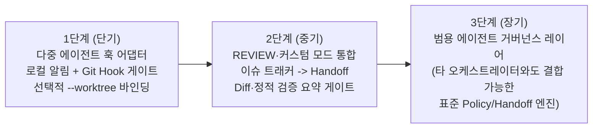

# AI 코딩 에이전트 오케스트레이션 솔루션 비교 및 `guard` 향후 방향 제안

- **작성일**: 2026-11-28
- **비교 대상**: `guard` vs `amux` (`amuxhq/amux`, `elyesghazel/amux`, `hewigovens/amux`), `Conductor` (Melty Labs), `Emdash`
- **관련 문서**: [01_requirements.md](../01_requirements.md), [02_architecture.md](../02_architecture.md), [11_review_mode_design.md](../11_review_mode_design.md), [12_custom_mode_plan.md](../12_custom_mode_plan.md)

---

## 1. 개요: 문제 정의와 핵심 목표의 차이

최근 AI 코딩 에이전트(Claude Code, OpenAI Codex, Gemini CLI, Antigravity CLI 등)가 보편화되면서, 단일 에이전트에서 벗어나 **여러 에이전트를 동시에 조율·통제**하는 도구들이 빠르게 등장하고 있습니다. 다만 `guard`와 시장의 유사 솔루션들은 출발점(해결하려는 핵심 병목)에 뚜렷한 차이가 있습니다.

| 솔루션 | 핵심 목표 (What Problem It Solves) | 중심 패러다임 |
| :--- | :--- | :--- |
| **`guard`** | 에이전트의 **치팅·역할 이탈 방지(Cleanroom 무결성)**, 인간 조율자의 **관찰성 확보**, **인간 승인 기반 핸드오프** | `PreToolUse` 훅 기반 결정론적 정책 강제 + TUI 관제탑(`guard top`) |
| **`amux`** | 터미널 기반 에이전트들의 **멀티플렉싱, 원격 모니터링/제어, 서브에이전트 간 태스크 조율** | PTY/tmux 멀티플렉서, 웹/모바일 컨트롤 플레인, MCP 기반 에이전트 통신 |
| **`Conductor`** | 여러 에이전트 병렬 실행 시 발생하는 **디스크/브랜치 충돌 제거 및 Diff 중심 코드 리뷰 피로 해소** | **Git Worktree 격리** + macOS 네이티브 Diff-first 리뷰 UI |
| **`Emdash`** | 25+ 종의 다양한 CLI 에이전트를 **로컬/원격에서 병렬 실행하고 이슈 트래커~PR 머지까지 일원화** | **Git Worktree 격리** + 오픈소스 로컬 퍼스트 ADE(Electron) |

요약하면, **`amux`·`Conductor`·`Emdash`는 "병렬 실행의 생산성과 워크플로우 편의성(Throughput & UX)"**에 집중하는 반면, **`guard`는 "에이전트 실행의 신뢰 경계(Trust Boundary), Cleanroom TDD 격리, 결정론적 정책 집행(Integrity & Governance)"**에 집중합니다.

---

## 2. 주요 기능 비교 매트릭스

| 비교 항목 | `guard` | `amux` (`amuxhq` / `elyesghazel`) | `Conductor` | `Emdash` |
| :--- | :--- | :--- | :--- | :--- |
| **형태 / 기술 스택** | Go CLI + TUI (`guard top`) | Rust + SQLite + Web/Mobile (`amuxhq`) / Rust TUI (`elyesghazel`) | macOS 네이티브 앱 (상용) | Electron 데스크톱 앱 + SQLite (오픈소스) |
| **에이전트 지원** | `agy` 중심 (확장 가능 훅 어댑터 구조) | Claude Code, Codex, Gemini CLI 등 | Claude Code, Codex, Cursor, OpenCode 등 | 25+ CLI 에이전트 (Claude Code, Codex, Copilot, OpenCode 등) |
| **격리 메커니즘** | **정책/권한 격리**: 모드(`PLAN`/`TEST`/`DEV`/`REVIEW`)별 파일·셸 훅 차단 | **프로세스/패인 격리**: tmux/PTY 패인 분리 | **디스크/브랜치 격리**: 작업별 독립 Git Worktree 자동 생성 | **디스크/브랜치 격리**: 작업별 독립 Git Worktree 자동 생성 |
| **치팅/무결성 방어** | **강력함**: `read`/`write`/`command` 차단, 셸 우회 탐지, 자체 승인 차단 | 없음 (에이전트 자율 실행) | 없음 (Worktree 단위로만 분리) | 없음 (Worktree 단위로만 분리) |
| **작업 위임 / 협업** | **Handoff 프로토콜** (`guard handoff send/inbox/ack/approve`) + Scope Lock | 공유 태스크 보드(`amuxhq`) / MCP 도구(`spawn_agent`, `send_to_agent`) | 태스크별 독립 워크스페이스 생성 (수동 조율) | 티켓 단위 세션 생성 및 동일 태스크 멀티 모델 비교 |
| **인간 개입 (HITL)** | `guard handoff approve` (에이전트 자체 승인 물리 차단) | 입력/권한 대기 시 시각적 알림 + 원격 조향 | Diff-first 리뷰 UI + PR/머지 승인 | Diff 뷰어 + CI 상태 확인 + PR/머지 |
| **관찰성 (Observability)** | `guard top` TUI, `guard status`, 세션별 `allow`/`deny` 이벤트 로그(50건) | 웹 대시보드, macOS/iOS 컴패니언 앱, 사용량 한도 복구 | 워크스페이스별 채팅/터미널/Diff 통합 뷰 | 통합 대시보드, 멀티 에이전트 상태 및 Diff 뷰 |
| **외부/원격 연동** | 로컬 전용 (데몬리스 파일 기반) | Tailscale / 셀프호스팅 원격 제어 | GitHub, Linear 이슈 연동 | GitHub, Linear, Jira, GitLab, Asana, YouTrack + **SSH/SFTP 원격 실행** |

---

## 3. 솔루션별 장단점 상세 검토

### 3.1 `guard` (현재 상태)
* **장점**
  * **독보적인 Cleanroom & TDD 무결성 보장**: `DEV` 모드에서 테스트 파일 열람 차단, `TEST` 모드에서 프로덕션 코드 및 `git diff`/`rg` 등 셸 우회 차단, `PLAN` 모드에서 소스 수정 차단 등 **에이전트가 지시만으로는 어기기 쉬운 원칙을 물리적으로 강제**합니다.
  * **에이전트-인간 신뢰 경계(Trust Boundary)**: `guard handoff approve` 등 게이트키퍼 명령의 에이전트 자체 실행을 훅 레벨에서 원천 차단합니다.
  * **초경량 데몬리스 아키텍처**: 상시 데몬이나 DB 서버 없이 단일 Go 바이너리와 로컬 JSON/YAML 파일만으로 동작해 도입·배포·디버깅이 단순합니다.
  * **선언적 정책(`guard-policy.yaml`)**: 프로젝트 구조에 맞춰 모드와 규칙을 유연하게 커스터마이징할 수 있습니다.
* **단점 및 한계**
  * **파일시스템(Worktree) 격리 부재**: 동일 워크스페이스에서 여러 모드/세션이 동시에 작업할 때 디스크 파일 수정 충돌을 막아주지 못합니다.
  * **Diff 리뷰 및 시각적 UX 부족**: 터미널 TUI(`guard top`)는 상태 관제에는 효율적이나, 코드 변경분(Diff)을 시각적으로 검토하고 머지하는 경험은 제공하지 못합니다.
  * **에이전트/플랫폼 확장성 한계**: 현재 `agy` 훅 규격 중심으로 설계되어 있어 Claude Code, Codex, Cursor 등 타 CLI 에이전트와의 즉시 호환성이 부족합니다.
  * **원격 알림 및 이슈 트래커 연동 부재**: 장시간 작업 중 승인 대기나 정책 위반이 발생했을 때 외부(데스크톱 알림, Slack, 모바일 등)로 알리거나 GitHub/Linear 이슈를 직접 핸드오프로 연결하는 기능이 없습니다.

### 3.2 `amux`
* **장점**: 터미널 멀티플렉싱(`tmux`/PTY)과 원격 제어(Tailscale, 웹/iOS)에 특화되어 언제 어디서나 백그라운드 에이전트를 모니터링·개입할 수 있으며, MCP를 통한 서브에이전트 스폰(`spawn_agent`)이 자연스럽습니다.
* **단점**: 에이전트 내부 행위(프로덕션/테스트 접근 경계, 셸 우회 등)를 통제하는 보안·가드레일 계층이 없으며, 워크트리 자동 격리나 코드 리뷰 UI가 약합니다.

### 3.3 `Conductor`
* **장점**: Git Worktree 자동 격리와 **Diff-first 리뷰 UX**의 완성도가 매우 높아, 개발자가 "팀장(Tech Lead)"처럼 여러 에이전트의 산출물을 빠르게 리뷰·머지하기에 최적화되어 있습니다.
* **단점**: macOS 전용 클로즈드 상용 앱이라 Linux/Windows 환경이나 사내 커스텀 CI/정책 파이프라인에 결합하기 어렵고, 역할 기반 접근 제어(Cleanroom TDD) 기능이 없습니다.

### 3.4 `Emdash`
* **장점**: 오픈소스이면서 25+ CLI 에이전트 지원, Worktree 격리, 주요 이슈 트래커(Jira/Linear/GitHub 등) 연동, SSH 원격 실행까지 가장 폭넓은 **ADE(Agentic Development Environment)** 기능을 제공합니다.
* **단점**: Electron 기반 데스크톱 앱으로 리소스가 무겁고, CLI/터미널 중심의 경량 워크플로우나 에이전트 치팅 방지(정책 기반 파일/셸 차단) 기능은 제공하지 않습니다.

---

## 4. `guard`의 향후 발전 방향 제안

시장의 유사 툴들이 **대규모 병렬 실행, Worktree 관리, GUI 편의성**을 앞세우고 있는 반면, **에이전트 역할 격리와 결정론적 신뢰 경계(Governance & Cleanroom)** 영역은 아직 경쟁이 비어 있는 `guard`만의 핵심 해자(Moat)입니다.

따라서 `guard`는 무거운 Electron 앱이나 화려한 대규모 에이전트 스웜 경쟁을 따라가기보다, **"인간의 인지 부하를 최소화하는 경량 CLI/TUI 철학을 유지하면서, 비동기 파이프라인의 신뢰성과 확장성을 높이는 방향"**이 가장 유효합니다.

### 4.1 병렬 수행 범위와 `git worktree`에 대한 현실적 전제

향후 기능을 설계할 때는 **"에이전트가 병렬로 돌 수 있는가"**보다 **"사람이 병렬로 통제할 수 있는가"**를 기준으로 범위를 한정해야 합니다.

1. **HITL 병목과 적정 병렬 모델 (전경 1개 + 백그라운드 자율 실행)**
   * `PLAN`(기획·설계)과 `DEV`(구현)처럼 사람의 의사결정이 수시로 개입해야 하는 HITL 작업을 동시에 여러 개 띄우면, 컨텍스트 스위칭 비용 때문에 **결국 사람이 전체 속도의 병목**이 됩니다.
   * 현실적으로 유효한 병렬 모델은 **사람은 한 번에 하나의 전경(Foreground) 작업(`PLAN` 또는 `REVIEW`)에만 집중하고, 명세와 완료 기준이 확정된 `TEST`/`DEV` 티켓은 가드레일 안에서 백그라운드 자율 실행 후 체크포인트(`handoff approve`)에서만 보고받는 비동기 파이프라인**입니다.
2. **대규모 병렬 탐색(Map-Reduce)의 한계와 단계적 탐색의 우위**
   * 수십 개 에이전트를 동시에 띄우는 Map-Reduce 방식은 "초반에 출력 스키마와 평가 기준이 완전히 고정된 작업"(예: 고정 룰셋 기반 대량 파일 스캔, 단순 반복 마이그레이션)에서만 효과를 냅니다.
   * 일반 소프트웨어 개발·탐색에서는 탐색 과정에서 정보가 갱신되며 가설과 주제가 계속 바뀌므로, **소수 에이전트로 가설을 좁혀가는 단계적(직렬) 탐색**이 비용·정확도 면에서 훨씬 효과적입니다.
3. **`git worktree`의 필요성과 선택적 도입**
   * `guard`는 `PLAN`(문서)·`TEST`(테스트)·`DEV`(프로덕션) 별로 접근 가능한 파일 집합을 서로 겹치지 않게(Disjoint) 격리하므로, 같은 디렉터리에서 역할 간 작업을 병행해도 파일 수정 충돌이 거의 발생하지 않습니다.
   * 따라서 `git worktree`는 기본 필수가 아니며, **동일 모드(예: `DEV` 2개)를 동시에 돌리는 Multi-Feature 작업**이나 **미완성 코드로 인한 빌드/테스트 간섭·브랜치 분리가 필요한 경우**에만 선택 옵션(`--worktree`)으로 제공하는 것이 합리적입니다.

### 4.2 단기 과제 (로컬 비동기 파이프라인 신뢰성 및 Git 경계 연동)
1. **다중 에이전트 훅 어댑터 표준화**
   * `internal/adapters/hook`을 `agy` 단일 포맷에서 어댑터 방식으로 확장해 Claude Code, Codex CLI, Gemini CLI 등의 `PreToolUse` / 훅 페이로드를 공통 `EvalRequest`로 매핑합니다.
2. **로컬 알림 + Git Hook (`pre-push` / `GIT` 게이트) 연동**
   * `guard`는 **로컬 AI 개발 오케스트레이션**에 집중하므로, 외부 메신저(Slack/Discord) 연동 대신 `guard top` 상태 표시 및 터미널 벨·OS 로컬 알림(`notify-send` 등)만 경량으로 유지합니다.
   * 원격 팀 협업과의 비동기 경계인 Git 반영 시점에는 **Git Hook(`pre-push`)** 또는 **`GIT` 게이트**(혹은 `DEV`/`TEST` 내 `git push` 차단)를 연동해, 미승인 `handoff` 티켓이나 미검증 변경분이 원격 저장소로 푸시되는 것을 방지합니다.
3. **선택적 Git Worktree 세션 바인딩 (`--worktree` 옵션)**
   * 기본은 현재 워크스페이스 공유 방식을 유지하되, 다중 기능 동시 개발이나 빌드 격리가 필요할 때만 `guard dev --worktree`로 세션 ID에 매핑된 독립 Worktree를 자동 생성·정리할 수 있게 합니다.

### 4.3 중기 과제 (단계적 워크플로우 완결성 확보)
1. **커스텀 모드 및 `REVIEW` 모드 정식 통합**
   * [11_review_mode_design.md](../11_review_mode_design.md)와 [12_custom_mode_plan.md](../12_custom_mode_plan.md)의 설계를 구현해 `PLAN → TEST → DEV → REVIEW` 4단계 파이프라인을 완성하고, 결정론적 정적 검증(`Makefile`)과 읽기 전용 리뷰를 표준화합니다.
2. **이슈 트래커 → `guard handoff` 브리지**
   * `guard handoff import --github <issue>` 또는 `--linear <id>` 형태로 외부 이슈 본문과 관련 문서를 읽어 즉시 `guard handoff send` 티켓(`--ref`, `--targets`)으로 발행하는 CLI 서브커맨드를 제공합니다.
3. **Diff 요약 & 정적 검증 머지 게이트**
   * `guard top` 또는 `guard handoff approve` 시점에 변경분(`git diff --stat`)과 정적 검사·테스트 통과 여부를 함께 요약해 주어, 사람이 최소한의 컨텍스트 스위칭만으로 승인 여부를 판단할 수 있게 합니다.

### 4.4 장기 전략 (포지셔닝)
* **경쟁 구도 재정의**: `Emdash`나 `Conductor`의 "대규모 에이전트 병렬 쇼케이스"를 모방하기보다, **`guard`를 "단계적이고 깊이 있는 AI 개발을 지탱하는 Cleanroom & Policy Enforcement 레이어"**로 포지셔닝합니다.
* 단독으로 사용할 때는 **인지 부하가 없는 비동기 4단계(`PLAN → TEST → DEV → REVIEW`) 경량 오케스트레이터**로 동작하고, `Emdash`나 `amux` 등 타 오케스트레이터 위에서도 각 세션의 `guard hook`을 통해 **TDD 격리·프로덕션 보호·인간 승인 게이트**를 동일하게 보장하는 표준 가드레일 미들웨어 역할을 수행합니다.
