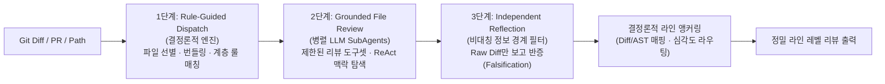

# Alibaba OpenCodeReview (OCR) 리서치 보고서

- **GitHub 저장소**: [alibaba/open-code-review](https://github.com/alibaba/open-code-review) (Apache-2.0, CLI: `ocr`, npm: `@alibaba-group/open-code-review`)
- **핵심 논문**: *OpenCodeReview: Determinism over Non-Determinism for Cost-Effective Agent-Based Code Review* ([arXiv:2608.09290](https://arxiv.org/abs/2608.09290)) — Zhengfeng Li 외 (Alibaba Group, Nanjing University)
- **벤치마크 논문**: *AACR-Bench: Evaluating Automatic Code Review with Holistic Repository-Level Context* ([arXiv:2601.19494](https://arxiv.org/abs/2601.19494))
- **관련 설계 문서**: [11_review_mode_design.md](../11_review_mode_design.md)

---

## 1. 개요 및 핵심 철학 ("Determinism Dividend")

**OpenCodeReview (`ocr`)**는 알리바바 그룹 내부에서 수만 명의 개발자가 약 2년간 실전 검증한 뒤 오픈소스로 공개한 하이브리드 AI 코드 리뷰 CLI 및 에이전트 프레임워크입니다.

핵심 철학은 **"불확실한 에이전트를 위한 결정론적 엔지니어링 (Deterministic Engineering for Uncertain Agents)"**이며, 이를 통해 얻는 신뢰성·비용 이점을 **"결정론 배당(Determinism Dividend)"**이라고 부릅니다. 즉, **전통적 코드로 결정론적 처리가 가능한 작업은 절대 LLM에 맡기지 않고, LLM은 오직 맥락 추론과 로직 결함 판단에만 집중**시킵니다.

### 범용 코딩 에이전트(Claude Code, Codex 등)의 코드 리뷰 4대 실패 모드
OCR 논문이 지적하는 범용 에이전트 기반 코드 리뷰의 구조적 한계는 다음과 같습니다.

| 실패 모드 | 원인 | 실무 영향 |
| :--- | :--- | :--- |
| **불완전한 커버리지 (Incomplete Coverage)** | 대규모 PR에서 에이전트가 자율적으로 파일을 고르거나 건너뜀 | 핵심 변경 파일이 리뷰에서 누락됨 |
| **위치 드리프트 (Position Drift)** | LLM이 자유 텍스트로 라인 번호를 추측·생성 | 변경되지 않은 라인이나 존재하지 않는 라인에 코멘트 부착 |
| **오탐 폭증 & 자기강화 편향 (Self-Reinforcing Bias)** | 동일 컨텍스트 내 자기비판(Intrinsic Self-Critique)의 확증 편향 | 저신뢰 코멘트 대량 발생(Precision 7~15% 수준), 리뷰어 피로도 급증 |
| **토큰 폭증 (Token Explosion)** | 제한 없는 도구 탐색(Unbounded Tool Exploration) | 동일 모델 대비 5~15배의 토큰 낭비 및 지연 증가 |

---

## 2. 3단계 하이브리드 아키텍처 및 파이프라인

OCR은 자유형 LLM 루프 대신 **결정론적 파이프라인(Go 기반 엔지니어링 계층)**과 **격리된 LLM SubAgent 계층**을 3단계로 엄격히 분리합니다.

### 2.1 1단계: Rule-Guided Dispatch (결정론적 라우팅 & 번들링)
- **파일 선별 및 번들링(Bundling)**: 에이전트에게 저장소 전체를 탐색시키지 않고, 결정론적 코드가 Git diff/커밋/대상 경로를 파싱해 연관된 변경 파일들을 격리된 **번들(Bundle)** 단위로 묶습니다. 이를 통해 대규모 변경에서도 **누락(Incomplete Coverage)을 원천 차단**합니다.
- **계층형 룰셋(Multi-Layer Ruleset)**: `System → Global → Project → CLI` 우선순위 계층으로 룰을 관리하며, 파일 패턴·언어 특성에 따라 템플릿 엔진 기반으로 해당 파일에 필요한 규칙만 정밀 주입합니다.
  - 기본 내장 다국어 룰셋: Null Pointer Exception(NPE), 동시성/스레드 안전성(Thread-Safety), XSS, SQL Injection, 리소스 누수 등 고위험 결함 중심.

### 2.2 2단계: Grounded File Review (제한된 도구셋 + 병렬 SubAgent)
- **파일/번들 단위 병렬 SubAgent**: 1단계에서 격리된 번들마다 독립 SubAgent가 ReAct 루프로 동작합니다.
- **제한된 리뷰 전용 도구셋(Curated, Bounded Tool Set)**: 자유로운 셸 명령이나 수정 도구를 주지 않고, 전체 파일 읽기·코드 검색·호출부/의존성 조회 등 **리뷰에 필요한 읽기 전용 도구로 액션 공간을 제한**합니다.
- **Diff 너머의 맥락 파악**: 단순 `git diff` 조각만 보는 것이 아니라, 필요 시 주변 원본 코드와 호출 인터페이스를 도구로 조회해 비즈니스 로직 및 동시성 결함을 추론합니다.

### 2.3 3단계: Independent Reflection (비대칭 정보 경계 + 반증 우선 필터)
OCR 아키텍처에서 가장 독창적이고 실효성이 높은 오탐 억제 메커니즘입니다.
- **비대칭 정보 경계 (Asymmetric Information Boundary)**:
  - 2단계 SubAgent는 도구를 통해 넓은 저장소 컨텍스트를 탐색하며 후보 코멘트를 생성합니다.
  - 반면 3단계 **Independent Reflector**에게는 SubAgent의 탐색 이력(Tool-augmented exploration history)을 **의도적으로 차단**하고, **오직 Raw Diff와 후보 코멘트만 제공**합니다.
  - 탐색 과정에서 누적된 노이즈나 환각 근거에 오염되지 않고, 실제 diff 증거만으로 코멘트의 타당성을 검증합니다.
- **반증 우선 필터 (Falsification-First Filter)**:
  - 새로운 지적을 생성하지 않고, 기존 후보 코멘트를 **반증·기각(Filter out)**하는 역할만 수행합니다.
  - 같은 모델 인스턴스가 자신의 추론을 스스로 칭찬하는 **자기강화 편향(Confirmation Bias / Sycophancy)**을 구조적으로 차단합니다.
- **결정론적 라인 앵커링 (Line Positioning)**:
  - LLM이 출력한 위치를 실제 Git diff 구조 및 AST 기반 매핑으로 검증·고정해 **Position Drift를 제거**합니다.

---

## 3. 운영 모드, 심각도 라우팅 및 Agent Skills 생태계

### 3.1 3가지 실행 모드
1. **Native Diff Review (`ocr`)**: 로컬 워킹 트리(staged/unstaged), 특정 커밋, 브랜치 비교, GitHub Actions PR에 대해 자체 설정된 LLM 엔드포인트(OpenAI/Anthropic 호환)로 전체 파이프라인 실행.
2. **Full-File Scan (`ocr scan`)**: Git diff가 없는 레거시 모듈·신규 인수 코드·특정 디렉터리(`ocr scan --path internal/agent`) 전체를 대상으로 감사 수행.
3. **Delegation Mode (`ocr delegate` + `open-code-review-delegate` Skill)**:
   - **OCR 측에 별도 LLM API 키가 필요 없는(LLM-free) 위임 패턴**입니다.
   - 호스트 코딩 에이전트(Claude Code, Cursor, Codex 등)가 `SKILL.md` 지침에 따라 OCR CLI를 **결정론적 전처리기**로 호출합니다:
     1. `ocr delegate preview --format json [--from <ref> --to <ref>]` → 리뷰 대상 파일·메타데이터 확정
     2. `ocr delegate rule --format json <file-paths...>` → 대상 파일에 매칭되는 룰셋 추출
     3. 호스트 에이전트가 자신의 구독 모델로 시맨틱 리뷰 수행

### 3.2 심각도 체계 및 노이즈 라우팅
- 5단계 심각도: `critical` · `high` · `medium` · `low` · `info`
- **`route_severity_below` 설정**: 기준 심각도 미만(`low`, `info` 등)의 지적은 인라인 코멘트로 도배하지 않고 **통합 요약 블록(Summary Block)**으로 라우팅해 리뷰어 피로도를 제어합니다.
- **신뢰도(Confidence) 기반 필터링**: 고신뢰 결함만 자동 수정 또는 차단 게이트로 연결합니다.

---

## 4. 벤치마크 성능 (AACR-Bench) 및 트레이드오프

### 4.1 AACR-Bench 평가 결과 (arXiv:2608.09290)
- **벤치마크 규모**: 50개 오픈소스 프로젝트, 10개 언어, 실제 PR 200건, 80명 이상 시니어 엔지니어가 교차 검증한 정답 코멘트 1,505건.
- **SEM-F1**: 동일 기반 모델(Claude 계열 등)을 사용하는 범용 에이전트(Claude Code) 대비 **최대 2.17× 높은 SEM-F1** 달성 (예: `25.10%` vs `11.57%`).
- **정밀도(Precision)**: Claude Code가 수천 건의 광범위 코멘트를 쏟아내며 Precision이 `7~15%`대로 급락하는 반면, OCR은 Independent Reflection을 통해 고정밀 영역에 안착.
- **토큰 효율성**: 범용 에이전트 대비 **5~15배 적은 토큰 소비** (평균 약 **1/9 수준**).

### 4.2 의도된 트레이드오프 및 한계점
1. **Precision 우선 vs Recall 상한**: 오탐과 토큰을 극단적으로 줄이기 위해 **재현율(Recall) 상한을 의도적으로 낮게 수용**합니다. 모든 극단적 엣지케이스를 빠짐없이 잡는 것이 목적인 보안 전수 감사에는 단독으로 부족할 수 있습니다.
2. **비즈니스 명세(Spec) 외부 맥락 부재**: OCR은 코드 저장소와 기술적 룰셋(NPE, XSS 등)에 강점이 있지만, PR 외부의 기획서·요구사항 명세서와의 정합성 검증은 별도 컨텍스트 주입 없이는 한계가 있습니다.
3. **정적 도구(`Makefile`/Linter/Compiler)와의 역할 중복 가능성**: 컴파일러·타입체커·복잡도 분석기가 0% 오차로 잡을 수 있는 영역까지 LLM 룰셋으로 커버하려 하면 불필요한 비용이 발생합니다.

---

## 5. `guard` REVIEW 모드 설계([11_review_mode_design.md](../11_review_mode_design.md))에 주는 핵심 인사이트

현재 초안인 [11_review_mode_design.md](../11_review_mode_design.md)는 **"정적 검증(`Makefile`) + 비즈니스 명세(`guard handoff --ref`) + Read-Only 물리 격리"**라는 강력한 차별점을 이미 갖추고 있습니다. 여기에 OCR의 검증된 아키텍처 인사이트를 결합하면 다음과 같은 고도화 포인트가 도출됩니다.

| 영역 | 현재 `11_review_mode_design.md` 초안 | OCR 인사이트 기반 보완·심화 포인트 |
| :--- | :--- | :--- |
| **1. 결정론적 전처리 (Determinism Dividend)** | 에이전트가 직접 `git diff`와 `Targets`를 확인 (Step 1) | **`ocr delegate preview` 패턴 차용**: 대규모 diff에서 파일 누락(Incomplete Coverage)을 막기 위해, `guard` CLI(또는 리뷰 진입 커맨드)가 변경 파일 목록·라인 범위·번들 단위를 결정론적으로 추출해 인박스/프롬프트에 구조화 전달하는 방안 검토 |
| **2. 오탐 억제 메커니즘 (Independent Reflection)** | 단일 세션 내 프롬프트 지침(Step 4 오탐 억제 기준)에 의존 | **비대칭 정보 경계 기반 2-Pass 검증**: 동일 컨텍스트의 자기비판(Self-Critique)은 확증 편향이 발생함. 1차 리뷰어가 탐색 후 후보 결함을 뽑으면, 탐색 이력이 없는 **독립 서브에이전트(Reflector)가 Raw Diff + 명세서만으로 반증(Falsification)**하는 2단계 리뷰 프로토콜 검토 |
| **3. 위치 드리프트 방지 (Position Drift)** | "파일 경로, 라인/코드 스니펫 포함" 텍스트 규칙 | 리뷰 리포트의 `파일:라인`이 실제 `git diff` 범위 또는 현행 파일 라인과 일치하는지 검증하는 **결정론적 후처리/스니펫 인용 강제 규칙** 검토 |
| **4. 심각도 라우팅 (`route_severity_below`)** | `Critical`·`Major` → `handoff --to dev --type fix` | `Minor`·`Info`는 수정 티켓에 섞지 않고 **별도 요약/참고 섹션으로 강제 분리**하여 `DEV` 세션의 불필요한 컨텍스트 오염과 수정 루프 낭비 방지 |
| **5. 계층형 도메인 룰셋 & `ocr` 공존 전략** | `.agents/rules/guard-review.md` 단일 파일 | 프로젝트별 파일 패턴(`**/*.go`, `internal/auth/**` 등)에 따라 도메인 체크리스트를 모듈화하거나, 사용자가 이미 `ocr` CLI를 설치한 경우 **`guard review` 내부에서 `ocr delegate`를 선택적 전처리기로 결합**하는 플러그인형 워크플로우 고려 |
| **6. Full-File Audit 확장 (`ocr scan`)** | `git diff` 기반 변경분 리뷰 중심 | 레거시 모듈 점검이나 초기 감사 시 `Targets` 경로 전체를 리뷰하는 **Full-File Audit 모드**(diff 없는 시나리오) 명시적 지원 검토 |

### 요약: `guard REVIEW`만의 고유 포지셔닝
- **OCR의 강점**: 결정론적 파일 번들링 · 계층 룰 매칭 · 비대칭 반증 필터(Precision 극대화) · 토큰 절감.
- **`guard REVIEW`의 고유 강점**: OS/훅 레벨 Read-Only 물리 격리 · `Makefile` 결정론적 정적 게이트 결합 · **`guard handoff --ref` 기반 비즈니스 명세 정합성 검증** · **`DEV` 세션으로의 구조화된 `fix` 핸드오프 피드백 루프**.
- 두 접근은 경쟁 관계가 아니라 **상호 보완적**이며, `11_review_mode_design.md` 딥 다이브에서 OCR의 **결정론적 전처리·비대칭 반증 필터·심각도 라우팅** 개념을 `guard`의 경량 아키텍처에 맞게 선별 흡수하는 것이 핵심 과제입니다.
