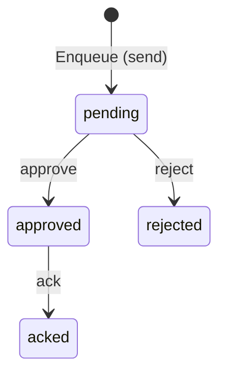

# [handoff-qa-test-brief.md] 범용 핸드오프 프로토콜 QA 테스트 가이드

> **대상 독자**: QA (`TEST` 모드 에이전트 및 검증 담당자)  
> **검증 대상**: `guard handoff` 프로토콜 (Phase 1 ~ Phase 5 구현 완료분)  
> **참고 문서**:
> - 계약 명세 (필수): [05_handoff_protocol_contract.md](../spec/05_handoff_protocol_contract.md), [02_session_hub_contract.md](../spec/02_session_hub_contract.md), [03_adapters_cli_contract.md](../spec/03_adapters_cli_contract.md)
> - 아키텍처 설계: [08_handoff_protocol.md](../08_handoff_protocol.md)
> - 상세 개발 계획: [handoff_protocol_dev_plan.md](../dev/handoff_protocol_dev_plan.md)

---

## 1. 목적 및 검증 범위

### 1.1 기능 목적
- 다중 에이전트(`PLAN`, `DEV`, `TEST`, `ALL`) 간 작업 위임·검증 요청·결함 수정·설계 질의를 수동 복사 없이 파일 기반 비동기 큐(`~/.guard/handoff/queue.json`)로 중계합니다.
- 모든 핸드오프는 **Human-in-the-loop 승인 게이트(`guard top` 또는 `guard handoff approve`)**를 거쳐야만 수신 세션 인박스(`~/.guard/sessions/<id>.inbox`)로 전달됩니다.
- 코드 수정이 수반되는 핸드오프(`fix`, `task`)에만 조건부로 `Scope Lock`(`AllowedWritePaths`)을 적용합니다.

### 1.2 범위 외 (Out of Scope)
- 외부 셸 스크립트 직접 실행(`action:<name>`)은 설계에서 제외되었습니다. Consumer는 에이전트 세션(`agy`)으로 단일화되어 있습니다.
- 터미널 PTY 키 주입은 구현 대상이 아닙니다.

---

## 2. 구현 기능 및 대상 패키지 맵

| 계층 | 패키지 | 주요 기능 | 계약서 |
| :--- | :--- | :--- | :--- |
| **Handoff Hub** | `guard/internal/hub/handoff` | `HandoffItem` 검증, `ParseTarget`, `FormatEnvelope`, `Flock`+Atomic Write 큐 CRUD, 인박스 전달, `ApproveAndRoute`, `ConsumePendingForMode` | [05_handoff_protocol_contract.md](../spec/05_handoff_protocol_contract.md) |
| **Core** | `guard/internal/core` | `guard handoff approve` 에이전트 자체 승인 차단 (`handoff-self-approve-block`) | [05_handoff_protocol_contract.md](../spec/05_handoff_protocol_contract.md#3-core-신뢰-경계-계약-guardinternalcore) |
| **Session Hub** | `guard/internal/hub/session` | `Session.AllowedWritePaths`, `UpdateScope`, `FindActiveByMode`, `ErrNoActiveSession` | [02_session_hub_contract.md](../spec/02_session_hub_contract.md) |
| **Launcher** | `guard/internal/adapters/launcher` | `EnsureWorkflowRule` (`.agents/rules/guard-workflow.md`), 오프라인 대기 티켓 자동 소비, `GUARD_INBOX_PATH` 주입, 종료 시 `.inbox` 정리 | [03_adapters_cli_contract.md](../spec/03_adapters_cli_contract.md#2-launcher-adapter-guardinternaladapterslauncher) |
| **TUI & i18n** | `guard/internal/adapters/tui`, `guard/internal/i18n` | 3줄 요약 모달(`[Enter]`/`[V]`/`[Esc]`), 256KB 상한 참조 문서 뷰어, `[H]` 하단 큐 패널 전환, `ko.json`/`en.json` 동기화 | [03_adapters_cli_contract.md](../spec/03_adapters_cli_contract.md#3-tui-control-tower-guardinternaladapterstui) |
| **CLI** | `guard/cmd/guard` | `guard handoff <send\|inbox\|approve\|reject\|ack>`, `guard top` 핸드오프 연동 | [05_handoff_protocol_contract.md](../spec/05_handoff_protocol_contract.md#4-cli-계약-guard-handoff) |

---

## 3. 핵심 계약 요약 (Contract Invariants)

### 3.1 상태 전이 규칙

- 위 경로 외 모든 전이(`pending → acked`, `rejected → approved`, `acked → approved`, `approved → approved`)는 `handoff.ErrInvalidTransition`을 반환해야 합니다.

### 3.2 조건부 Scope Lock 매트릭스 (`ShouldApplyScopeLock`)

| `Type` | `Targets` 비어있지 않음 | 수신 모드 (`DEV`/`ALL`) | 수신 모드 (`PLAN`/`TEST`) |
| :--- | :---: | :---: | :---: |
| `fix` | O | **적용 (`true`)** | 미적용 (`false`) |
| `task` | O | **적용 (`true`)** | 미적용 (`false`) |
| `verify` | O | 미적용 (`false`) | 미적용 (`false`) |
| `review` | O | 미적용 (`false`) | 미적용 (`false`) |
| `fix` / `task` | X (빈 목록) | 미적용 (`false`) | 미적용 (`false`) |

---

## 4. 테스트 환경 구성

### 4.1 전제 조건 및 빌드
```bash
# 1. 최신 바이너리 빌드
go build -o ./guard ./cmd/guard

# 2. 전체 테스트(레이스 디텍터 포함) 실행
go test -race -v ./...
```

### 4.2 격리된 테스트 환경 (실제 `~/.guard` 오염 방지)
- **Go 블랙박스 테스트**: 모든 `Manager` 생성자는 디렉터리 주입을 지원하므로 반드시 `t.TempDir()`을 사용합니다.
  - `handoff.NewManager(filepath.Join(tmp, "handoff"), filepath.Join(tmp, "sessions"))`
  - `session.NewManager(filepath.Join(tmp, "sessions"))`
  - `launcher.New(sessMgr, &stdout, &stderr).WithHandoffManager(handoffMgr)`
  - `tui.NewModelWithHandoff(sessMgr, handoffMgr, workspaceDir)`
- **CLI 수동/통합 테스트**: 임시 `HOME`과 `WORKSPACE_ROOT`를 지정해 격리 실행합니다.
  ```bash
  export TEST_HOME=$(mktemp -d)
  export TEST_WS=$(mktemp -d)

  # 1) 핸드오프 발행 (Producer)
  HOME="$TEST_HOME" WORKSPACE_ROOT="$TEST_WS" AGENT_MODE=TEST \
    ./guard handoff send --to dev --type fix --ref doc/spec/05_handoff_protocol_contract.md \
    --targets "internal/hub/handoff/queue.go" -m "결함 수정 테스트"

  # 2) 큐 조회
  HOME="$TEST_HOME" WORKSPACE_ROOT="$TEST_WS" ./guard handoff inbox --json

  # 3) 자체 승인 차단 검증 (Hook PreToolUse)
  echo '{"tool_name":"run_command","tool_input":{"command":"guard handoff approve hnd-1"}}' \
    | HOME="$TEST_HOME" AGENT_MODE=ALL ./guard hook
  # 기대 출력: {"decision":"deny","reason":"..."}
  ```

---

## 5. 검증 대상 기능 및 수용 기준 (Acceptance Criteria)

세부 테스트 케이스 및 엣지 케이스 설계는 QA에서 [계약서](../spec/05_handoff_protocol_contract.md)를 기준으로 독립적으로 도출합니다. 구현된 기능의 최상위 수용 기준은 다음과 같습니다.

1. **핸드오프 발행 및 조회**:
   - 발신 세션이 대상(`plan`/`dev`/`test`/`all` 또는 `sessionId`), 유형(`task`/`verify`/`fix`/`review`), 요약, 참조 문서, 대상 경로를 지정해 티켓을 큐에 등록하고 조회할 수 있어야 한다.
2. **Human-in-the-loop 승인 게이트 및 자체 승인 차단**:
   - 발행된 티켓은 사용자 승인 전까지 수신 세션에 전달되지 않아야 하며, 에이전트가 훅 경유로 `guard handoff approve`를 자체 실행하려는 시도는 모드·정책과 무관하게 차단되어야 한다.
3. **활성 세션 전달 및 조건부 Scope Lock**:
   - 승인 시점에 수신 세션이 활성 상태이면 즉시 세션 인박스(`.inbox`)에 표준 Markdown Envelope이 전달되어야 하며, 코드 수정 성격(`fix`/`task`)이고 쓰기 가능 모드일 때만 대상 경로가 `AllowedWritePaths`에 반영되어야 한다.
4. **오프라인 대기 및 런처 자동 전달**:
   - 승인 시점에 대상 모드의 활성 세션이 없으면 티켓이 대기 상태로 보관되었다가, 이후 해당 모드로 런처를 실행할 때 중복 없이 자동 전달되고 세션 종료 시 임시 인박스가 정리되어야 한다.
5. **TUI 관제탑 승인 UX 및 다국어**:
   - `guard top`에서 대기 중인 핸드오프가 요약 모달로 표시되고 단축키로 승인·반려·참조 문서 열람 및 하단 큐 패널 전환이 가능해야 하며, 한/영(`ko`/`en`) 리소스가 일관되게 동작해야 한다.


---

## 6. 블랙박스 QA 테스트 계획 (Blackbox QA Test Plan)

### 6.1 테스트 개요
- **목표**: Handoff 프로토콜(Phase 1 ~ Phase 5)의 인터페이스 계약 및 런타임 불변식이 정상 동작하는지 외부 관점(Black-box)에서 검증한다.
- **테스트 격리 원칙**: 실제 사용자 디렉터리(`~/.guard`) 오염을 방지하기 위해 `t.TempDir()` 및 임시 디렉터리(`TEST_HOME`, `TEST_WS`) 기반 환경에서만 수행한다.

---

### 6.2 테스트 케이스 명세

#### TC-STATE: 상태 머신 및 파일 락 동시성
| TC ID | 테스트 명칭 | 입력 및 사전조건 | 기대 결과 (수용 기준) |
| :--- | :--- | :--- | :--- |
| **TC-STATE-01** | 정상 생명주기 전이 | 티켓 생성(`send`) → 승인(`approve`) → 수신확인(`ack`) | 상태가 `pending` → `approved` → `acked`로 순차 전이되며 에러 없음 |
| **TC-STATE-02** | 정상 반려 전이 | 티켓 생성(`send`) → 반려(`reject`) | 상태가 `pending` → `rejected`로 전이되며 인박스 미전달 |
| **TC-STATE-03** | 잘못된 상태 전이 차단 | `pending → acked`, `approved → approved`, `rejected → approved` 시도 | `handoff.ErrInvalidTransition` 반환 및 상태 불변 유지 |
| **TC-STATE-04** | 동시 쓰기 안전성 (`flock`) | 5개 이상의 고루틴/프로세스에서 동시 `send` 및 `approve` 호출 | 큐 파일 손상 없음, 원자적 갱신(Atomic Write) 보장, 모든 티켓 유실 없이 등록 |

#### TC-GATE: 보안 및 Human-in-the-loop 자체 승인 차단
| TC ID | 테스트 명칭 | 입력 및 사전조건 | 기대 결과 (수용 기준) |
| :--- | :--- | :--- | :--- |
| **TC-GATE-01** | 에이전트 훅을 통한 자체 승인 차단 | Hook PreToolUse에 `guard handoff approve <id>` 명령어 인입 | 모드(`PLAN`/`DEV`/`TEST`/`ALL`) 무관하게 `decision: deny` 반환 및 실행 차단 |
| **TC-GATE-02** | 승인 전 인박스 격리 | 티켓 발행 후 승인 전 상태 | 수신 세션 인박스(`.inbox`)에 티켓 미노출 및 메시지 주입 차단 |
| **TC-GATE-03** | 사용자 승인 시 인박스 전달 | 사용자 권한(CLI/TUI)으로 `approve` 호출 | 수신 세션 인박스에 표준 Envelope Markdown 파일 정상 생성 |

#### TC-SCOPE: 조건부 Scope Lock 매트릭스 검증
| TC ID | 테스트 명칭 | 유형 (`Type`) | 대상 경로 (`Targets`) | 수신 세션 모드 | 기대 결과 (`AllowedWritePaths`) |
| :--- | :--- | :---: | :---: | :---: | :--- |
| **TC-SCOPE-01** | 결함 수정 + 타깃 + DEV | `fix` | `["pkg/a.go"]` | `DEV` | **적용**: 세션 `AllowedWritePaths`에 `pkg/a.go` 추가 |
| **TC-SCOPE-02** | 작업 위임 + 타깃 + ALL | `task` | `["pkg/b.go"]` | `ALL` | **적용**: 세션 `AllowedWritePaths`에 `pkg/b.go` 추가 |
| **TC-SCOPE-03** | 검증 요청 + 타깃 + TEST | `verify` | `["pkg/a.go"]` | `TEST` | **미적용**: Scope Lock 미적용 (세션 스코프 불변) |
| **TC-SCOPE-04** | 리뷰 요청 + 타깃 + PLAN | `review` | `["doc/a.md"]` | `PLAN` | **미적용**: Scope Lock 미적용 (세션 스코프 불변) |
| **TC-SCOPE-05** | 타깃 누락 결함 수정 | `fix` | `[]` (비어있음) | `DEV` | **미적용**: 타깃 경로가 없으므로 Scope Lock 미적용 |

#### TC-ROUTE: 세션 라우팅 및 런처 오프라인 큐 처리
| TC ID | 테스트 명칭 | 세션 상태 | 시나리오 및 검증 항목 |
| :--- | :--- | :---: | :--- |
| **TC-ROUTE-01** | 활성 세션 즉시 전달 | 온라인 (수신 세션 활성) | `approve` 즉시 활성 세션의 인박스로 전달 및 상태 갱신 |
| **TC-ROUTE-02** | 오프라인 대기 큐 보관 | 오프라인 (대상 모드 세션 없음) | `approve` 시 `approved` 상태로 대기, 에러 없이 큐에 보관 |
| **TC-ROUTE-03** | 런처 기동 시 자동 소비 | 오프라인 → 신규 세션 기동 | 해당 모드로 `guard run <mode>` 실행 시 대기 티켓 자동 감지 및 인박스 주입 |
| **TC-ROUTE-04** | 런처 종료 시 인박스 정리 | 세션 종료 (Cleanup) | 런처 프로세스 종료 시 해당 세션의 `.inbox` 파일 자동 제거 |

#### TC-CLI-E2E: CLI 엔드투엔드 파이프라인
| TC ID         | 서브커맨드                    | 시나리오                                                        | 기대 결과                          |
| :------------ | :----------------------- | :---------------------------------------------------------- | :----------------------------- |
| **TC-CLI-01** | `handoff send`           | 필수 인자(`--to`, `--type`, `-m`) 및 옵션(`--targets`, `--ref`) 전달 | 큐에 티켓 정상 등록, 고유 ID(`hnd-*`) 출력 |
| **TC-CLI-02** | `handoff inbox`          | 대기 중 티켓 목록 테이블 및 `--json` 플래그 조회                            | JSON 및 테이블 포맷 정상 파싱 및 출력       |
| **TC-CLI-03** | `handoff approve/reject` | 대기 티켓 승인 및 반려 처리                                            | 상태 전이 정상 반영, 반려 시 사유 기록        |
| **TC-CLI-04** | `handoff ack`            | 승인 티켓 수신 완료 처리                                              | 티켓 상태 `acked` 전이 확인            |

#### TC-TUI-I18N: 관제탑 TUI 및 다국어 지원
| TC ID         | 테스트 명칭         | 시나리오                                                      | 기대 결과                                    |
| :------------ | :------------- | :-------------------------------------------------------- | :--------------------------------------- |
| **TC-TUI-01** | 3줄 요약 모달 및 단축키 | `guard top` 실행 중 티켓 인입 시 모달 렌더링, `[Enter]` 승인, `[Esc]` 반려 | 키 입력에 따른 액션 호출 및 상태 변경                   |
| **TC-TUI-02** | 참조 문서 뷰어 크기 상한 | 256KB 초과 문서 참조 시 열람                                       | 256KB 상한 제한 및 잘림 안내 메시지 표시               |
| **TC-TUI-03** | 다국어 일관성        | `LANG=ko_KR.UTF-8` 및 `LANG=en_US.UTF-8` 환경 실행             | 모달/패널 라벨이 `ko.json`, `en.json`에 맞게 로컬라이징 |

---

### 6.3 테스트 실행 환경 및 방법

```bash
# 1. Go 격리 블랙박스 테스트 실행
go test -race -v ./test/e2e/... -run "TestHandoff"

# 2. CLI 수동/스크립트 E2E 검증
export TEST_HOME=$(mktemp -d)
export TEST_WS=$(mktemp -d)
# 테스트 수행 후 정리: rm -rf "$TEST_HOME" "$TEST_WS"
```

---

### 6.4 QA 실행 및 검증 체크리스트

- [ ] **TC-STATE**: 상태 머신 및 flock 원자성 검증
- [ ] **TC-GATE**: PreToolUse 자체 승인 차단 및 인박스 격리 검증
- [ ] **TC-SCOPE**: 조건부 Scope Lock 5개 조합 검증
- [ ] **TC-ROUTE**: 활성 세션 라우팅 & 오프라인 런처 자동 소비 검증
- [ ] **TC-CLI-E2E**: CLI 서브커맨드 4종 통합 시나리오 검증
- [ ] **TC-TUI-I18N**: 관제탑 TUI 모달 인터랙션 및 다국어 검증


---

## 7. 단계별 상세 블랙박스 테스트 시나리오 (Defect-Hunting)

> **작성 및 실행 원칙**
> - 본 시나리오는 테스트 통과(PASS)가 아닌 **계약 위반 및 결함(FAIL) 발견**을 목적으로 한다.
> - 에러 무시(`_ = err`), 통과용 하드코딩, 느슨한 검증(`err == nil`만 확인, 빈 값/단순 길이 비교)을 금지한다.
> - 모든 시나리오는 격리된 임시 디렉터리(`t.TempDir()` 또는 `TEST_HOME`/`TEST_WS`)에서 독립 실행하며, 계약서([05_handoff_protocol_contract.md](../spec/05_handoff_protocol_contract.md), [02_session_hub_contract.md](../spec/02_session_hub_contract.md), [03_adapters_cli_contract.md](../spec/03_adapters_cli_contract.md))의 정확한 값·에러 타입·부수효과를 단언(Assert)한다.

---

### Stage 1. `TC-STATE` — 상태 머신 · 입력 검증 · 동시성 · 큐 Compaction

#### TC-STATE-01: 정상 생명주기 전이 및 ID/타임스탬프 계약
- **Given**: 빈 격리 디렉터리로 생성된 `handoff.Manager`
- **When**:
  1. ID 미지정 `HandoffItem` (`Type: fix`, `From: {Mode: "test"}`, `To: {Mode: "dev"}`, `Summary: "결함 수정"`)을 `Enqueue`
  2. 반환된 ID로 `UpdateStatus(id, StatusApproved, "")` 호출
  3. 이어서 `UpdateStatus(id, StatusAcked, "")` 호출
- **Then**:
  - `Enqueue` 반환 ID가 정규식 `^hnd-\d{8}-[0-9a-f]{8}$`에 정확히 일치
  - 초기 상태 `Status == StatusPending`, `CreatedAt` 비어있지 않음
  - 각 전이 후 `Get(id)`로 디스크 재조회 시 상태가 `approved` → `acked`로 정확히 영속화되고 `UpdatedAt >= CreatedAt`

#### TC-STATE-02: 정상 반려 전이 및 인박스 미전달
- **Given**: `pending` 상태 티켓 1건 (`To: {Mode: "dev"}`)과 활성 `DEV` 세션 1개
- **When**: `UpdateStatus(id, StatusRejected, "요구사항 불명확")` 호출
- **Then**:
  - `Get(id)` 결과 `Status == StatusRejected`, `RejectReason == "요구사항 불명확"`
  - 활성 세션의 `<sessionDir>/<sessID>.inbox` 파일이 존재하지 않아야 함 (`os.IsNotExist`)

#### TC-STATE-03: 금지된 상태 전이 전수 차단 (Adversarial)
- **Given**: 각각 `pending`, `approved`, `rejected`, `acked` 상태의 티켓 4건
- **When**: 계약상 허용되지 않은 모든 전이 쌍 시도:
  - `pending → acked`, `pending → pending`
  - `approved → approved`, `approved → pending`, `approved → rejected`
  - `rejected → approved`, `rejected → acked`, `rejected → pending`
  - `acked → approved`, `acked → rejected`, `acked → pending`, `acked → acked`
- **Then**:
  - 모든 시도가 `errors.Is(err, handoff.ErrInvalidTransition)`를 반환해야 함 (단순 `err != nil` 불충분)
  - 실패 직후 `Get(id)` 재조회 시 기존 `Status` 및 `RejectReason`이 변경되지 않아야 함

#### TC-STATE-04: 입력 유효성 위반 및 경로 탈출 공격 (Adversarial)
- **Given**: 격리된 `handoff.Manager`
- **When**: 다음 비정상 입력 각각 호출:
  1. `ParseTarget("")`, `ParseTarget("   ")`, `ParseTarget("../etc/passwd")`, `ParseTarget("..")`, `ParseTarget(".")`, `ParseTarget("sess/1")`, `ParseTarget("sess\\1")`
  2. `InboxPath("../evil")`, `InboxPath("a/b")`, `InboxPath("")`
  3. `Enqueue`: `Summary == ""`, 알 수 없는 `Type: "deploy"`, `References: []string{"doc.md", ""}`, `Targets: []string{""}`, `ParentID: "../bad"`
  4. 동일 `ID`로 `Enqueue` 2회 연속 호출
- **Then**:
  - (1), (3)은 `errors.Is(err, handoff.ErrInvalidItem)` 반환
  - (2)는 `errors.Is(err, handoff.ErrInvalidSessionID)` 반환
  - (4) 두 번째 호출은 에러 반환 및 `queue.json` 내 기존 첫 번째 티켓 내용 무손상

#### TC-STATE-05: 동시 쓰기 및 동일 티켓 승인 경합 (`flock` + Atomic Write)
- **Given**: 격리된 `handoff.Manager`
- **When**:
  1. 10개 고루틴이 동시에 각기 다른 티켓 5건씩(총 50건) `Enqueue` 실행
  2. 단일 `pending` 티켓 1건에 대해 10개 고루틴이 동시에 `UpdateStatus(id, StatusApproved, "")` 호출
- **Then**:
  - (1) `List(ListFilter{})` 결과 정확히 50건 조회, `queue.json`이 유효한 JSON이며 누락·중복 없음
  - (2) 10개 고루틴 중 **정확히 1개**만 `err == nil`, 나머지 **9개는 모두 `ErrInvalidTransition`** 반환

#### TC-STATE-06: 큐 Compaction (`DefaultMaxQueueItems = 200`) 활성 티켓 보존
- **Given**: 격리된 `handoff.Manager`
- **When**:
  1. 완료 티켓(`acked` 100건 + `rejected` 80건 = 180건)을 순차 등록·완료 처리
  2. 활성 티켓(`pending` 25건 + `approved` 25건 = 50건)을 추가 등록 (총 230건 > 200)
- **Then**:
  - `List(ListFilter{OnlyActive: true})` 결과가 **정확히 50건** (활성 티켓 0건 유실)
  - 전체 티켓 수는 `<= 200`이며, 제거된 티켓은 모두 가장 오래된 완료(`acked`/`rejected`) 티켓이어야 함

---

### Stage 2. `TC-GATE` — Core 신뢰 경계 및 자체 승인 우회 공격

#### TC-GATE-01: 모드 및 정책 무관 자체 승인 원천 차단
- **Given**: 모드 4종(`PLAN`, `DEV`, `TEST`, `ALL`) × 정책 2종(`nil` 정책, 전체 허용 정책) = 8개 조합
- **When**: 각 조합에서 `core.EvaluateRequest(policy, req)`에 `CommandLine: "guard handoff approve hnd-20261121-12345678"` 전달
- **Then**:
  - 8개 조합 모두 `Decision.Allowed == false`
  - `Decision.RuleName == "handoff-self-approve-block"`
  - `Decision.Reason`이 비어있지 않은 구체적 차단 사유 문자열 포함

#### TC-GATE-02: 셸 체이닝 · 서브셸 · 인라인 스크립트 · 경로 변형 우회 공격 (Adversarial)
- **Given**: `AGENT_MODE=ALL`, `policy == nil`
- **When**: 다음 우회 명령어 각각에 대해 `core.EvaluateRequest` 및 `hook.Handler.Handle` 실행:
  1. `echo ok && guard handoff approve hnd-1`
  2. `true; guard handoff approve hnd-1`
  3. `false || guard handoff approve hnd-1`
  4. `bash -c "guard handoff approve hnd-1"`
  5. `sh -c 'guard handoff approve hnd-1'`
  6. `python3 -c 'import subprocess; subprocess.run(["guard", "handoff", "approve", "hnd-1"])'`
  7. `/usr/local/bin/guard handoff approve hnd-1`
  8. `./guard handoff approve hnd-1`
  9. `AGENT_MODE=ALL guard handoff approve hnd-1`
- **Then**:
  - 모든 변형이 `Allowed == false`, `RuleName == "handoff-self-approve-block"` 반환 (단 1건이라도 통과 시 즉시 **FAIL**)
  - Hook 출력 stdout이 `{"decision":"deny","reason":"..."}`이며 stderr에 차단 사유 1줄 출력

#### TC-GATE-03: 정상 핸드오프 명령 오탐(False Positive) 방지
- **Given**: `AGENT_MODE=DEV`, `policy == nil`
- **When**: 아래 명령어 각각에 대해 `core.EvaluateRequest` 호출:
  - `guard handoff send --to test --type verify -m "검증 요청"`
  - `guard handoff inbox --json`
  - `guard handoff ack hnd-1`
  - `guard handoff reject hnd-1 -m "반려"`
- **Then**:
  - 모두 `RuleName != "handoff-self-approve-block"`이며 `Allowed == true`

#### TC-GATE-04: 승인 전 인박스 물리 격리
- **Given**: 활성 `DEV` 세션 (`sess-dev-1`, 현재 프로세스 PID)
- **When**: `Enqueue`로 `To: {Mode: "dev"}` 티켓 등록 후 승인(`ApproveAndRoute`)은 호출하지 않음
- **Then**:
  - `<sessionDir>/sess-dev-1.inbox` 파일 미존재
  - `sessMgr.Get("sess-dev-1")`의 `AllowedWritePaths`가 `nil`/비어있음

---

### Stage 3. `TC-SCOPE` — 조건부 Scope Lock 매트릭스 및 Envelope 계약

#### TC-SCOPE-01 ~ TC-SCOPE-05: 5대 조합 매트릭스 전수 검증
- **Given**: 격리된 `session.Manager` + `handoff.Manager`, 워크스페이스 `ws`, 활성 세션(초기 `AllowedWritePaths: []string{"existing/keep.go"}`)
- **When**: 아래 매트릭스의 각 케이스별로 `Enqueue` 후 `ApproveAndRoute(handoffMgr, sessMgr, ws, id)` 호출:

| TC ID           | `Type`   | `Targets`                  | 수신 세션 모드 | 기대 `ScopeLocked` | 기대 `Session.AllowedWritePaths` | 기대 Envelope 헤더               |
| :-------------- | :------- | :------------------------- | :------: | :--------------: | :----------------------------- | :--------------------------- |
| **TC-SCOPE-01** | `fix`    | `["pkg/a.go"]`             |  `DEV`   |      `true`      | `["pkg/a.go"]`                 | `수정 허용 대상 (Scope Locked)`    |
| **TC-SCOPE-02** | `task`   | `["pkg/b.go", "pkg/c.go"]` |  `ALL`   |      `true`      | `["pkg/b.go", "pkg/c.go"]`     | `수정 허용 대상 (Scope Locked)`    |
| **TC-SCOPE-03** | `verify` | `["pkg/a.go"]`             |  `TEST`  |     `false`      | `["existing/keep.go"]` (불변)    | `작업 대상` (`Scope Locked` 미포함) |
| **TC-SCOPE-04** | `review` | `["doc/a.md"]`             |  `PLAN`  |     `false`      | `["existing/keep.go"]` (불변)    | `작업 대상` (`Scope Locked` 미포함) |
| **TC-SCOPE-05** | `fix`    | `[]`                       |  `DEV`   |     `false`      | `["existing/keep.go"]` (불변)    | `작업 대상` 섹션 생략 (`Scope Locked` 미포함) |
| **TC-SCOPE-06** | `fix`    | `["pkg/a.go"]`             |  `TEST`  |     `false`      | `["existing/keep.go"]` (불변)    | `작업 대상` (`Scope Locked` 미포함) |
| **TC-SCOPE-07** | `task`   | `["pkg/a.go"]`             |  `PLAN`  |     `false`      | `["existing/keep.go"]` (불변)    | `작업 대상` (`Scope Locked` 미포함) |
- **Then**:
  - `ApproveResult.ScopeLocked`, `sessMgr.Get(sessID).AllowedWritePaths`, `.inbox` 내 Envelope 문자열이 표의 기대값과 정확히 일치

#### TC-SCOPE-08: `FormatEnvelope` 필수 필드 누락 방어
- **Given**: `ID == ""` 또는 `Type == ""` 또는 `Summary == ""`인 `HandoffItem`
- **When**: `handoff.FormatEnvelope(item, true)` 호출
- **Then**: `errors.Is(err, handoff.ErrInvalidItem)` 반환

---

### Stage 4. `TC-ROUTE` — 세션 라우팅 · 오프라인 버퍼링 · 중복 소비 방지 · 런처 생명주기

#### TC-ROUTE-01: 활성 세션 즉시 전달 및 Envelope 마커 검증
- **Given**: 워크스페이스 `ws`에 생존 PID(`os.Getpid()`)를 가진 활성 `DEV` 세션 `sess-dev-live` 존재, `pending` 티켓(`To: {Mode: "dev"}`)
- **When**: `ApproveAndRoute(handoffMgr, sessMgr, ws, id)` 호출
- **Then**:
  - `res.Buffered == false`, `res.SessionID == "sess-dev-live"`, `res.InboxPath == <sessionDir>/sess-dev-live.inbox`
  - `.inbox` 파일에 `<!-- GUARD_HANDOFF_ENVELOPE: START`와 `<!-- GUARD_HANDOFF_ENVELOPE: END -->`, 티켓 `ID`, `Summary` 포함
  - `handoffMgr.Get(id)` 재조회 시 `Status == StatusApproved`, `To.SessionID == "sess-dev-live"`

#### TC-ROUTE-02: 오프라인 모드 버퍼링 (사망 PID 세션 배제 포함)
- **Given**: 워크스페이스 `ws`에 `DEV` 활성 세션 없음 (단, 사망한 PID `999999`를 가진 Stale `DEV` 세션 파일 1개 존재)
- **When**: `To: {Mode: "dev"}` 티켓에 대해 `ApproveAndRoute` 호출
- **Then**:
  - `err == nil`, `res.Buffered == true`, `res.SessionID == ""`, `res.InboxPath == ""`
  - `handoffMgr.Get(id)` 결과 `Status == StatusApproved`, `To.SessionID == ""`
  - Stale 세션용 `.inbox` 파일이 생성되지 않아야 함

#### TC-ROUTE-03: 미존재 특정 SessionID 대상 승인 실패 시 원자적 롤백 (Adversarial)
- **Given**: `To: {SessionID: "sess-ghost-999"}`로 발행된 `pending` 티켓 (해당 세션 미존재)
- **When**: `ApproveAndRoute(handoffMgr, sessMgr, ws, id)` 호출
- **Then**:
  - `err != nil` 반환
  - `handoffMgr.Get(id)` 재조회 시 `Status == StatusPending` 그대로 유지 (`approved`로 반쪽 전이되면 **FAIL**)

#### TC-ROUTE-04: 다중 세션 동시 `ConsumePendingForMode` 중복 소비 방지 (Race Attack)
- **Given**: `Status == StatusApproved`, `To: {Mode: "dev", SessionID: ""}`인 오프라인 대기 티켓 1건
- **When**: 서로 다른 5개 세션 ID(`sess-1` ~ `sess-5`)를 가진 5개 고루틴이 동시에 `ConsumePendingForMode("dev", sessID)` 호출
- **Then**:
  - 5개 고루틴이 반환한 티켓 개수의 총합이 **정확히 1**
  - 정확히 1개 세션의 `.inbox` 파일만 생성되고, 나머지 4개 세션의 `.inbox` 파일은 미존재
  - 큐의 티켓 `To.SessionID`가 소비한 단일 세션 ID와 일치

#### TC-ROUTE-05: 기전달 티켓(`To.SessionID != ""`) 재소비 차단
- **Given**: `TC-ROUTE-01`에서 `sess-dev-live`에 이미 전달된 `approved` 티켓
- **When**: 신규 세션 `sess-dev-new`가 `ConsumePendingForMode("dev", "sess-dev-new")` 호출
- **Then**:
  - 반환 슬라이스 길이 `0`, `sess-dev-new.inbox` 파일 미생성

#### TC-ROUTE-06: 런처(`launcher.Run`) 오프라인 티켓 자동 소비 · 환경 주입 · 종료 정리
- **Given**:
  - `To: {Mode: "dev"}`, `Type: "fix"`, `Targets: ["src/app.go"]`인 오프라인 `approved` 티켓 1건
  - 격리된 `ws`, `session.Manager`, `handoff.Manager`를 주입한 `launcher.New(...).WithHandoffManager(handoffMgr)`
- **When**: `launcher.Run("dev", ws, []string{"sh", "-c", "env && test -f \"$GUARD_INBOX_PATH\" && cat \"$GUARD_INBOX_PATH\""})` 실행
- **Then**:
  - 종료 코드 `0`
  - 자식 프로세스 stdout에 `AGENT_MODE=DEV`, `GUARD_SESSION_ID=<id>`, `GUARD_INBOX_PATH=<sessionDir>/<id>.inbox` 출력
  - 자식 실행 중 `GUARD_INBOX_PATH` 파일이 존재하고 티켓 Envelope 내용 포함
  - `<ws>/.agents/rules/guard-workflow.md` 자동 생성은 `filepath.Base(cmdArgs[0]) == "agy"`일 때만 수행됨(일반 `sh` 명령 시 워크스페이스 오염 방지를 위해 미생성; Rule 생성은 `launcher.EnsureWorkflowRule(ws)` 또는 `agy` 이름의 실행 파일로 별도 검증)
  - `launcher.Run` 반환(자식 종료) 직후: `<sessionDir>/<id>.json` 및 `<sessionDir>/<id>.inbox` 모두 삭제 확인 (`os.IsNotExist`)
  - 버퍼(`bytes.Buffer`)로 주입한 `stdout`에 ANSI OSC 시퀀스(`\033]0;`)가 섞이지 않았는지 확인

---

### Stage 5. `TC-CLI-E2E` — 실제 빌드 바이너리 CLI 통합 시나리오

> 사전 단계: `go build -o "$TEST_BIN/guard" ./cmd/guard`로 최신 바이너리 빌드 후 격리된 `HOME="$TEST_HOME"`, `WORKSPACE_ROOT="$TEST_WS"`에서 실행.

#### TC-CLI-01: `guard handoff send` 플래그 파싱 및 필수값 누락 거부
- **When**:
  1. 정상: `AGENT_MODE=TEST guard handoff send --to dev --type fix --ref a.md --ref b.md --targets "x.go,y.go" -m "CLI 테스트"`
  2. 비정상: `guard handoff send --to dev` (`-m` 누락), `guard handoff send -m "요약"` (`--to` 누락), `guard handoff send --to "../bad" -m "요약"`
- **Then**:
  - (1) 종료 코드 `0`, `guard handoff inbox --json` 결과에 `references: ["a.md","b.md"]`, `targets: ["x.go","y.go"]`, `status: "pending"` 정확히 파싱
  - (2) 모두 종료 코드 `1` 및 `stderr` 비어있지 않은 에러 메시지 출력

#### TC-CLI-02: `guard handoff inbox` 필터링 및 `--all` / `--json` 계약
- **Given**: `pending` 1건(`dev`), `approved` 1건(`test`), `acked` 1건(`dev`), `rejected` 1건(`plan`)
- **When**:
  1. `guard handoff inbox --json`
  2. `guard handoff inbox --all --json`
  3. `guard handoff inbox --mode dev --json`
- **Then**:
  - (1) 유효한 JSON 배열, 활성 2건(`pending`, `approved`)만 포함 (`acked`/`rejected` 미포함)
  - (2) 전체 4건 포함
  - (3) `dev` 대상 활성 1건만 포함

#### TC-CLI-03: `approve` / `reject` / `ack` CLI 상태 전이 및 오류 종료 코드
- **When**:
  1. `pending` 티켓 A: `guard handoff approve <A>` → `guard handoff ack <A>` → `guard handoff approve <A>`(중복)
  2. `pending` 티켓 B: `guard handoff reject <B> -m "스펙 변경"` → `guard handoff ack <B>`(금지 전이)
  3. 미존재 ID: `guard handoff approve hnd-00000000-00000000`
- **Then**:
  - 정상 전이는 종료 코드 `0`, 중복 승인·금지 전이·미존재 ID는 모두 종료 코드 `1`

#### TC-CLI-04: `guard hook` 바이너리 파이프라인 자체 승인 차단
- **When**: `echo '{"tool_name":"run_command","tool_input":{"command":"guard handoff approve hnd-1"}}' | HOME="$TEST_HOME" AGENT_MODE=ALL guard hook`
- **Then**:
  - 종료 코드 `0`
  - stdout JSON 파싱 결과 `decision == "deny"`, `reason != ""`
  - stderr에 차단 사유 출력

---

### Stage 6. `TC-TUI-I18N` — 관제탑 TUI 오버레이 · 대용량 방어 · 다국어 정합성

#### TC-TUI-01: 요약 모달 인터랙션 및 `[H]` 패널 전환
- **Given**: `pending` 티켓 1건이 존재하는 상태에서 `tui.NewModelWithHandoff(sessMgr, handoffMgr, ws)` 초기화 및 틱 갱신
- **When**:
  1. `View()` 렌더링 확인 → `[H]` 키 입력 → 하단 패널 전환 확인
  2. 모달 활성 상태에서 `[Enter]` 입력 (승인 케이스) 및 별도 티켓에서 `[Esc]` 입력 (반려 케이스)
- **Then**:
  - `Enter` 후 티켓 상태가 `approved`로 전이, `Esc` 후 티켓 상태가 `rejected`로 전이
  - `[H]` 입력 시 하단 패널이 `최근 이벤트 로그 ↔ Handoff Queue`로 토글

#### TC-TUI-02: 오버레이 포커스 가로채기 방지 (Priority Invariant)
- **Given**: `tui.Model`에서 `?` 키(도움말 오버레이) 또는 `Space` 키(이벤트 상세 모달)를 열어둔 상태
- **When**: 백그라운드에서 새 `pending` 핸드오프를 `Enqueue`하고 틱 갱신 메시지 전달
- **Then**:
  - 현재 열린 도움말/이벤트 모달이 유지되며 핸드오프 요약 모달이 포커스를 강제로 가로채지 않아야 함

#### TC-TUI-03: 256KB 초과 참조 문서 뷰어 방어
- **Given**: 300KB(`307,200` 바이트) 크기의 참조 문서를 `--ref`로 가진 `pending` 티켓
- **When**: 모달에서 `[V]` 키로 참조 문서 뷰어 진입 및 `View()` 렌더링
- **Then**:
  - 패닉/프리즈 없이 정상 렌더링
  - 렌더링된 문서 길이가 256KB 상한을 초과하지 않으며 `i18n.T("tui.handoff.ref_truncated")` 문구 포함

#### TC-TUI-04: `ko.json` / `en.json` 카탈로그 키 및 포맷 동사 100% 일치
- **Given**: `guard/internal/i18n` 내장 카탈로그 (`ko.json`, `en.json`)
- **When**:
  1. 두 파일의 전체 키 집합 비교 (특히 `tui.handoff.*`, `tui.footer.handoff`)
  2. 동일 키에 대한 `fmt` 포맷 동사(`%s`, `%d`, `%v` 등) 개수 비교
  3. `DetectLocaleFromLookup` 우선순위 (`GUARD_LANG` > `LC_ALL` > `LC_MESSAGES` > `LANG` > `"en"`) 및 `C`/`POSIX` 폴백 검증
- **Then**:
  - 누락 키 0건, 포맷 동사 불일치 0건, 로케일 우선순위 및 폴백 100% 일치
