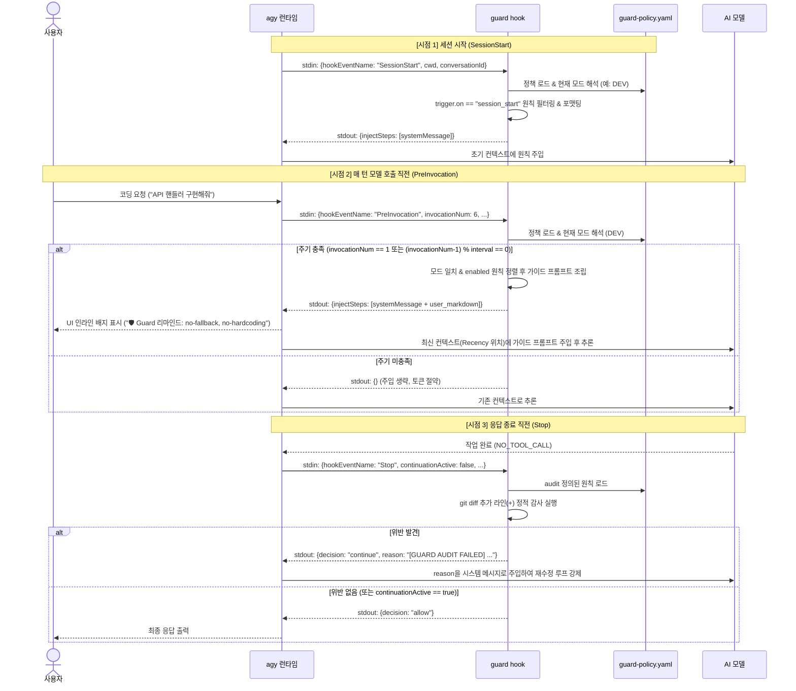
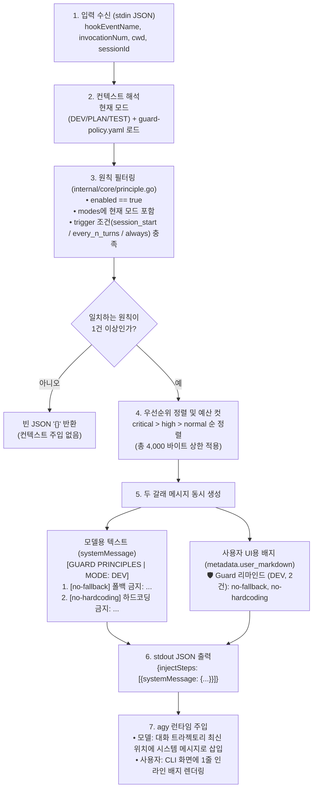

# 💬 00-live-chat

> Created by `chatlog` on 2026-11-20 01:16:33

---

## 🧑‍💻 User · `2026-11-19 22:09:18` {#step-0}

@[doc/04_development_plan.md] 기반으로 개발을 진행하겠습니다. 
Phase 1 개발 진행해주세요.

---

## 🤖 Antigravity · `2026-11-19 22:13:16` {#step-23}

[04_development_plan.md](file:///home/yundream/mytask/kms/guard/doc/04_development_plan.md)의 **Phase 1: Guard 코어 엔진 구축 (`internal/core`)** 개발을 완료했습니다.

### 구현 산출물
- [go.mod](file:///home/yundream/mytask/kms/guard/go.mod) / [go.sum](file:///home/yundream/mytask/kms/guard/go.sum): Go 모듈(`module guard`) 초기화 및 기존 `main.go` 의존성(`gopkg.in/yaml.v3`) 정리.
- [evaluator.go](file:///home/yundream/mytask/kms/guard/internal/core/evaluator.go): `Rule`, `Policy`, `Decision` 도메인 모델 및 순수 판정 오케스트레이터 `Evaluate(mode, policy, toolName, targetPath, cmdLine)` 구현 (`ALL`/`QA` 우회, 파일 도구 및 셸 명령어 통합 평가).
- [matcher.go](file:///home/yundream/mytask/kms/guard/internal/core/matcher.go): 파일 접미사(`*_test.go`), 기본 Glob(`*.ts`), 다중 와일드카드(`**/tests/**`, `src/internal/**`), 디렉토리 경계 오탐 방지 및 `exclude_patterns` 예외 매칭 구현.
- [command.go](file:///home/yundream/mytask/kms/guard/internal/core/command.go):
  - 따옴표·이스케이프를 고려한 복합 셸 연산자(`;`, `&&`, `||`, `|`, `\n`) 세그먼트 분리 파서 구현.
  - 세그먼트 단위 안전 명령어 화이트리스트(`git status`, `git branch`, `git commit`, `git log` 요약, `go build`, `go vet`) 판별로 접두사 우회(`git status && cat ...`) 차단.
  - 읽기 우회 탐지(파일 뷰어 `cat/head/tail/more/less/strings` 등, 입력 리다이렉션 `<`, `git show/diff/checkout/log -p`, 인라인 스크립트 `python -c`/`node -e`/`bash -c`) 및 쓰기 우회 탐지(`>`, `>>`, `tee`, `sed -i`, 인라인 스크립트) 구현.
- [evaluator_test.go](file:///home/yundream/mytask/kms/guard/internal/core/evaluator_test.go): 패턴 매칭, 모드별(`DEV`, `PLAN`, `TEST`, `ALL`/`QA`) 파일 도구 판정, 셸 우회 패턴에 대한 테이블 기반 단위 테스트 작성.

### 검증 결과
- `go test -v ./internal/core/...`: 전체 통과 (`TestMatchPattern`, `TestEvaluate_FileTools`, `TestEvaluate_CommandRules`, `TestEvaluate_NilPolicy` — 0.005s)
- `go test ./... && go build ./...`: 통과

다음으로 **Phase 2 (`internal/hub` 상태 및 정책 허브 구축)** 진행이 필요하시면 말씀해 주세요.

---

## 🧑‍💻 User · `2026-11-19 22:13:58` {#step-24}

Phase 1 단계에서 어떤 기능을 사용할 수 있나요.

---

## 🤖 Antigravity · `2026-11-19 22:13:58` {#step-25}

Phase 1에서는 외부 I/O나 UI에 연결되지 않은 **순수 Go 판정 엔진(`guard/internal/core` 패키지)**이 완성되었습니다.

### 1. Phase 1에서 사용 가능한 기능 (코어 라이브러리 & 테스트)
현재 `internal/core` 패키지를 통해 아래 기능을 코드 호출 및 단위 테스트(`go test -v ./internal/core/...`)로 바로 사용할 수 있습니다.

- **정책 통합 판정 (`core.Evaluate`)**: `(모드, 정책, 도구명, 대상 경로, 셸 명령어)`를 입력받아 `Decision{Allowed, RuleName, Reason}` 반환
- **경로 패턴 매칭 (`core.MatchPattern`)**:
  - 접미사(`*_test.go`, `*.spec.ts`), 기본 Glob(`*.ts`), 다중 와일드카드(`**/tests/**`, `src/internal/**`)
  - 예외 패턴(`exclude_patterns`) 우선 허용 (`TEST` 모드에서 테스트/계약 파일 예외 등)
- **파일 도구 검사**: `DEV`, `PLAN`, `TEST`, `ALL`/`QA` 모드별 `read_file`, `write_file`, `edit_file` 허용/차단
- **셸 명령어 우회 탐지**:
  - 복합 제어 연산자(`;`, `&&`, `||`, `|`, 줄바꿈) 분리 파싱
  - 안전 명령어 화이트리스트(`git status`, `git branch`, `git commit`, `git log` 요약, `go build`, `go vet`) 및 접두사 우회(`git status && cat ...`) 차단
  - 읽기 우회 차단: 뷰어(`cat`, `head`, `tail`, `more`, `less`, `strings` 등), 입력 리다이렉션(`<`), `git show/diff/checkout/log -p`, 인라인 스크립트(`python -c`, `node -e`, `bash -c` 등)
  - 쓰기 우회 차단: 리다이렉션(`>`, `>>`), `tee`, `sed -i`, 인라인 스크립트

### 2. 현재 CLI(`guard`)에서의 상태
- 루트의 기존 [main.go](file:///home/yundream/mytask/kms/guard/main.go)는 아직 그대로 유지되어 있으므로, `make build`로 빌드되는 바이너리는 **기존 기능(`guard dev|test|plan|all`, `status`, `run`, 기존 stdin 훅)**만 동작하며 새 `internal/core` 엔진과 아직 연결되어 있지 않습니다.
- 실제 터미널/훅에서 새 엔진을 사용하는 기능은 다음 단계에서 활성화됩니다:
  - **Phase 2 (`internal/hub`)**: 다중 경로 정책 로더, `~/.guard/sessions/*.json` 세션 관리 및 PID GC
  - **Phase 3 (`adapters/hook`, `adapters/launcher`, `cmd/guard`)**: 새 코어 엔진이 연결된 `guard hook`, `guard dev agy` 런처, `guard clean`
  - **Phase 4 (`adapters/tui`)**: `guard top` 실시간 TUI 관제탑

---

## 🧑‍💻 User · `2026-11-19 22:16:40` {#step-26}

사용자 관점에서 어떤 기능을 사용할 수 있냐고 묻는 겁니다. 직접 사용하면서 테스트하는게 목표입니다.

---

## 🤖 Antigravity · `2026-11-19 22:16:40` {#step-27}

사용자 관점(터미널에서 `guard` 명령어를 직접 실행해 테스트하는 관점)에서 말씀드리면, **Phase 1만 완료된 현재 시점에는 새로 직접 실행해서 테스트할 수 있는 사용자 기능은 아직 없습니다.**

이유는 [04_development_plan.md](file:///home/yundream/mytask/kms/guard/doc/04_development_plan.md)가 내부 코어부터 쌓아 올리는 Bottom-Up 방식이라, Phase 1에서는 CLI와 연결되지 않은 내부 판정 모듈(`internal/core`)만 먼저 구현했기 때문입니다.

### 현재 시점에 직접 실행해 볼 수 있는 것
1. **구버전 CLI (기존 기능 그대로)**
   - 루트의 기존 [main.go](file:///home/yundream/mytask/kms/guard/main.go)는 건드리지 않았으므로 `make build` 후 기존 기능(`guard dev|test|plan|all`, `guard status`, `guard run`, `echo '{...}' | ./guard`)은 실행되지만, **Phase 1에서 만든 새 엔진은 아직 연결되어 있지 않습니다.**
2. **코어 단위 테스트 실행**
   - `go test -v ./internal/core/...`로 새 판정 엔진의 허용/차단 결과를 확인하는 수준만 가능합니다.

### 직접 사용하면서 테스트할 수 있게 되는 시점
- **Phase 2 (`internal/hub`)**: 정책 로더와 세션/GC 저장소 구축 (아직 CLI 미연결)
- **Phase 3 (`adapters/hook`, `adapters/launcher`, `cmd/guard`)**: **이 시점부터 새 코어 엔진이 CLI에 연결되어 직접 사용·테스트 가능** (`guard dev agy` 런처 + 배너, `guard hook` 파이프 테스트, `guard status`, `guard clean`)
- **Phase 4 (`adapters/tui`)**: `guard top` TUI 관제탑을 직접 띄워 단축키(`D/T/P/A/C`)로 실시간 제어·테스트 가능

바로 **Phase 2 → Phase 3**까지 진행해서 직접 실행하며 테스트할 수 있는 상태로 만들까요?

---

## 🧑‍💻 User · `2026-11-19 23:05:12` {#step-28}

Phase 2 진행하세요.

---

## 🤖 Antigravity · `2026-11-19 23:10:36` {#step-43}

[04_development_plan.md](file:///home/yundream/mytask/kms/guard/doc/04_development_plan.md)의 **Phase 2: 상태 및 정책 허브 구축 (`internal/hub`)** 개발을 완료했습니다.

### 구현 산출물
- **정책 허브 (`internal/hub/policy`)**
  - [model.go](file:///home/yundream/mytask/kms/guard/internal/hub/policy/model.go): `core.Policy`/`core.Rule` 공유 모델 및 내장 기본 정책(`DefaultPolicy`) 정의.
  - [loader.go](file:///home/yundream/mytask/kms/guard/internal/hub/policy/loader.go): `guard-policy.yaml` 다중 경로 우선순위 탐색 (`GUARD_POLICY_PATH` ➔ `./guard-policy.yaml` ➔ `.agents/guard-policy.yaml` ➔ `~/.config/guard/guard-policy.yaml` ➔ 내장 Fallback) 및 손상된 YAML 안전 폴백 구현.
  - [policy_test.go](file:///home/yundream/mytask/kms/guard/internal/hub/policy/policy_test.go): 5단계 우선순위, 손상된 YAML 폴백, `core.Evaluate` 연동 테스트.
- **세션 & GC 허브 (`internal/hub/session`)**
  - [model.go](file:///home/yundream/mytask/kms/guard/internal/hub/session/model.go): `Session`, `Event` 모델 및 `MaxEvents = 50` 상수 정의.
  - [manager.go](file:///home/yundream/mytask/kms/guard/internal/hub/session/manager.go): `~/.guard/sessions/<id>.json` CRUD, 임시 파일 + `os.Rename` 기반 **Atomic Write**, `UpdateMode`, `ResetViolations`, 최대 50건 회전 및 `deny` 카운트 누적 `AppendEvent`, 손상된 JSON 격리 `List` 구현.
  - [gc.go](file:///home/yundream/mytask/kms/guard/internal/hub/session/gc.go): `process.Signal(syscall.Signal(0))` 기반 `IsProcessAlive` 및 고아 세션 자동 수거 `CleanStaleSessions` 구현.
  - [session_test.go](file:///home/yundream/mytask/kms/guard/internal/hub/session/session_test.go): `t.TempDir()` 기반 CRUD, Atomic Write, 60건 이벤트 회전/리셋, 실제 종료 프로세스 PID 자동 수거 테스트.

### 검증 결과
- `go test -v ./internal/hub/...`: 전체 통과 (`guard/internal/hub/policy`, `guard/internal/hub/session`)
- `go test ./... && go build ./...`: 통과

다음 **Phase 3 (`internal/adapters/hook`, `internal/adapters/launcher`, `cmd/guard`)**를 진행하면 `guard dev agy`, `guard hook`, `guard status`, `guard clean`을 터미널에서 직접 실행하며 테스트할 수 있게 됩니다. 진행할까요?

---

## 🧑‍💻 User · `2026-11-19 23:12:03` {#step-44}

승인

---

## 🤖 Antigravity · `2026-11-19 23:17:02` {#step-59}

[04_development_plan.md](file:///home/yundream/mytask/kms/guard/doc/04_development_plan.md)의 **Phase 3: 훅 & 런처 어댑터 및 CLI 라우터 통합** 개발을 완료했습니다.

### 구현 산출물
- **Hook 어댑터 (`internal/adapters/hook`)**
  - [payload.go](file:///home/yundream/mytask/kms/guard/internal/adapters/hook/payload.go): Antigravity `PreToolUse` 입출력 DTO 및 필드 추출 헬퍼.
  - [handler.go](file:///home/yundream/mytask/kms/guard/internal/adapters/hook/handler.go): stdin JSON 파싱 ➔ `SessionMgr` 모드 조회 ➔ `policy.Load` ➔ `core.Evaluate` 판정 ➔ `SessionMgr.AppendEvent` 기록 ➔ stdout JSON(`allow`/`deny`) 출력.
  - [handler_test.go](file:///home/yundream/mytask/kms/guard/internal/adapters/hook/handler_test.go): 차단 판정·이벤트 기록 및 세션 모드 오버라이드 단위 테스트.
- **Launcher 어댑터 (`internal/adapters/launcher`)**
  - [banner.go](file:///home/yundream/mytask/kms/guard/internal/adapters/launcher/banner.go): 실행 직전 모드별 차단/허용 범위·세션 ID·정책 출처 브리핑 배너 출력.
  - [launcher.go](file:///home/yundream/mytask/kms/guard/internal/adapters/launcher/launcher.go): 기동 전 고아 세션 GC, 자식 프로세스 PID 바인딩 세션 생성, 종료/시그널 시 `defer` 자동 정리.
- **CLI 라우터 및 루트 정리**
  - [main.go](file:///home/yundream/mytask/kms/guard/cmd/guard/main.go): `dev|test|plan|all [cmd...]`, `status`, `clean [--all]`, `reset <sessionId>`, `hook` 및 stdin 파이프 자동 감지 라우터 구현.
  - 기존 루트 `main.go` 제거 및 [Makefile](file:///home/yundream/mytask/kms/guard/Makefile) 빌드 타겟을 `./cmd/guard`로 업데이트.

### 검증 결과
- `make build` (`./guard` 생성) 및 `go test -v ./...` 전체 통과.
- 스모크 검증: `echo '{"sessionId":"p3-smoke",...}' | ./guard` ➔ `deny` JSON 출력, `~/.guard/sessions/p3-smoke.json` 생성·갱신, `./guard status` 테이블 출력, `./guard dev echo "launcher-ok"` 배너 출력 및 종료 시 세션 자동 삭제 확인.

### 지금 바로 직접 테스트해 볼 수 있는 기능
```bash
# 1. Zero-Config 런처 실행 (배너 출력 + 세션 자동 생성/종료 시 정리)
./guard dev agy          # 또는 테스트용으로 ./guard dev bash

# 2. 워크스페이스/세션 상태 및 정책 출처 확인
./guard status

# 3. 훅 파이프라인 직접 테스트 (DEV 모드 테스트 파일 차단 / 복합 셸 우회 차단)
echo '{"sessionId":"demo1","tool_name":"read_file","tool_args":{"Path":"pkg/auth_test.go"}}' | ./guard
echo '{"sessionId":"demo1","tool_name":"run_command","tool_args":{"CommandLine":"git status && cat pkg/auth_test.go"}}' | ./guard

# 4. 고아 세션 정리 / 전체 초기화
./guard clean
./guard clean --all
```

직접 테스트해 보신 뒤 **Phase 4 (`guard top` TUI 관제탑 구축 및 배포)** 진행을 원하시면 말씀해 주세요.

---

## 🧑‍💻 User · `2026-11-19 23:18:24` {#step-60}

사람이 직접 진행하는 E2E 테스트를 하려 합니다. qa 문서 만들어서 가이드 해주세요.

---

## 🤖 Antigravity · `2026-11-19 23:19:14` {#step-63}

사람이 터미널에서 직접 따라 하며 검증할 수 있는 E2E QA 가이드를 [05_qa_e2e_guide.md](file:///home/yundream/mytask/kms/guard/doc/05_qa_e2e_guide.md)에 작성했습니다.

### 포함된 QA 시나리오 요약
- **시나리오 1**: Zero-Config 런처(`guard dev bash`) 배너 출력, PID 바인딩, `exit` 시 자동 정리
- **시나리오 2**: DEV 모드 `read_file` 차단, 화이트리스트(`git status`, `go build`, `go test`), 셸 뷰어·와일드카드·복합 연산자(`&&`, `;`, `|`)·Git·인라인 스크립트(`python3 -c`, `node -e`) 우회 차단
- **시나리오 3**: PLAN 모드 소스 코드 쓰기(`write_file`, `>`, `tee`, `sed -i`) 차단 및 문서 허용
- **시나리오 4**: TEST 모드 프로덕션 코드 차단 및 `exclude_patterns`(`*_test.go`, `contract/**`, `testutil/**`) 허용
- **시나리오 5**: 세션 이벤트 누적 확인, 실시간 모드 전환(`DEV -> ALL`), 차단 카운트 리셋(`guard reset`)
- **시나리오 6**: `kill -9` 비정상 종료 후 `guard clean` 고아 세션 자동 수거(GC)
- **시나리오 7**: `GUARD_POLICY_PATH` 최우선 커스텀 정책 로드 검증
- **시나리오 8**: (선택) `make install` 후 실제 `guard dev agy` 연동 테스트 및 최종 체크리스트

문서를 따라 진행해 보시면서 이상 동작이나 개선이 필요한 부분이 있으면 바로 알려주세요.

---

## 🧑‍💻 User · `2026-11-19 23:22:30` {#step-64}

AI를 사용 해서 개발하지만 "코파일럿 사용하는 수준의 개발자에게 QA"를 맡긴다고 가정해 보겠습니다. 

QA 문서만 보고 이 개발자는 "이게 어떤 프로그램이고 각 단계를 밟아나가서 끝까지 가게 되면 내가 무엇을 할 수 있겠구나" 를 알 수 있을 문서를 만든다고 가정해 보세요. 

위의 가정하에 글, 다이어그램 등을 이용해서 문서를 업데이트 해주세요.

---

## 🤖 Antigravity · `2026-11-19 23:38:30` {#step-67}

[05_qa_e2e_guide.md](file:///home/yundream/mytask/kms/guard/doc/05_qa_e2e_guide.md)를 코파일럿 수준의 개발자도 문서만 보고 맥락·동작 원리·활용 가치를 파악하며 따라 할 수 있도록 전면 업데이트했습니다.

### 주요 보강 내용
1. **프로그램 개요 및 비유 (`1. 시작하기 전에`)**: 코파일럿(조수)과 자율 AI 에이전트(인턴 개발자)의 차이를 짚어 `guard`가 왜 필요한 "보안 검문소"인지 설명하고, **전체 동작 흐름 다이어그램(`flowchart LR`)**과 **4가지 모드(`DEV`/`PLAN`/`TEST`/`ALL`) 비교표**를 추가했습니다.
2. **QA 여정 지도 및 시뮬레이션 원리 (`2. QA 여정 지도`)**: Step 0~8 전체 흐름을 한눈에 보는 **로드맵 다이어그램(`flowchart TD`)**과, 왜 `echo '{...}' | ./guard`로 테스트하는지 설명하는 **시퀀스 다이어그램(`sequenceDiagram`)**을 추가했습니다.
3. **단계별 맥락 강화 (`3. 단계별 E2E QA 시나리오`)**: 각 Step마다 `🎯 확인하는 것(실제 상황 비유)`, `실행 명령어`, `✅ 기대 결과` 구조로 통일해 초보자도 각 명령의 의미를 이해하며 검증할 수 있게 정리했습니다.
4. **완주 후 달성 역량 (`4. 이 QA를 끝까지 완주하면 무엇을 할 수 있게 되나요?`)**: QA 완료 시점에 실무에서 `guard`로 할 수 있는 4가지 활용 역량과 최종 체크리스트를 정리했습니다.

---

## 🧑‍💻 User · `2026-11-19 23:39:10` {#step-68}

그럼 저는 여기에서 make install 로 설치하면 되나요 ?

---

## 🤖 Antigravity · `2026-11-19 23:39:10` {#step-69}

네, 맞습니다! 현재 디렉토리(`/home/yundream/mytask/kms/guard`)에서 `make install`을 실행하시면 됩니다.

- **설치 경로**: [Makefile](file:///home/yundream/mytask/kms/guard/Makefile) 설정에 따라 `~/.local/bin/guard`에 빌드 및 설치됩니다.
- **사용 방법**: `~/.local/bin`이 `PATH`에 포함되어 있다면 어느 디렉토리에서든 `./guard` 대신 `guard` 명령어로 바로 실행하실 수 있습니다. (`which guard`로 경로 확인 가능)
- **참고**: [05_qa_e2e_guide.md](file:///home/yundream/mytask/kms/guard/doc/05_qa_e2e_guide.md)의 `./guard` 명령어도 `make install` 후에는 `guard`로 동일하게 테스트하실 수 있습니다.

---

## 🧑‍💻 User · `2026-11-19 23:42:14` {#step-70}

그런데, 규칙을 어떻게 만들 수 있죠 ? 제가 메뉴얼을 보고 만드는 건 너무 많은 시간이 걸릴 거 같은데요.

---

## 🤖 Antigravity · `2026-11-19 23:42:14` {#step-71}

사실 **기본적으로 규칙을 직접 만드실 필요가 없습니다.**

### 1. 아무것도 안 만들어도 바로 동작합니다 (내장 기본 규칙)
`guard`에는 `DEV`(테스트 파일 열람 차단), `PLAN`(소스 코드 수정 차단), `TEST`(프로덕션 코드 열람 차단) 3가지 핵심 규칙이 이미 내장되어 있습니다. ([guard-policy.yaml](file:///home/yundream/mytask/kms/guard/guard-policy.yaml) / [model.go](file:///home/yundream/mytask/kms/guard/internal/hub/policy/model.go))

다른 프로젝트에서도 똑같이 쓰고 싶다면, 현재 폴더의 파일을 글로벌 위치에 한 번만 복사해 두면 끝납니다:
```bash
mkdir -p ~/.config/guard
cp /home/yundream/mytask/kms/guard/guard-policy.yaml ~/.config/guard/guard-policy.yaml
```

---

### 2. 규칙을 추가하고 싶을 때 가장 빠른 2가지 방법

#### 방법 A: AI에게 자연어로 시키기 (추천 — 매뉴얼 볼 필요 없음)
규칙 파일(`guard-policy.yaml`) 구조가 매우 단순하므로, `agy`에게 평소처럼 말로 시키시면 됩니다.
- 예: *"guard-policy.yaml에 DEV 모드에서 `.env` 파일과 `infra/` 폴더를 못 읽게 하는 규칙 추가해 줘"*
- 예: *"PLAN 모드에서 `Makefile` 수정도 막아줘"*

#### 방법 B: 6줄짜리 최소 블록만 복붙하기
직접 추가할 때도 알아야 할 필드는 딱 5~6개뿐입니다. 기존 [guard-policy.yaml](file:///home/yundream/mytask/kms/guard/guard-policy.yaml) 맨 아래에 아래 블록을 복붙해서 `mode`, `type`, `patterns`만 바꾸면 됩니다.

```yaml
  - name: "my-secret-guard"       # 규칙 이름 (자유롭게)
    mode: "DEV"                   # DEV | PLAN | TEST | ""(모든 모드)
    type: "read"                  # read(읽기 차단) | write(쓰기 차단)
    patterns:                     # 막을 파일/폴더 패턴
      - "*.env"
      - "**/secrets/**"
    message: "[POLICY VIOLATION] 비밀 설정 파일에는 접근할 수 없습니다."
```
*(특정 파일만 예외로 열어주고 싶을 때만 `exclude_patterns:`를 한 줄 추가하면 됩니다.)*

---

원하시면 추후에 `guard init` (현재 프로젝트에 기본 `guard-policy.yaml` 자동 생성)이나 `guard rule add` 같은 간편 명령어를 추가해 드릴 수도 있습니다.

---

## 🧑‍💻 User · `2026-11-19 23:43:07` {#step-72}

생성형 AI 를 통해서 만드는게 가장 좋다는 건가요 ?

---

## 🤖 Antigravity · `2026-11-19 23:43:07` {#step-73}

아니요. **현재 Phase 3까지 구현된 상태에서 가장 빠른 임시 방법**일 뿐, 제품 UX 관점에서 가장 좋은 방법은 아닙니다.

### AI에게 규칙 생성을 맡길 때의 한계
1. **신뢰·검증 문제**: AI가 `**/tests/**` 대신 `tests/*`처럼 패턴을 미묘하게 틀리게 작성해도, 직접 테스트해 보기 전까지는 구멍이 뚫린 걸 알기 어렵습니다.
2. **역할의 역설**: AI를 통제하기 위한 보안 규칙인데, 그 규칙을 매번 AI에게 맡기는 구조는 보안·거버넌스 관점에서 깔끔하지 않습니다.
3. **프로젝트별 반복 설명**: Go가 아닌 Python/TypeScript 프로젝트로 갈 때마다 폴더 구조를 다시 설명해야 합니다.

### 사용자 입장에서 더 좋은 방식
매뉴얼을 읽지 않고도 정확하게 규칙을 만들 수 있는 이상적인 흐름은 다음과 같습니다:

1. **자동 감지 프리셋 (`guard init`)**: 현재 프로젝트에 `go.mod`, `package.json`, `pyproject.toml` 등이 있는지 자동 감지해 언어/프레임워크에 맞는 `guard-policy.yaml`을 한 번에 생성.
2. **간편 추가 커맨드 (`guard rule add`)**: YAML 문법을 몰라도 CLI 옵션이나 대화형 질문(모드 선택 ➔ 읽기/쓰기 선택 ➔ 경로 입력)으로 규칙 추가.
3. **즉시 확인 (`guard check`)**: 규칙을 추가한 직후 `guard check DEV read .env` 한 줄로 "실제로 막히는지" 바로 검증.

지금은 Phase 4(`guard top` TUI 관제탑)가 남아 있는데, 필요하시면 위와 같은 **규칙 생성·검증 편의 기능(`guard init` / `guard check`)**도 함께 설계·추가할 수 있습니다.

---

## 🧑‍💻 User · `2026-11-19 23:46:07` {#step-74}

글쎄요. 솔직히 당신이 말하는 가이드는 너무 복잡합니다. 저라면 그냥 SKILL 에 guard 를 등록하고 자동으로 만들어달라고 할거 같은데요.

---

## 🤖 Antigravity · `2026-11-19 23:46:07` {#step-75}

맞습니다. 제가 오히려 불필요한 CLI 명령어를 늘리는 복잡한 방향을 제안드렸네요.

말씀하신 대로 **Antigravity Skill(`SKILL.md`)에 `guard`를 등록해 두는 방식**이 훨씬 깔끔하고 Agent-Native한 해법입니다:

1. **사용자 인지 부하 제로**: 새 CLI 옵션(`init`, `rule add` 등)이나 YAML 문법을 전혀 외울 필요 없이, 어떤 프로젝트에서든 *"이 프로젝트 구조에 맞게 guard 정책 만들어 줘"* 한 마디로 끝납니다.
2. **정확성·검증까지 자동화**: `SKILL.md`에 `guard-policy.yaml`의 정확한 스키마, 패턴 규칙(`**`, `exclude_patterns`), 그리고 **정책 생성 직후 `echo '{...}' | guard`로 실제 허용/차단 검증까지 수행하는 절차**를 한 번만 적어두면 AI의 실수(패턴 오작성 등)도 원천 차단됩니다.
3. **도구 본체의 단순성 유지**: `guard` 바이너리는 본연의 역할(초경량 차단 엔진 + 세션/런처/관제)에만 집중할 수 있습니다.

원하시면 바로 **`guard` 전용 Skill(`SKILL.md`)**을 만들어 드릴까요, 아니면 먼저 **Phase 4 (`guard top` TUI 관제탑)**를 진행할까요?

---

## 🧑‍💻 User · `2026-11-19 23:48:41` {#step-76}

생성형 AI가 만들도록 한다면 "sample"을 생성형 AI 에게 제공해야 할 것으로 보이는데요, guard help 를 하면 예제가 나오거나 하면 되지 않을까요? 이걸 퓨샷으로 해서 AI 가 만들게 하면 될 건데요. 아니면 guard doc 이라든가.

---

## 🤖 Antigravity · `2026-11-19 23:48:41` {#step-77}

정말 좋은 접근입니다. 별도 문서를 따로 관리할 필요 없이 **`guard` 바이너리 자체가 AI에게 Few-shot 샘플과 스펙을 직접 공급**하는 구조가 가장 깔끔합니다.

### 추천 구성: `guard help` + `guard doc`
- **`guard help`**: 사람이 볼 때 지저분하지 않도록 기존처럼 간결한 CLI 사용법만 유지 (하단에 `guard doc` 안내 한 줄 추가).
- **`guard doc`**: AI가 Few-shot 컨텍스트로 바로 읽고 `guard-policy.yaml`을 정확히 생성할 수 있도록 아래 내용을 stdout으로 출력:
  1. 정책 파일 탐색 경로 우선순위 (5단계)
  2. 규칙 스키마 및 패턴 문법 요약 (`*_test.go`, `**/dir/**`, `exclude_patterns`)
  3. **복사·응용 가능한 완성형 `guard-policy.yaml` 샘플** (DEV / PLAN / TEST)
  4. 생성 직후 테스트용 검증 명령 예시 (`echo '{...}' | guard`)

### 이 방식의 장점
1. **Skill이 초경량화됨**: `SKILL.md`에 긴 스펙을 중복 작성할 필요 없이 *"정책 생성/수정 전 `guard doc`을 실행해 샘플을 참조하라"* 몇 줄이면 끝납니다.
2. **항상 최신 스펙 유지**: `guard` 바이너리에 내장되므로 코드와 샘플이 어긋날 일이 없습니다.
3. **에이전트 비종속**: `agy`뿐만 아니라 다른 AI CLI에서도 `guard doc` 한 번 실행시키면 바로 규칙을 생성할 수 있습니다.

바로 `guard doc` 서브커맨드를 [main.go](file:///home/yundream/mytask/kms/guard/cmd/guard/main.go)에 추가해 드릴까요?

---

## 🧑‍💻 User · `2026-11-19 23:49:10` {#step-78}

승인

---

## 🤖 Antigravity · `2026-11-20 00:17:10` {#step-84}

[main.go](file:///home/yundream/mytask/kms/guard/cmd/guard/main.go)에 `guard doc` (별칭 `guard sample`) 서브커맨드를 추가하고 빌드를 완료했습니다.

### 변경 내용
- **`guard doc` (`guard sample`)**: AI 에이전트가 Few-shot 컨텍스트로 바로 참조해 `guard-policy.yaml`을 생성할 수 있도록 다음 정보를 stdout으로 출력합니다:
  1. 정책 파일 탐색 우선순위 (5단계)
  2. 규칙 스키마 및 패턴 문법 (`*_test.go`, `**/tests/**`, `exclude_patterns` 등)
  3. 완성형 `guard-policy.yaml` 샘플 (DEV / PLAN / TEST / 전역 Secret 보호 규칙)
  4. 생성 직후 검증용 명령어 예시 (`guard status`, `echo '{...}' | guard`)
- **`guard help`**: `guard doc` 사용법 안내 항목 추가.

### 확인 결과
- `make build` 성공 및 `./guard doc` 정상 출력 확인.
- `~/.local/bin/guard`에도 반영하려면 `make install`을 한 번 실행해 주시면 됩니다.

---

## 🧑‍💻 User · `2026-11-20 00:19:10` {#step-85}

E2E 시나리오도 수정해야 하지 않나요 ? 저라면 agy 를 이용해서 바로 SKILL 등록 해달라고 할 거 같은데요.

---

## 🤖 Antigravity · `2026-11-20 00:19:45` {#step-91}

[05_qa_e2e_guide.md](file:///home/yundream/mytask/kms/guard/doc/05_qa_e2e_guide.md)의 E2E 시나리오를 `guard doc` 및 `agy` Skill 등록 흐름에 맞게 업데이트했습니다.

### 변경 내용
- **QA 여정 지도 & 체크리스트**: Step 7을 `guard doc` Few-shot 샘플 확인 + `agy` Skill 연동 + `GUARD_POLICY_PATH` 검증 흐름으로 반영.
- **Step 7 세분화**:
  - **TC-7.1**: `./guard doc` 출력(탐색 우선순위, 스키마, Few-shot 샘플, 검증 명령어) 확인.
  - **TC-7.2**: `agy`에게 `guard doc` 기반 Skill 등록을 요청하고 자연어로 프로젝트 맞춤 `guard-policy.yaml`을 생성하는 실전 프롬프트 가이드 추가.
  - **TC-7.3**: 생성된 커스텀 정책이 `GUARD_POLICY_PATH`로 최우선 로드·차단되는지 검증.
- **완주 후 역량**: AI Skill 기반 자동 정책 생성 활용 항목으로 갱신.

---

## 🧑‍💻 User · `2026-11-20 00:20:03` {#step-92}

여기 까지 했으면 사용자는 사실상 guard agy 이렇게 해도 되는거 아닌가요 ?

---

## 🤖 Antigravity · `2026-11-20 00:20:03` {#step-93}

현재 [main.go](file:///home/yundream/mytask/kms/guard/cmd/guard/main.go)의 라우터는 `dev`, `test`, `plan`, `all` 같은 예약 서브커맨드만 인식하기 때문에, 지금 `guard agy`를 치면 `알 수 없는 서브커맨드: agy`가 출력됩니다.

하지만 말씀하신 대로 **`guard agy`를 지원하는 것이 훨씬 직관적**입니다.
- `default:` 분기에서 `exec.LookPath(args[0])`로 실제 실행 가능한 명령어(`agy`, `bash` 등)인지 확인한 뒤:
  - **존재하는 명령어라면**: 현재 워크스페이스 기본 모드(`readWorkspaceMode` — `.agents/current_mode` 또는 기본 `DEV`)로 즉시 런처 실행 (`guard agy` == 현재 모드로 `agy` 실행).
  - **존재하지 않는 단어(오타 등)라면**: 기존처럼 `알 수 없는 서브커맨드` 안내 출력.

이렇게 `guard agy` (기본 모드 즉시 실행) 지원을 추가해 드릴까요?

---

## 🧑‍💻 User · `2026-11-20 00:21:58` {#step-94}

guard agy 를 하면 어떤 일이 발생하나요. 이때 사용자에게 필요한 단계를 알려주면 되지 않나요 ? 아니면 guard 가 agy 에게 SKILL 등록을 요청해 버릴 수 도 있고, 즉 사용자가 guard agy 만 실행하면 알아서 SKILL 등록, 그리고 화면에 사용법 알려줄 수 있을 거 같은데 어떤가요. 그게 guard 위에 agy 를 실행하는 장점 아닐가요.

---

## 🤖 Antigravity · `2026-11-20 00:21:58` {#step-95}

정확히 핵심을 짚으셨습니다. **`guard`가 `agy`를 감싸서(Wrapper) 실행하는 진짜 가치가 바로 "완전 자동 부트스트랩(True Zero-Config)"**입니다.

`agy`에게 말로 Skill 등록을 요청할 필요조차 없이, **`guard agy`를 실행하면 `agy`가 켜지기 직전에 `guard`가 알아서 환경과 Skill을 준비해 두고 화면에 핵심 사용법까지 안내**할 수 있습니다.

### `guard agy` 실행 시 자동 수행 흐름
1. **기본 모드 자동 결정**: 모드를 생략(`guard agy`)하면 현재 워크스페이스 기본 모드(`.agents/current_mode`, 없으면 `DEV`)로 자동 진입.
2. **Skill 자동 설치 (최초 1회)**: `~/.gemini/antigravity-cli/skills/guard/SKILL.md`가 없으면 `guard`가 직접 생성 (`guard doc`을 참조해 정책을 자동 작성·검증하는 지침 내장). ➔ `agy`가 켜지자마자 `guard` Skill을 즉시 인식.
3. **훅 연동 상태 체크**: 현재 워크스페이스에 `PreToolUse` 훅 설정(`.agents/hooks.json`)이 빠져 있으면 배너에서 한 줄로 안내 (또는 자동 연결).
4. **시각적 브리핑 + 핵심 사용법 출력**:
   - 현재 활성 모드, 세션 ID, 차단/허용 범위
   - 바로 써먹을 수 있는 팁 (예: *"대화창에서 '이 프로젝트에 맞게 guard 정책 만들어 줘'라고 요청하세요 / 다른 터미널에서 `guard status`로 상태 확인"*)
5. **세션 PID 바인딩 & `agy` 기동** ➔ `agy` 종료 시 세션 파일 자동 정리.

이렇게 되면 사용자는 설정 문서를 읽을 필요 없이 **`guard agy` 딱 한 줄**로 설치·Skill 등록·가이드 확인·안전 실행까지 한 번에 끝낼 수 있습니다.

이 **`guard agy` 자동 부트스트랩(기본 모드 실행 + Skill 자동 생성 + 배너 사용법 안내)** 기능을 바로 구현할까요?

---

## 🧑‍💻 User · `2026-11-20 00:23:52` {#step-96}

guard 가 어떻게 skill 을 준해주는 건가요. guard 가 agy 에게 명령을 내리는 건가요. ?

---

## 🤖 Antigravity · `2026-11-20 00:23:52` {#step-97}

아니요, `guard`가 `agy`에게 명령을 내리거나 통신하는 방식이 아닙니다. **`agy`가 시작될 때 지정된 폴더에서 Skill 파일을 자동으로 읽어 들이는 원리**를 이용하는 것입니다.

### 동작 원리 (3단계)
1. **`agy`의 자동 스캔 규칙**: `agy`는 실행될 때 `~/.gemini/antigravity-cli/skills/<스킬명>/SKILL.md` 경로의 파일들을 자동으로 탐색해서 사용 가능한 Skill 목록으로 등록합니다.
2. **`guard`의 사전 파일 생성**: 사용자가 `guard agy`를 치면, `guard`가 `agy` 프로세스를 띄우기 **직전**에 `~/.gemini/antigravity-cli/skills/guard/SKILL.md` 파일이 있는지 확인하고 없으면 파일 하나를 생성해 둡니다 (`os.WriteFile`).
3. **`agy` 자동 인식**: 바로 이어서 `agy`가 실행되면서 방금 생성된 `SKILL.md`를 자동으로 읽어 들입니다.

즉, `guard`는 `agy`를 제어하는 게 아니라 **`agy`가 켜지기 직전에 정해진 자리에 안내서(`SKILL.md`) 한 장을 미리 놓아두는 것**뿐이며, 최초 1회 생성된 이후에는 이미 파일이 있으므로 건드리지 않고 그대로 통과합니다.

---

## 🧑‍💻 User · `2026-11-20 00:24:46` {#step-98}

해당 방식으로 코드 수정해주세요.

---

## 🤖 Antigravity · `2026-11-20 00:26:49` {#step-109}

`guard agy` 기본 모드 직접 실행 및 Antigravity Skill 자동 부트스트랩 기능을 구현했습니다.

### 변경 산출물
- [bootstrap.go](file:///home/yundream/mytask/kms/guard/internal/adapters/launcher/bootstrap.go):
  - `EnsureAgentSkill`: 런처 기동 직전 `~/.gemini/antigravity-cli/skills/guard/SKILL.md`가 없으면 최초 1회 자동 생성(이미 존재하면 사용자 수정 내용 보존).
  - `HasWorkspaceHook`: `.agents/hooks.json`에 `guard` 훅 등록 여부 확인.
- [banner.go](file:///home/yundream/mytask/kms/guard/internal/adapters/launcher/banner.go) / [launcher.go](file:///home/yundream/mytask/kms/guard/internal/adapters/launcher/launcher.go):
  - 프로세스 기동 전 `EnsureAgentSkill` 자동 수행.
  - Skill 최초 등록 알림, `agy` 실행 시 훅 미등록 경고, 대화창 정책 생성·관제 사용 팁을 배너에 함께 출력.
- [main.go](file:///home/yundream/mytask/kms/guard/cmd/guard/main.go):
  - `guard agy`, `guard bash`처럼 모드를 생략하고 실행 가능한 명령어를 넘기면 `exec.LookPath`로 확인 후 현재 워크스페이스 기본 모드(`.agents/current_mode` 또는 `DEV`)로 즉시 런처 실행.
- [bootstrap_test.go](file:///home/yundream/mytask/kms/guard/internal/adapters/launcher/bootstrap_test.go): Skill 최초 생성·기존 파일 보존 및 훅 감지 단위 테스트 추가.

### 검증 결과
- `make build` 및 `go test ./...` 전체 패키지 통과.
- `./guard echo "direct-launch-ok"` 실행 시 기본 모드(`DEV`) 진입, `/home/yundream/.gemini/antigravity-cli/skills/guard/SKILL.md` 자동 등록 배너 및 사용 팁 출력 확인.

---

## 🧑‍💻 User · `2026-11-20 00:28:49` {#step-110}

예를 들어서 제가 DEV 모드를 만들어주세요. DEV 모드에서는 *_test.go 에 접근 할 수 없습니다. 이런식으로 하면 되는 건가요 ?

---

## 🤖 Antigravity · `2026-11-20 00:28:50` {#step-111}

네, 정확히 그렇게 말씀하시면 됩니다!

### 실제 동작 흐름
1. 터미널에서 `guard agy` 실행 (`SKILL.md`가 이미 자동 등록된 상태로 `agy` 시작).
2. 대화창에 자연어로 요청:
   > *"guard 정책 만들어 주세요. DEV 모드에서는 `*_test.go`에 접근할 수 없습니다."*
   > *(예: "PLAN 모드에서는 `src/` 수정 금지, 모든 모드에서 `.env` 읽기 금지도 추가해 주세요.")*
3. `agy`가 자동으로 `guard` Skill을 활성화하여:
   - `guard doc`을 실행해 최신 스키마·샘플을 확인하고,
   - 프로젝트에 `./guard-policy.yaml`을 작성한 뒤,
   - `guard status`와 파이프 테스트(`echo '{...}' | AGENT_MODE=DEV guard`)로 실제 차단(`deny`)되는지 검증까지 끝내줍니다.

### 참고
- `DEV`, `PLAN`, `TEST` 모드는 `guard dev agy`, `guard plan agy`, `guard test agy`로 바로 실행할 수 있습니다.
- 만약 아예 새로운 커스텀 모드 이름(예: `REVIEW`)을 정책에 추가하셨다면 `guard run REVIEW agy` 형태로 실행하시면 됩니다.

---

## 🧑‍💻 User · `2026-11-20 00:35:22` {#step-112}

DEV 모드에서는 *_test.go 파일을 아예 읽을 수 없다고 했는데, 아래와 같은 명령을 실행하겠다고 하는데요. 잘못 된거 아닌가요 ?


Requesting permission for:
   echo '{"sessionId":"verify","tool_name":"read_file","tool_args":{"Path":"pkg/foo_test.go"}}' | AGENT_MODE=DEV guard
   echo '{"sessionId":"verify","tool_name":"read_file","tool_args":{"Path":"pkg/foo.go"}}' | AGENT_MODE=DEV guard

---

## 🤖 Antigravity · `2026-11-20 00:35:22` {#step-113}

**잘못된 것이 아니라 정상적인 검증 단계입니다!**

### 왜 이 명령어가 나오나요?
1. **실제로 파일을 읽는 명령어가 아닙니다**
   - `echo '{"sessionId":"verify",...}' | AGENT_MODE=DEV guard`는 디스크에서 `pkg/foo_test.go`를 여는 게 아니라, **가짜 JSON 요청 문자열**을 `guard`에 넣어 **"방금 만든 `guard-policy.yaml`이 제대로 작동하는지 모의 테스트"**하는 명령어입니다.
   - 첫 번째 줄: 테스트 파일(`pkg/foo_test.go`) 요청 시 `guard`가 **`deny`**를 반환하는지 확인
   - 두 번째 줄: 일반 코드(`pkg/foo.go`) 요청 시 `guard`가 **`allow`**를 반환하는지 확인
2. **`SKILL.md`의 4단계(즉시 검증) 지침에 따라 실행된 것입니다**
   - `guard`가 자동 설치한 `SKILL.md`에 *"정책 파일을 만든 뒤 `echo '{...}' | guard`로 허용/차단 여부를 직접 검증하라"*는 절차가 들어 있어 AI가 이를 수행하려는 것입니다.
3. **왜 `guard`가 이 `echo` 명령 자체는 막지 않았나요?**
   - `echo`는 파일을 읽지 않고 문자열만 출력하는 명령어이므로 차단 대상(`cat`, `head`, `git show`, `python -c` 등)이 아닙니다.

그대로 승인하시면 첫 번째 명령에서 `{"decision":"deny",...}`, 두 번째 명령에서 `{"decision":"allow"}`가 출력되며 정책 검증이 완료됩니다.

---

## 🧑‍💻 User · `2026-11-20 00:38:21` {#step-114}

테스트를 위해서 아래와 같이 지시를 했는데, test 파일을 읽었습니다. 검토해주세요.

> @[internal/adapters/hook/handler_test.go] 파일 분석해주세요.

○ Thought for 5.3s (The request to analyze `@[internal/adapters/hook/handler_test.go]` suggests a focus on the `guard` hook, potentially...)
● Explored 1 file (handler_test.go) (ctrl+o to expand)

▸ Thought for 8s, 733 tokens

  internal/adapters/hook/handler_test.go는 hook 패키지의 Handler가 PreToolUse JSON 페이로드를 처리해 정책 판정 및 세션 이벤트 기록을       
  수행하는지 검증하는 단위 테스트 파일입니다.                                                                                              
  
  (참고: 현재 세션에서는 read_file 호출이 guard 훅에 의해 차단되지 않고 파일이 정상적으로 읽혔습니다.)                                     
  
  테스트 구성                                                                                                                              
  
  1. TestHandler_DenyAndRecordEvent (L12-L55)
      • 목적: DEV 모드 세션에서 테스트 파일 읽기 시도 시 차단(deny)과 위반 기록 저장을 검증합니다.                                         
      • 시나리오:                                                                                                                          
          • 임시 디렉터리 기반 session.Manager에 DEV 모드 세션(sess-hook-1)을 생성합니다.                                                  
          • {"sessionId":"sess-hook-1","tool_name":"read_file","tool_args":{"Path":"pkg/auth_test.go"}} 페이로드를 h.Handle에 전달합니다.  
      • 검증 항목:                                                                                                                         
          • stdout JSON 응답이 decision: "deny"이고 reason이 비어 있지 않은지 확인합니다.                                                  
          • stderr에도 위반 메시지가 출력되었는지 확인합니다.                                                                              
          • 세션 저장소(mgr.Get("sess-hook-1"))에 ViolationCount == 1과 Events[0](Decision: "deny", Target: "pkg/auth_test.go")이          
          기록되었는지 확인합니다.                                                                                                         
  
  2. TestHandler_SessionModeOverridesWorkspace (L57-L86)
      • 목적: 세션 모드(ALL)가 워크스페이스 기본 정책보다 우선 적용되어 테스트 파일 접근이 허용되는지 검증합니다.                          
      • 시나리오:                                                                                                                          
          • ALL 모드 세션(sess-hook-2)을 생성합니다.                                                                                       
          • 중첩 스키마 형식(toolCall.name: "run_command", toolCall.args.CommandLine: "cat pkg/auth_test.go")의 페이로드를 전달합니다.     
      • 검증 항목:                                                                                                                         
          • stdout JSON 응답이 decision: "allow"인지 확인합니다.

---

## 🤖 Antigravity · `2026-11-20 00:39:01` {#step-123}

원인을 확인했습니다. **데이터상 2가지 원인**이 있습니다.

### 1. 직접 원인: `.agents/hooks.json`에 `guard` 훅이 등록되지 않음
현재 워크스페이스의 [hooks.json](file:///home/yundream/mytask/kms/guard/.agents/hooks.json)에는 `chatlog`의 `Stop` 훅만 있고 **`PreToolUse` 훅 자체가 없습니다**:
```json
{
  "chatlog": {
    "Stop": [
      {
        "type": "command",
        "command": "chatlog hook"
      }
    ]
  }
}
```
따라서 `agy`가 `read_file`을 실행할 때 `guard`를 아예 호출하지 않고 바로 파일을 읽었습니다. (배너에 떴을 `⚠️ [참고] 현재 워크스페이스에 .agents/hooks.json(PreToolUse -> guard) 설정이 감지되지 않았습니다.` 경고가 바로 이 원인입니다.)

### 2. 함께 확인된 연동 함정 (`hooks.json` 실행 디렉터리 문제)
Antigravity 공식 훅 명세([hooks.md](file:///home/yundream/.gemini/antigravity-cli/builtin/skills/agy-customizations/docs/hooks.md#L130-L131))를 확인한 결과:
- `agy`는 `PreToolUse` 훅을 실행할 때 **작업 디렉터리(`cwd`)를 `hooks.json`이 들어 있는 폴더(`.agents/`)로 설정**해서 실행합니다.
- 반면 실제 프로젝트 루트 경로는 stdin JSON의 `cwd` / `workspacePaths` 필드로 전달됩니다.
- 따라서 [handler.go](file:///home/yundream/mytask/kms/guard/internal/adapters/hook/handler.go)에서도 stdin JSON의 `cwd`를 정책 탐색 경로(`CWD`)로 반영해야 프로젝트 루트의 `./guard-policy.yaml`을 정확히 읽을 수 있습니다.

---

### 해결 방안 (권장)
1. **`.agents/hooks.json`에 `guard` `PreToolUse` 훅 등록** (또는 `guard agy` 부트스트랩 시 `SKILL.md`처럼 `.agents/hooks.json`에 자동 병합 등록):
   ```json
   "guard": {
     "PreToolUse": [
       {
         "matcher": "*",
         "hooks": [
           {
             "type": "command",
             "command": "guard hook"
           }
         ]
       }
     ]
   }
   ```
2. **[payload.go](file:///home/yundream/mytask/kms/guard/internal/adapters/hook/payload.go) / [handler.go](file:///home/yundream/mytask/kms/guard/internal/adapters/hook/handler.go) 보강**: `agy`가 stdin으로 넘겨주는 `cwd` / `workspacePaths`를 정책 로드 시 `CWD` 및 `WorkspaceRoot`로 사용하도록 수정.

위 2가지를 바로 적용해 드릴까요? (적용 후 `make install`하고 `guard agy`를 다시 띄워 같은 테스트를 하시면 즉시 차단됩니다.)

---

## 🧑‍💻 User · `2026-11-20 00:40:05` {#step-124}

승인

---

## 🤖 Antigravity · `2026-11-20 00:43:34` {#step-141}

수정 및 재설치(`~/.local/bin/guard`)를 완료했습니다.

### 변경 내용
1. **[.agents/hooks.json](file:///home/yundream/mytask/kms/guard/.agents/hooks.json)**: 기존 `chatlog` 설정을 유지하면서 `"guard"` `PreToolUse` (`matcher: "*"`, `command: "guard hook"`) 훅을 병합 등록했습니다.
2. **[bootstrap.go](file:///home/yundream/mytask/kms/guard/internal/adapters/launcher/bootstrap.go) / [launcher.go](file:///home/yundream/mytask/kms/guard/internal/adapters/launcher/launcher.go) / [banner.go](file:///home/yundream/mytask/kms/guard/internal/adapters/launcher/banner.go)**:
   - `guard agy` 실행 시 워크스페이스에 `guard` 훅이 없으면 `.agents/hooks.json`에 기존 훅을 보존하며 자동 병합 등록하는 `EnsureWorkspaceHook` 추가.
   - [bootstrap_test.go](file:///home/yundream/mytask/kms/guard/internal/adapters/launcher/bootstrap_test.go)에 병합 및 중복 방지 단위 테스트 추가.
3. **[payload.go](file:///home/yundream/mytask/kms/guard/internal/adapters/hook/payload.go) / [handler.go](file:///home/yundream/mytask/kms/guard/internal/adapters/hook/handler.go)**:
   - `agy`가 stdin으로 전달하는 `cwd` / `workspacePaths`를 정책 탐색 경로(`CWD`, `WorkspaceRoot`)로 우선 반영해 `.agents/`에서 훅이 실행되더라도 루트의 `./guard-policy.yaml`을 정확히 로드하도록 수정.
   - `GUARD_SESSION_ID` 환경변수를 `conversationId`보다 우선해 런처가 생성한 세션 파일과 훅 이벤트 기록이 하나의 세션으로 일관되게 연동되도록 보강.

### 검증 결과
- `make build && make install` (`~/.local/bin/guard` 갱신 완료) 및 `go test ./...` 전체 통과.

이제 `guard dev agy` (또는 `guard agy`)를 새로 실행하신 뒤 `@[internal/adapters/hook/handler_test.go] 파일 분석해주세요.`를 다시 테스트해 보시면 `read_file`이 즉시 차단됩니다.

---

## 🧑‍💻 User · `2026-11-20 00:44:47` {#step-142}

깨끗한 상태에서 테스트하고 싶습니다. chatlog-status.json 은 제가 지웠는데, SKILL 이나 hooks.json 도 정리해주세요.

---

## 🤖 Antigravity · `2026-11-20 01:16:14` {#step-145}

깨끗한 초기 상태로 정리했습니다.

### 정리 완료 항목
- `~/.gemini/antigravity-cli/skills/guard` 삭제 (Skill 초기화)
- `/home/yundream/mytask/kms/guard/.agents/hooks.json` 삭제 (`.agents/` 비어 있음)
- `~/.guard/sessions/` 기존 세션 2건 삭제 (`guard clean --all`)

이제 터미널에서 `guard agy` (또는 `guard dev agy`)를 실행하시면 배너에 **Skill 자동 등록**과 **PreToolUse 훅 자동 등록**이 동시에 수행되면서 깨끗한 상태로 E2E 테스트를 시작하실 수 있습니다.

---

## 🧑‍💻 User · `2026-11-23 12:55:10` {#step-0}

저는 AI 에게 지속적으로 가드레일 명령을 내립니다. 예를 들어서 "개발 원칙은 1. 폴백하지 말라, 2. 하드코딩 하지 말라" 등입니다.

AGENTS.md 에 기술해도 잊어버릴 것이기 때문에, 매번 코딩 할때마다 이를 명시하고 있습니다. 해결 및 완화 방안 알려주세요.

---

## 🤖 Antigravity · `2026-11-23 12:55:35` {#step-6}

AI가 `AGENTS.md`의 규칙을 잊어버리는 이유는 구조적입니다. 대화가 길어질수록 초기 시스템 프롬프트의 주의력(attention)이 떨어지는 **컨텍스트 희석(Lost in the Middle)** 현상이 발생하고, 에러를 해결하려는 모델의 기본 성향("어떻게든 동작하게 만들기")이 자연어 금지 규칙을 덮어쓰기 때문입니다.

따라서 **"AI가 기억하게 만드는 것"에서 "시스템이 자동으로 리마인드·검증·차단하게 만드는 것"으로 전환**하는 것이 가장 효과적입니다. 적용 효과가 큰 순서대로 정리합니다.

---

### 1. 매번 직접 적는 대신 `PreInvocation` Hook으로 자동 주입 (즉시 적용)
사용자가 매번 프롬프트에 원칙을 반복 입력하는 행위를 **훅(Hook)으로 자동화**하면, 모델 호출 직전(가장 최신 컨텍스트 위치)에 핵심 원칙을 주입할 수 있습니다.

Antigravity에서는 `.agents/hooks.json`의 `PreInvocation` 이벤트를 활용합니다.

```json
{
  "core-principles-reminder": {
    "PreInvocation": [
      {
        "type": "command",
        "command": "./scripts/inject-principles.sh"
      }
    ]
  }
}
```

* **핵심 팁**: 매 호출마다 무조건 주입하면 대화가 누적되어 토큰만 낭비됩니다. 스크립트에서 stdin으로 들어오는 `invocationNum`을 확인해 **주기적으로(예: N턴마다 한 번)** 짧은 `systemMessage`를 주입하는 방식이 효율적입니다.
* **효과**: 사람이 반복 입력하지 않아도, 최신 컨텍스트 영역(recency)에 규칙이 유지되어 망각이 크게 줄어듭니다.

---

### 2. "기억" 대신 "결정론적 차단/검증"으로 전환 (가장 확실한 해결책)
"폴백 금지", "하드코딩 금지" 같은 규칙은 **자연어 지시보다 정적 검사 + Hook 게이트**로 잡을 때 준수율이 압도적으로 높습니다.

1. **정적 검사/린트 규칙화**
   * **하드코딩 금지**: ESLint(`no-magic-numbers`), Ruff, Semgrep, 또는 간단한 regex/AST 스크립트로 URL·시크릿·매직 넘버·임시 경로 감지
   * **폴백 금지**: 빈 `catch {}`, `except: pass`, 불허용된 `|| defaultValue` / `?? fallback` 패턴을 Semgrep이나 커스텀 린트 규칙으로 에러 처리
2. **`Stop` Hook 또는 `PreToolUse` Hook으로 자동 검증**
   * **`Stop` Hook**: AI가 작업을 마치고 응답을 끝내려 할 때(`NO_TOOL_CALL`), `git diff`에 대해 위 검사 스크립트를 실행합니다. 위반이 발견되면 `{"decision": "continue", "reason": "diff에서 하드코딩/폴백 패턴 발견: ... 수정하세요"}`를 반환해 **AI가 스스로 고칠 때까지 종료를 막습니다.**
   * **`PreToolUse` Hook**: 파일 수정(`edit_file`, `write_file`) 직전 파라미터를 검사해 명백한 금지 패턴이 포함되면 `{"decision": "deny", "reason": "..."}`로 즉시 차단합니다.

---

### 3. 작성자와 검증자 분리 (Diff 전용 감사)
코드를 작성한 직후의 모델은 본인이 넣은 폴백이나 하드코딩을 "임시 처리/예외 방어"로 합리화하는 경향이 강합니다.

* **리뷰 전용 서브에이전트/체크 단계 분리**: 구현이 끝나면 `git diff`만 읽고 **"오직 1) 폴백 유무, 2) 하드코딩 유무만 찾아라"**라는 단일 목적의 검토를 수행하게 합니다.
* 목적이 좁아질수록(단일 관점 리뷰) 모델의 위반 탐지율이 급격히 올라갑니다.

---

### 4. `AGENTS.md` 작성법 및 컨텍스트 관리 개선 (완화책)
`AGENTS.md` 자체의 효력을 높이려면 아래 3가지를 지키는 것이 중요합니다.

1. **부정형("하지 마라") + 구체적 대안("대신 이렇게 하라")을 세트로 작성**
   * ❌ `1. 폴백하지 말라. 2. 하드코딩하지 말라.`
   * ✅ `1. 폴백 금지: 값이 없거나 실패하면 기본값으로 넘기지 말고 즉시 명시적 에러를 throw/반환하라.`
   * ✅ `2. 하드코딩 금지: 설정값·URL·상수는 env/config로 분리하고, 값이 불명확하면 임의 값을 넣지 말고 작업을 멈추고 사용자에게 질문하라.`
   * 대안이 없으면 AI는 막혔을 때 습관적으로 폴백/하드코딩으로 회귀합니다.
2. **절대 원칙은 3~5개로 압축해 최상단 배치**
   * 규칙 파일이 길어질수록 개별 규칙의 준수율이 떨어집니다. 자주 어기는 핵심 원칙 몇 개만 짧게 두고, 세부 컨벤션은 디렉터리별 하위 `AGENTS.md`나 온디맨드 스킬(`.agents/skills/`)로 분리하세요.
3. **긴 세션 방치 금지**
   * 작업 단위가 바뀔 때마다 새 세션을 열거나, 대화가 길어지면 `/compact`로 컨텍스트를 정리해 초기 규칙이 밀려나지 않도록 관리하세요.

---

### 추천 도입 순서
1. **당장 체감 효과**: `AGENTS.md`의 원칙을 **금지 + 대안** 형태로 짧게 다듬기
2. **반복 입력 제거**: `.agents/hooks.json`에 `PreInvocation` 리마인더 또는 `Stop` Hook(`git diff` 자동 검사) 추가
3. **완전 자동화**: 자주 발생하는 하드코딩/폴백 패턴을 Semgrep/Linter 규칙으로 등록해 Hook과 연결

원하시면 현재 워크스페이스에 바로 쓸 수 있는 **`.agents/hooks.json` + `git diff` 기반 폴백/하드코딩 검사 스크립트** 초안을 만들어 드릴까요?

---

## 🧑‍💻 User · `2026-11-23 12:57:58` {#step-7}

그러한 프롬프트 규칙도 일종의 가드레일이라고 볼 수 있습니다. agy 와 같은 툴을 이용할 때, 힘든 점은 그러한 기능이 숨어 있어서 관리하기가 쉽지 않다는 점입니다.

---

## 🤖 Antigravity · `2026-11-23 12:58:07` {#step-10}

정확한 지적입니다. 실제로 `agy` 같은 에이전트 CLI에서 프롬프트 기반 가드레일이 관리하기 어려운 이유는 **기능이 없어서가 아니라, 추상화와 가시성이 빠져 있기 때문**입니다.

### 왜 관리하기 힘들게 느껴지는가
1. **설정의 파편화**: 정적 규칙(`AGENTS.md`, `.agents/rules/`), 런타임 훅(`.agents/hooks.json`), 글로벌 설정(`~/.gemini/config/`)이 서로 다른 경로와 포맷으로 흩어져 있습니다.
2. **가시성(Observability) 부재**: 현재 세션에 어떤 원칙이 활성화되어 있는지, 실제로 모델에게 전달되었는지, 컨텍스트에서 밀려났는지 사용자가 확인할 방법이 없습니다.
3. **Hard / Soft 가드레일의 단절**: "이 파일/명령은 금지(`PreToolUse`)"와 "폴백·하드코딩 금지(`PreInvocation` / `Stop`)"는 본질적으로 같은 **가드레일 정책**인데, 구현 방식이 완전히 분리되어 있어 매번 사람이 배관(JSON 스펙, 셸 스크립트)을 직접 짜야 합니다.

---

### 해결 방향: 프롬프트 규칙을 "1급 가드레일 정책"으로 승격

지금 작업 중이신 `guard` 같은 레이어에서 **Hard 가드레일(툴 차단)**과 **Prompt 가드레일(원칙 주입·검증)**을 하나의 정책 파일(`guard-policy.yaml`)과 CLI로 통합하면 이 문제가 깔끔하게 해소됩니다.

#### 1. 단일 정책 파일(Single Source of Truth)로 통합
사용자가 `.agents/hooks.json`의 `PreInvocation`·`Stop` 스펙을 몰라도, 정책 YAML 한 곳에서 모드별(`DEV`, `PLAN`, `TEST`)로 프롬프트 원칙을 선언하고 관리합니다.

```yaml
# 개념 예시 (guard-policy.yaml 확장)
prompt_guardrails:
  DEV:
    remind_every: 5          # N턴마다 자동 리마인드 (0이면 세션 시작 시 1회)
    rules:
      - id: no-fallback
        text: "폴백 금지: 실패/누락 시 기본값으로 넘기지 말고 명시적 에러를 반환하라."
        level: remind        # remind | audit | block
      - id: no-hardcoding
        text: "하드코딩 금지: 설정값/URL/상수는 env 또는 config로 분리하고 불명확하면 질문하라."
        level: audit         # Stop 훅에서 diff 패턴 체크까지 연계
```

#### 2. 훅 배관(Plumbing)의 완전 은닉
* `.agents/hooks.json`에는 `guard` 바이너리 하나만 각 라이프사이클(`PreToolUse`, `PreInvocation`, `Stop`)에 연결해 두고, 실제 규칙 추가·수정·비활성화는 전부 `guard-policy.yaml` 또는 CLI(`guard rule add/list/toggle`)로만 수행합니다.
* 사용자는 "어떤 훅 이벤트를 써야 하는지" 고민할 필요 없이 **원칙 자체**에만 집중할 수 있습니다.

#### 3. "숨어 있음"을 없애는 가시성 확보
* **`guard status` 확장**: 현재 적용 중인 경로/명령 차단 규칙과 함께 **활성 프롬프트 원칙 목록·주입 주기·모드**를 한눈에 출력합니다.
* **인라인 상태 표시**: `agy`의 `PreInvocation` 훅은 `systemMessage`와 별도로 `metadata.user_markdown`을 지원합니다. 원칙이 리마인드될 때 UI에 한 줄로(예: `🛡️ Guard: DEV 원칙 2건 리마인드됨 (no-fallback, no-hardcoding)`) 표시해 주면 "지금 가드레일이 살아 있다"는 확신을 줄 수 있습니다.

#### 4. 강제 수준의 단계화 (`remind` → `audit` → `block`)
* **`remind`**: `PreInvocation`에서 주기적으로 원칙을 최신 컨텍스트에 주입
* **`audit`**: `Stop` 훅에서 `git diff`를 검사해 위반 의심 시 종료를 막고 수정 요청
* **`block`**: `PreToolUse`에서 명백한 위반 패턴(예: 금지된 하드코딩 시크릿/패턴)을 즉시 `deny`

---

혹시 현재 워크스페이스의 `guard` 도구에 이런 **프롬프트 가드레일(리마인더/원칙 관리)** 기능을 정식으로 통합하는 방향을 고민 중이신가요? 원하시면 현재 `guard` 구조를 확인해서 스키마와 훅 연동 설계안을 구체적으로 잡아드릴 수 있습니다.

---

## 🧑‍💻 User · `2026-11-23 13:06:22` {#step-11}

각 종 리마인더/원칙 관리를 통합하기 위한 설계 문서 작성해주세요.

---

## 🤖 Antigravity · `2026-11-23 13:08:11` {#step-27}

기존 `guard` 아키텍처와 문서 체계를 이어받아 통합 리마인더 및 프롬프트 가드레일 설계 문서를 작성했습니다.

- **문서 위치**: [10_prompt_guardrail_design.md](file:///Users/stagefive/kms/guard/doc/10_prompt_guardrail_design.md)

### 핵심 설계 요약
1. **단일 정책 파일 통합 (`guard-policy.yaml`)**: 기존 `rules:`(Hard Guardrail)와 100% 하위 호환되면서 `principles:` 섹션에 모드별 개발 원칙, 리마인드 주기(`session_start`, `every_n_turns`, `always`), 종료 전 감사(`diff_regex`, `command`)를 한곳에서 선언합니다.
2. **훅 배관 은닉 (`guard hook` 멀티 이벤트 디스패치)**: `.agents/hooks.json`에는 `guard hook` 단일 명령만 `PreToolUse` / `PreInvocation` / `Stop`에 연결하고(`guard init` 자동 병합, `guard doctor` `DOC-007` 진단), 내부에서 `hookEventName`으로 자동 분기합니다.
3. **가시성 확보**: `guard principle list/add/enable/disable/test` CLI, `guard status` 요약, `PreInvocation` 주입 시 1줄 인라인 배지(`metadata.user_markdown`), `guard top` TUI 이벤트 추적을 통해 "숨어 있는 규칙" 문제를 해소합니다.
4. **안전장치**: `Stop` 감사는 `git diff`의 추가 라인(`+`)만 검사해 레거시 오탐을 막고, `continuationActive` 체크로 무한 루프를 원천 차단하며, 오류 시 Fail-Open 원칙을 유지합니다.

설계 내용 중 스키마 이름(`principles` 등)이나 동작 방식에서 조정하고 싶은 부분이 있으면 말씀해 주세요. 확정되면 Phase 1부터 바로 구현하거나, `DEV` 세션으로 핸드오프할 수 있습니다.

---

## 🧑‍💻 User · `2026-11-23 13:58:01` {#step-28}

가이드 프롬프트가 언제 어떻게 만들어지고, 어떻게 주입되는지 다이어그램으로 나타내 주세요.

---

## 🤖 Antigravity · `2026-11-23 13:58:01` {#step-29}

가이드 프롬프트가 **언제(라이프사이클 시점)** 트리거되고, **어떻게(조립 파이프라인)** 만들어져 모델 컨텍스트에 주입되는지 두 개의 다이어그램으로 정리했습니다.

---

### 1. 언제 만들어지고 주입되는가 (전체 라이프사이클)

`agy` 런타임이 세션 시작·모델 호출 직전·종료 직전마다 `guard hook`을 호출하며, 각 시점에 맞는 가이드 프롬프트를 동적으로 생성해 주입합니다.



---

### 2. 어떻게 가이드 프롬프트가 조립·주입되는가 (내부 생성 파이프라인)

`guard hook`이 호출되었을 때 `guard-policy.yaml`의 선언 데이터가 실제 모델용 프롬프트(`systemMessage`)와 사용자용 배지(`user_markdown`)로 변환되는 과정입니다.



---

### 핵심 포인트 요약
- **생성 시점**: 미리 정적 파일(`AGENTS.md`)에 박아두는 것이 아니라, `PreInvocation` 시점에 **현재 모드(`DEV`/`PLAN`/`TEST`)와 턴 번호(`invocationNum`)에 맞춰 즉석에서 동적 조립**합니다.
- **주입 위치**: `agy`가 `injectSteps`로 받은 `systemMessage`를 대화의 **가장 최신 위치(Recency Position)**에 삽입하므로, 초기 시스템 프롬프트보다 주의력(Attention)이 훨씬 높게 유지됩니다.
- **이중 출력**: `systemMessage` 본문은 모델에게만 전달되고, `metadata.user_markdown`은 사용자 UI에 1줄 배지로 렌더링되어 "지금 어떤 가이드 프롬프트가 주입되었는지" 숨김없이 확인할 수 있습니다.

원하시면 이 다이어그램 두 개를 [10_prompt_guardrail_design.md](file:///Users/stagefive/kms/guard/doc/10_prompt_guardrail_design.md) 본문에도 함께 반영해 드릴까요?

---

## 🧑‍💻 User · `2026-11-23 13:58:35` {#step-30}

승인

---

## 🤖 Antigravity · `2026-11-23 13:58:53` {#step-35}

[10_prompt_guardrail_design.md](file:///Users/stagefive/kms/guard/doc/10_prompt_guardrail_design.md#L176-L242)의 `4.2 가이드 프롬프트 생성 및 주입 흐름` 섹션에 두 다이어그램(전체 라이프사이클 시퀀스 다이어그램, 내부 조립 파이프라인 플로우차트)을 반영했습니다.

---

## 🧑‍💻 User · `2026-11-24 10:55:44` {#step-0}

https://github.com/alibaba/open-code-review 는 AI 리뷰 애플리케이션이라고 합니다. 분석해주세요.

---

## 🤖 Antigravity · `2026-11-24 10:56:24` {#step-8}

**`alibaba/open-code-review`**(CLI 명령어: `ocr`)는 알리바바(Alibaba Group)가 사내에서 약 2년간 수만 명의 개발자와 수백만 건의 코드 변경을 대상으로 실전 검증한 뒤 Apache-2.0 라이선스로 공개한 **오픈소스 AI 코드 리뷰 CLI 도구**입니다.

---

### 1. 프로젝트 개요 및 기술 스택
* **목적**: 범용 코딩 에이전트(Claude Code 등)에 코드 리뷰를 통째로 맡길 때 자주 발생하는 **파일 누락, 라인 번호 밀림(Position Drift), 과도한 오탐(False Positive), 높은 토큰 비용** 문제를 해결하기 위해 설계되었습니다.
* **기술 스택**: 코어는 **Go(Golang)**로 작성되었으며, `npm`(`@alibaba-group/open-code-review`) 및 GitHub Release 바이너리로 배포됩니다.
* **지원 모델/프로토콜**: OpenAI 호환 API, Anthropic API, AWS Bedrock 등을 지원해 Claude, GPT, Qwen, DeepSeek 등 다양한 모델과 연동할 수 있습니다.

---

### 2. 핵심 아키텍처: 하이브리드(Hybrid) 구조
이 프로젝트의 가장 큰 기술적 특징은 **결정론적(Deterministic) 엔지니어링 파이프라인**과 **LLM 에이전트**의 역할을 명확히 분리한 점입니다.

1. **결정론적 파이프라인 (코드 영역)**
   * Git diff 파싱, 리뷰 대상 파일 필터링, 파일 번들링(Smart Bundling), 언어/경로별 룰 매칭 등 정확성이 필수적인 작업을 코드로 처리합니다.
   * 대규모 PR에서도 파일이 누락되지 않도록 보장하며, 파일/번들 단위로 컨텍스트를 격리해 토큰 낭비를 막습니다.
2. **LLM 에이전트 레이어 (추론 영역)**
   * 파이프라인이 준비해 준 변경분과 매칭된 룰, 비즈니스 배경을 바탕으로 **결함 추론과 컨텍스트 탐색**에만 집중합니다.
3. **후처리 및 라인 위치 검증 모듈**
   * LLM이 생성한 리뷰 코멘트를 실제 Git diff의 정확한 물리적 라인 번호에 재매핑·검증하여, LLM 리뷰에서 흔한 라인 위치 어긋남 문제를 해소합니다.

---

### 3. 주요 기능 및 운영 방식

* **CLI 워크플로우 (`ocr`)**
  * `ocr review`: 현재 워킹 트리(staged/unstaged), 특정 커밋(`--commit`), 브랜치 간 비교(`--base`, `--head`) 리뷰
  * `ocr review -b "<맥락>"`: 비즈니스 배경(`--background`)을 함께 전달해 의도 기반 리뷰 정확도 향상
  * `ocr scan <path>`: Git diff가 없는 레거시 코드나 특정 디렉터리 전체 감사
  * `ocr review --preview`: LLM 호출 없이 파일 선택·필터링 범위만 사전 확인(토큰 비용 0)
* **다국어 빌트인 룰셋 & 룰 라우팅**
  * NPE(Null Pointer Exception), Thread-safety, XSS, SQL Injection 등 고위험 결함을 겨냥한 다국어 룰을 내장하고 있으며, 파일 특성에 맞는 룰만 결정론적으로 주입합니다.
* **Delegation Mode(위임 모드) 및 에이전트/IDE 통합**
  * 별도의 LLM API 키를 설정하지 않고도 **Claude Code, Cursor, Codex, Kimi Code** 등 기존 코딩 에이전트 환경에 플러그인/스킬 형태로 붙어 동작합니다.
  * 이 모드에서 `ocr`는 diff 파싱·파일 선별·룰 조회(`ocr delegate preview`, `ocr delegate rule`)만 담당하고, 실제 추론은 호스트 에이전트(예: Cursor/Claude 구독)에 위임합니다.
* **CI/CD 연동**: GitHub Actions, GitLab CI 파이프라인에 통합해 PR 자동 리뷰로 활용할 수 있습니다.

---

### 4. 벤치마크 성능 및 설계 트레이드오프 (`AACR-Bench`)
알리바바가 함께 공개한 리포지토리 단위 코드 리뷰 벤치마크 **AACR-Bench**(50개 오픈소스 저장소, 200개 실제 PR, 시니어 엔지니어 교차 검증 1,505개 결함) 기준, 동일 모델에서 범용 코딩 에이전트와 비교한 결과는 다음과 같습니다.

| 지표 | 범용 코딩 에이전트 | Open Code Review (`ocr`) | 해석 |
| :--- | :---: | :---: | :--- |
| **Precision (정밀도)** | ~7.2% | **~33.9%** | 오탐(노이즈) 대폭 감소 |
| **F1 Score** | ~11.6% | **~25.1%** | 전반적 리뷰 품질 우세 |
| **Recall (재현율)** | ~28.9% | ~20.0% | 의도적 트레이드오프 |
| **토큰 소비량** | 1x | **~1/9x (5~15배 절감)** | 비용·속도 효율 극대화 |

> **설계 철학**: 모든 잠재 이슈를 긁어모아(높은 Recall) 개발자에게 피로감을 주기보다, **확실하고 치명적인 결함만 적은 토큰으로 정확히 짚어내는(높은 Precision)** 실무 친화적 트레이드오프를 택했습니다.

---

### 5. 종합 평가 및 시사점
* **강점**
  * **"AI가 잘하는 것(추론)"과 "코드가 잘하는 것(필터링·번들링·라인 매핑·룰 라우팅)"을 분리**한 실전형 에이전트 하네스(Harness) 설계의 좋은 레퍼런스입니다.
  * Delegation Mode 덕분에 팀이 이미 사용 중인 Cursor나 Claude Code에 별도 API 비용 부담 없이 가볍게 얹어볼 수 있습니다.
* **고려할 점**
  * Precision 우선 설계 특성상 Recall(~20%)이 높지 않으므로, 사람 리뷰나 기존 정적 분석기(SAST/Linter)를 완전히 대체하기보다는 **1차 고신뢰 필터링 보조 도구**로 배치하는 것이 적합합니다.
  * 프로젝트 고유 컨벤션이나 도메인 규칙이 많은 경우, 커스텀 룰셋과 `--background` 컨텍스트를 얼마나 잘 연동하느냐가 체감 품질을 좌우합니다.

추가로 특정 영역(예: 사내 CI 도입 시나리오, 커스텀 룰 작성 방식, 다른 AI 리뷰 도구와의 비교 등)을 더 깊게 살펴보고 싶으시면 말씀해 주세요.

---

## 🧑‍💻 User · `2026-11-24 10:59:53` {#step-9}

저는 Makefile 에 린트/순환복잡도/인지복잡도/Type/에러무시 를 실행하고 AI가 이를 레포팅해주는 방식을 사용하고 있습니다. 제가 사용하는 방식과의 유사점 / 차이점 이 뭔가요.

---

## 🤖 Antigravity · `2026-11-24 10:59:53` {#step-10}

두 방식은 **“기계적인 일은 결정론적 도구에 맡기고, AI는 필요한 곳에만 쓴다”**는 큰 철학은 같지만, **AI가 파이프라인에서 맡는 역할(리포팅 vs 직접 탐지)**에서 본질적인 차이가 있습니다.

---

### 1. 유사점 (공통된 설계 철학)
* **결정론적 도구 + AI의 하이브리드 구조**: LLM에 코드베이스를 통째로 던지지 않고, 정확한 실행·필터링·측정은 코드/도구로 통제합니다.
* **오탐(False Positive) 및 토큰 낭비 억제**: AI가 불필요하게 파일을 헤매거나 엉뚱한 지적을 하지 않도록 입력 범위를 구조화합니다.
* **CI/로컬 자동화 친화적**: Makefile이든 `ocr` CLI든 표준화된 커맨드로 로컬과 CI 양쪽에서 일관되게 돌릴 수 있습니다.

---

### 2. 핵심 차이점

| 구분 | 현재 사용 중인 방식 (`Makefile` + AI 리포팅) | `alibaba/open-code-review` (`ocr`) |
| :--- | :--- | :--- |
| **결함 탐지 주체** | **정적 분석기**가 탐지 (AI는 결과 요약·해석·리포팅) | **LLM 에이전트**가 직접 코드를 읽고 탐지 |
| **결정론적 코드의 역할** | 실제 검사 수행 (린트·복잡도·타입·에러무시) | 검사 전후 오케스트레이션 (diff 파싱, 파일 번들링, 룰 매칭, 라인 번호 검증) |
| **잡아내는 결함 유형** | **구문·구조·지표 기반 결함**<br>(타입 불일치, 복잡도 초과, 에러 미처리, 스타일 위반) | **의미·문맥(Semantic) 기반 결함**<br>(비즈니스 로직 오류, 동시성/Thread-safety, 문맥상 NPE, XSS/SQLi 등) |
| **결과 일관성** | **100% 결정론적** (동일 코드 → 동일 결과, CI 차단 게이트에 최적) | **확률적** (Precision 우선 설계, Recall ~20% → 차단 게이트보다 리뷰 보조에 적합) |
| **비즈니스 맥락 반영** | 불가 (정적 규칙 기준) | 가능 (`--background` 옵션으로 변경 의도/도메인 맥락 주입) |
| **라인 매핑 방식** | 각 정적 분석기가 출력하는 파일/라인 번호를 그대로 활용 | LLM 출력 후 별도 검증 모듈이 Git diff 물리 라인에 재매핑 |

---

### 3. 실무 관점 정리: 대체가 아닌 **상호 보완**
현재 사용 중인 Makefile 방식은 **정적 품질 게이트로서 이미 매우 이상적인 구조**입니다. 타입 체크, 복잡도, 에러 무시 같은 항목은 LLM에게 시키면 오히려 느리고 비싸며 놓칠 수도 있기 때문에 정적 분석기로 잡는 것이 정석입니다.

다만 정적 분석기는 **"컴파일도 되고, 타입도 맞고, 복잡도도 낮지만, 비즈니스 로직이나 동시성 처리가 틀린 코드"**는 잡지 못합니다. `ocr` 같은 도구는 바로 그 빈틈을 메우기 위해 존재합니다.

```text
[1단계: 현재 방식] Makefile (린트 / 타입 / 복잡도 / 에러무시) → 빠르고 100% 확실한 기계적 게이트
        ↓ (통과 후)
[2단계: ocr 방식] Diff 기반 시맨틱 AI 리뷰 → 로직 버그, 동시성, 보안, 의도 부합 여부 검토
```

요약하면, 현재 방식은 **"정적 분석이 찾고 AI가 설명하는 구조"**이고, `ocr`은 **"파이프라인이 판을 깔아주고 AI가 직접 로직 결함을 찾는 구조"**입니다. 두 가지를 1·2단계로 조합하면 가장 빈틈없는 자동 리뷰 파이프라인이 됩니다.

---

## 🧑‍💻 User · `2026-11-24 11:03:51` {#step-11}

현재 우리가 개발하는 guard 는 DEV 와 TEST 세션별로 환경을 격리해서 작업을 수행할 수 있습니다. 그렇다면 TEST 세션에서 위 방식을 활용 할 수 있을지 검토해주세요. 즉 TEST 세션에서 make test 를 기반으로 정적/결정론적 테스트 + AI 기반 레포트를 하고 git diff 기반 + 비즈니스 로직을 전달 하는 것으로 리뷰가 가능해 보이는데 어떤가요.

---

## 🤖 Antigravity · `2026-11-24 11:04:09` {#step-19}

결론부터 말씀드리면 **아이디어 자체의 시너지는 매우 훌륭하지만, 현재 `guard`의 `TEST` 모드 정책과는 직접적인 충돌 지점이 하나 있습니다.** 이를 어떻게 정리하느냐에 따라 훨씬 깔끔한 구조로 발전시킬 수 있습니다.

---

### 1. 현재 `guard`의 `TEST` 모드와의 충돌 지점 (핵심 검토)

[guard-policy.yaml](file:///Users/stagefive/kms/guard/guard-policy.yaml#L29-L48)과 [README.ko.md](file:///Users/stagefive/kms/guard/README.ko.md#L16-L19)를 보면 현재 `TEST` 모드는 **Cleanroom TDD(블랙박스 격리)**를 전제로 설계되어 있습니다.
* `TEST` 모드는 `doc/**`와 `*_test.go` 외 **모든 프로덕션 코드 읽기/쓰기를 차단**합니다.
* 셸 우회 차단 기능에 **`git show` / `git diff` 차단**도 포함되어 있습니다.

따라서 `TEST` 세션에서 **`git diff`를 읽어 코드 리뷰를 수행하면, 프로덕션 내부 구현이 `TEST` 세션에 노출**되어 Cleanroom TDD 격리 원칙이 깨지게 됩니다.

---

### 2. 권장 설계 방안 비교

#### 방안 A (권장): 읽기 전용 `REVIEW` 모드 신설 (`PLAN` → `TEST` → `DEV` → `REVIEW`)
`TEST` 모드의 블랙박스 격리를 그대로 지키면서, 제안하신 하이브리드 리뷰를 전담하는 **`REVIEW` 모드**를 별도로 두는 방식입니다.

* **`TEST` 모드 (기존 유지)**: `doc/**` 명세 기반 테스트 작성 + `make test` 실행 (구현 은닉 유지)
* **`REVIEW` 모드 (신설 — Read-Only 화이트박스 검증)**:
  * **정책**: 프로덕션 코드, `doc/**`, `git diff` **읽기 허용** / 소스 코드 **쓰기 전면 차단** (리포트 출력 및 handoff 발행만 허용)
  * **1단계 (결정론적 게이트)**: `make check`(테스트 + 린트 + 순환/인지복잡도 + 타입 + 에러무시) 실행 → 결과를 AI가 구조화 리포팅
  * **2단계 (시맨틱 리뷰)**: `git diff` + **비즈니스 로직 명세**를 결합해 로직 버그·동시성·보안·요구사항 누락 검토
  * **피드백 루프**: 결함 발견 시 `guard handoff send --to dev --type fix ...`로 `DEV` 세션에 수정 위임

#### 방안 B: `TEST` 모드 안에서 해결 (모드 추가 없이)
모드를 늘리지 않고 `TEST` 세션에서 처리하려면 둘 중 하나를 선택해야 합니다.
1. **블랙박스 리포팅만 수행 (`git diff` 미사용)**: `TEST` 정책을 유지한 채 `make test` + 정적 분석기 stdout 결과와 `doc/**`만 보고 AI 리포트 작성. (격리는 유지되나 로직 수준 코드 리뷰는 불가)
2. **`TEST` 모드를 "QA/리뷰어" 역할로 재정의**: `TEST` 모드에서 프로덕션 코드 `read` 및 `git diff`를 허용하고 `write`만 차단(`*_test.go`, `doc/**`만 쓰기 허용). (Cleanroom TDD의 구현 은닉 효과는 포기)

---

### 3. `guard`만의 강력한 장점: `guard handoff`와의 시너지

`alibaba/open-code-review`에서는 비즈니스 맥락을 넘기기 위해 매번 수동으로 `ocr review --background "..."`을 입력해야 합니다. 반면 `guard`에는 이미 [guard-workflow.md](file:///Users/stagefive/kms/guard/.agents/rules/guard-workflow.md)의 **`guard handoff` 프로토콜**이 있습니다.

```bash
# DEV 세션이 구현 완료 후 리뷰 위임
guard handoff send --to review --type review \
  --ref doc/01_requirements.md \
  --targets internal/core/ \
  -m "세션 격리 정책 판정 로직 리팩토링 및 우회 패턴 추가"
```

* `--ref`(명세서 경로) + `-m`(핵심 요약) = **`ocr`의 `--background`(비즈니스 로직 맥락) 자동 전달**
* `--targets`(수정 대상 경로) = **`ocr`의 결정론적 파일 스코핑(필터링)** 역할

즉, `guard`의 핸드오프 봉투(`GUARD_HANDOFF_ENVELOPE`) 자체가 `open-code-review`의 결정론적 컨텍스트 파이프라인 역할을 자연스럽게 대체할 수 있습니다.

---

### 4. 구현 시 체크포인트
1. **[Makefile](file:///Users/stagefive/kms/guard/Makefile) 확장**: 현재는 `test: go test -v ./...`만 정의되어 있으므로, 린트·복잡도·타입·에러무시를 한 번에 돌리는 타깃(예: `make verify` 또는 `make audit`)을 두고 출력 형식을 일관되게 맞추면 AI 리포팅 품질이 높아집니다.
2. **정책(`guard-policy.yaml`) 및 훅 예외 처리**: `REVIEW` 모드를 도입한다면 `read`는 전면 허용하고 `write`만 차단하며, 셸 우회 감지기에서 `REVIEW` 모드일 때 `git diff` / `git show`를 허용하도록 분기해야 합니다.

`TEST` 모드의 Cleanroom TDD 격리를 계속 유지하실 계획이라면 **방안 A(`REVIEW` 모드 신설 + `guard handoff` 연동)**가 `guard`의 아키텍처 철학과 가장 잘 맞습니다. 이 방향으로 `guard`에 `REVIEW` 모드를 추가하는 설계나 정책 초안을 잡아볼까요?

---

## 🧑‍💻 User · `2026-11-24 11:05:53` {#step-20}

알리바바의 OCR을 사용하는게 좋다고 생각하나요. 제 환경에 맞게 새로 만드는게 좋다고 생각하나요.

---

## 🤖 Antigravity · `2026-11-24 11:05:53` {#step-21}

결론부터 말씀드리면, **현재 `guard` + `Makefile` + `agy` 워크플로우 기준으로는 “거창하게 새로 개발”도, “`ocr` 전면 도입”도 아닌, 현재 환경에 맞춘 경량 자체 구성을 먼저 추천**합니다. 다만 **CI/PR 자동화 단계**에서는 `ocr`이 확실히 유리합니다.

---

### 1. 왜 지금 환경에서는 “맞춤 경량 구성”이 더 나은가?
이미 `ocr`이 해결하려는 문제의 상당 부분을 현재 스택이 갖고 있기 때문입니다.

* **결정론적 검사**: 이미 `Makefile`(린트·복잡도·타입·에러무시·테스트)이 `ocr`보다 훨씬 강하고 정확하게 수행합니다.
* **파일 스코핑 & 비즈니스 맥락 전달**: `guard handoff`의 `--targets`(대상 파일)와 `--ref` / `-m`(명세서·의도)이 `ocr`의 파일 필터링과 `--background` 역할을 그대로 대체합니다.
* **추론 엔진**: 별도 API 설정 없이 이미 사용 중인 `agy` 세션이 직접 추론합니다.
* **도입·유지 비용**: 외부 CLI(`ocr`)를 `guard` 세션 격리·훅 정책과 맞물리게 관리하는 오버헤드보다, **`guard` 리뷰 모드(또는 정책) + 리뷰 전용 스킬(`SKILL.md`)**로 묶는 편이 훨씬 단순하고 팀 컨벤션에 100% 맞추기 쉽습니다.

> **핵심**: 여기서 "새로 만든다"는 것은 `ocr`처럼 Go로 리뷰 엔진을 새로 짜는 것이 아니라, **기존 `Makefile` + `git diff` + `guard handoff` + 리뷰 프롬프트/스킬**을 조합하는 수준이므로 구현 부담이 매우 작습니다.

---

### 2. 반대로 알리바바 `ocr`을 쓰는 게 확실히 이득인 경우
아래 요구사항이 생기면 직접 만들기보다 `ocr`을 도입하는 편이 훨씬 경제적입니다.

1. **GitHub/GitLab PR에 자동 인라인(라인 단위) 코멘트 게시가 필요할 때**
   * LLM 출력의 라인 번호 밀림(Position Drift)을 Git diff에 정확히 보정하고 PR API로 꽂아 넣는 작업은 직접 만들면 예외 처리가 꽤 까다롭습니다.
2. **수십 개 파일이 바뀌는 대규모 PR을 자동 번들링해야 할 때**
   * 컨텍스트 윈도우 한계에 맞춰 관련 파일을 묶어 분산 리뷰하는 로직은 `ocr`의 검증된 강점입니다.
3. **다국어 보안/동시성 룰셋(NPE, Thread-safety, XSS, SQLi 등)을 즉시 쓰고 싶을 때**

---

### 3. 현실적인 추천 전략 (2단계)

* **1단계 (지금 — 로컬 세션 리뷰)**: `guard` 환경에 맞춰 **자체 경량 구성**
  * `Makefile` 정적 분석 실행 → `git diff` + `guard handoff`의 `--ref`/`-m`을 받아 `agy`가 구조화된 리뷰 리포트 작성.
  * `ocr`에서 **설계 아이디어만 차용**: “오탐을 줄이기 위해 확실한 결함(로직·동시성·보안·명세 불일치)만 보고하고, 스타일/타입/복잡도는 `Makefile`에 위임한다”는 규칙을 리뷰 스킬에 명시.
* **2단계 (향후 — 팀 단위 CI/PR 자동화 필요 시)**: **`ocr` 도입 검토**
  * CI에서 PR이 열릴 때 자동 코멘트를 달아야 하거나, `ocr`의 **Delegation Mode**(`ocr delegate preview/rule`)로 빌트인 룰셋만 빌려 쓰고 싶을 때 점진적으로 붙이면 됩니다.

지금처럼 로컬 에이전트 세션(`DEV`/`TEST`) 중심으로 개발 중이시라면, **`ocr`을 먼저 설치하기보다 현재 `guard` + `Makefile` 기반으로 가볍게 돌려보신 뒤 병목(대규모 PR, PR 인라인 코멘트 등)이 실제로 생길 때 `ocr`을 붙이는 방향**이 가장 효율적입니다.

---

## 🧑‍💻 User · `2026-11-24 11:08:27` {#step-22}

LLM의 출력 라인 번호 밀림을 git diff 로 어떻게 보정을 하죠 ? git diff 로 보정을 하겠다는 것은 "수정된 코드"에 대해서만 리뷰를 하겠다는 의미가 될 거 같은데요.

---

## 🤖 Antigravity · `2026-11-24 11:08:27` {#step-23}

정확히 핵심을 짚으셨습니다. 두 가지 질문으로 나누어 정리해 드립니다.

---

### 1. LLM의 라인 번호 밀림은 어떻게 보정하나?

표준 `git diff`는 hunk 헤더(`@@ -10,6 +10,9 @@`)만 보여주고 줄마다 번호가 없기 때문에, LLM이 삭제(`-`)·추가(`+`) 줄을 눈으로 세다가 ±1~5줄씩 밀리거나 삭제된 줄을 가리키는 일이 잦습니다. 이를 보통 **3단계 결정론적 처리**로 보정합니다.

1. **전처리 — 라인 번호 명시적 태깅**
   * raw `git diff`를 그대로 넘기지 않고, 파서가 각 줄 앞에 실제 새 파일 기준 라인 번호를 붙여서 LLM에 전달합니다.
   ```text
   [L41]   func handle(u *User) {
   [L42] +     name := u.Name   // ← LLM이 번호를 직접 세지 않음
   ```
2. **후처리 — 코드 스니펫(앵커) 기반 재매칭**
   * LLM에게 라인 번호만 받지 않고 **`{ line: 44, code_snippet: "name := u.Name", comment: "..." }`** 형태로 **해당 줄의 실제 코드 문자열**을 같이 출력하게 합니다.
   * 후처리 코드가 LLM이 말한 `line: 44` 근처(예: ±5~10줄)에서 `"name := u.Name"`을 검색해 실제 물리 라인인 `42`로 스냅(보정)합니다.
3. **유효 범위 검증 및 폴백 (PR API 대응)**
   * GitHub/GitLab 인라인 코멘트 API는 **diff hunk 안에 포함된 라인**이 아니면 에러(`422`)로 거부합니다.
   * 보정된 라인이 실제 diff hunk 범위 안에 있는지 검증하고, 범위 밖이면 가장 가까운 유효 라인으로 조정하거나 PR 일반 코멘트로 폴백합니다.

---

### 2. "그럼 수정된 코드만 리뷰하겠다는 뜻인가?"

**네, 맞습니다. 다만 “읽는 범위”와 “지적하는 범위”를 분리합니다.**

* **지적 범위(Target) = 수정된 코드(diff) 중심**
  * PR 리뷰에서 이번 변경과 무관한 기존 레거시 코드 문제까지 지적하면 오탐·노이즈가 폭증하고 개발자 피로도가 높아집니다.
  * GitHub/GitLab의 인라인 리뷰 UI 자체도 diff에 포함된 라인만 코멘트를 허용합니다.
* **읽는 범위(Context) = 수정되지 않은 코드까지 포함**
  * 수정된 줄만 보면 로직 버그를 못 잡습니다. 따라서 에이전트는 **호출부(caller), 인터페이스, 주변 함수, 비즈니스 명세서** 등 수정되지 않은 코드를 충분히 읽고 추론하되, **“이번 변경으로 인해 발생·유발된 문제”**를 diff 라인에 짚어줍니다.
* **기존 코드 전체를 감사하고 싶을 때**
  * diff 기준이 아니라 파일 전체를 대상으로 삼아야 하므로, `ocr`에서도 `ocr review`(diff 기반)와 별개로 `ocr scan <path>`(전체 파일 감사) 모드를 분리해 두고 있습니다.

---

### 3. `guard` 환경에서의 시사점
로컬 `guard` 세션에서 Markdown 리포트로 리뷰 결과를 받는 구조라면 GitHub PR API의 라인 제약이 없으므로, **“1) 이번 diff에서 발견된 결함”**과 **“2) 이번 변경으로 영향을 받는 기존 코드의 주의점”**을 섹션으로 나누어 함께 리포팅하는 것도 가능합니다. 즉, 라인 번호 보정은 주로 **PR 인라인 코멘트 자동화**를 할 때 결정적으로 필요한 기법입니다.

---

## 🧑‍💻 User · `2026-11-24 11:11:41` {#step-24}

AI 리뷰는 결국, PR 올라온 코드에 대해서 LLM 이 리뷰를 하겠다는 것이고 이는 프롬프트 + 비즈니스 맥락 + diff 코드(원본 코드도 포함되겠지만) 를 LLM 에게 넘겨서 리뷰 받겠다는 거 아닌가요.

---

## 🤖 Antigravity · `2026-11-24 11:11:41` {#step-25}

**맞습니다. 본질은 정확히 그게 전부입니다.**

`알리바바 OCR`이든 `CodeRabbit`이든 모든 AI 코드 리뷰 도구의 핵심 공식은 결국 하나입니다.

```text
[리뷰 프롬프트/룰] + [비즈니스 맥락] + [diff 및 관련 원본 코드]  ──▶  LLM  ──▶  리뷰 결과
```

---

### 그런데 왜 "그냥 넘기는 것"과 전문 도구 사이에 차이가 생길까?

본질은 같지만, 실무에서 **그냥 프롬프트로 넘겼을 때 터지는 4가지 문제**를 코드로 얼마나 잘 제어하느냐(하네스 엔지니어링)에서 차이가 납니다.

1. **규모가 커질 때의 컨텍스트 관리 (번들링)**
   * 파일 2~3개 변경은 통째로 넘겨도 잘 보지만, 파일 20~30개가 바뀌면 LLM이 중간 파일을 빼먹거나(누락) 집중력이 떨어집니다. 이를 파일 단위로 쪼개고 관련 파일끼리 묶는 작업이 필요합니다.
2. **오탐(노이즈) 억제**
   * 단순히 "리뷰해줘"라고 하면 변수명 취향, 주석 추천 같은 잡음이 쏟아져 결국 아무도 안 보게 됩니다. 그래서 **"확실한 결함만 보고하라"는 룰 라우팅**이나, 1차 리뷰 결과를 다시 검증해 잡음을 쳐내는 후처리가 들어갑니다.
3. **정적 분석과의 역할 분리**
   * 타입·린트·복잡도·에러무시처럼 정적 도구가 100% 잡는 걸 LLM에 넘기지 않고 앞단에서 먼저 걸러내야, LLM이 비즈니스 로직·동시성·보안 결함에 집중합니다.
4. **PR 플랫폼 연동 디테일**
   * GitHub/GitLab PR에 인라인 코멘트를 달려면 라인 번호 보정, 중복 코멘트 방지 같은 기계적 후처리가 필요합니다.

---

### 정리
본질을 정확히 보셨기 때문에, **현재 `guard` + `Makefile` 환경처럼 로컬 세션 단위로 변경 범위가 관리되는 상황**에서는 굳이 무거운 외부 도구 없이도 말씀하신 조합만으로 충분합니다.

* **정적 검증**: `Makefile` (린트·복잡도·타입·에러무시·테스트)
* **비즈니스 맥락**: `guard handoff` (`--ref` 명세서 + `-m` 요약)
* **코드 입력**: `git diff` + 필요 시 원본 파일
* **리뷰 기준**: 오탐을 줄이는 리뷰 프롬프트/스킬

이 4가지만 깔끔하게 연결해 주시면, 사실상 상용 AI 리뷰 도구의 핵심 구조를 가장 가볍고 통제 가능하게 쓰시는 셈입니다.

---

## 🧑‍💻 User · `2026-11-24 15:18:13` {#step-26}

즉 handoff 에서 "리뷰할 대상, 기능에 대한 설명, 리뷰 범위" 등을 함께 넘기면 되기 때문에, 기본 프레임워크는 이미 만족을 하고 있으며, 나머지는 실제 현장의 상황을 프롬프트 혹은 도구의 형태로 통합하는 작업이 남았다고 보면 되는 건가요 ?

---

## 🤖 Antigravity · `2026-11-24 15:18:13` {#step-27}

**네, 정확히 그렇게 보시면 됩니다.**

기본 프레임워크(격리 실행 + 결정론적 검증 + 맥락·대상·범위 전달)는 이미 **`guard` + `guard handoff` + `Makefile`**로 충분히 갖춰져 있습니다.

실제 현장에 맞게 통합할 남은 작업은 딱 3가지입니다.

1. **권한 경계 정리 (`guard-policy.yaml` / 훅)**
   * `TEST` 모드(블랙박스 TDD)와 분리된 읽기 전용 **`REVIEW` 모드**(소스 + `git diff` 읽기 허용, 쓰기 차단)를 둘지, 기존 `TEST` 모드의 정책을 조정할지 확정.
2. **정적 검증 도구 통합 (`Makefile`)**
   * 리뷰 세션이 한 번에 호출해 결정론적 결과를 얻을 수 있는 통합 타깃(예: `make verify` = 테스트 + 린트 + 순환/인지복잡도 + 타입 + 에러무시) 구성.
3. **리뷰 절차 프롬프트화 (Rule 또는 Skill)**
   * 리뷰 세션이 핸드오프(`--ref`, `--targets`, `-m`)를 받았을 때 따를 표준 흐름을 문서화:
     1. `make verify` 실행 및 정적 결과 리포팅
     2. `git diff` + `--ref`(비즈니스 명세) + 관련 원본 코드 대조 리뷰
     3. **오탐 억제 기준** 적용 (스타일·단순 취향 제외, 로직·동시성·보안·명세 불일치 등 확실한 결함 위주)
     4. 결함 발견 시 `guard handoff send --to dev --type fix --parent <id>`로 수정 위임

즉, 새로운 AI 리뷰 엔진을 만드는 것이 아니라 **이미 있는 파이프라인 위에 현장 규칙(정책·Makefile·리뷰 프롬프트)을 얹는 통합 작업**만 남았다고 보시면 됩니다.

---

## 🧑‍💻 User · `2026-11-24 15:32:12` {#step-28}

그렇다면 지금 우리는 REVIEW 플랜을 일종의 템플릿 처럼 만들면, 사용자가 쉽게 REVIEW 세션을 만들고 Takeoff 하도록 할 수 있겠군요 ?

---

## 🤖 Antigravity · `2026-11-24 15:32:31` {#step-34}

**네, 정확합니다!** 특히 현재 `guard` 코드베이스를 보면 이미 [templates.go](file:///Users/stagefive/kms/guard/internal/hub/setup/templates.go)를 통해 `guard init` 시 정책(`guard-policy.yaml`)과 워크플로우 규칙(`.agents/rules/guard-workflow.md`)을 자동 생성하고 있고, `guard handoff send`에도 이미 `--type review`가 들어 있습니다.

따라서 **REVIEW 템플릿을 `guard`의 기본 구성 요소로 녹이면** 사용자가 명령어 한 줄로 바로 Takeoff할 수 있는 매우 깔끔한 경험이 됩니다.

---

### `REVIEW` 템플릿 & Takeoff 구성안

1. **정책 템플릿 (`guard-policy.yaml` 프리셋에 `REVIEW` 모드 추가)**
   * [templates.go](file:///Users/stagefive/kms/guard/internal/hub/setup/templates.go#L131-L188)의 스택별 프리셋(`go`, `node`, `python`, `generic`)에 읽기 전용 `REVIEW` 규칙을 기본 포함:
     * **허용**: 프로덕션 코드, 테스트, `doc/**`, `git diff` 읽기 + 정적 분석/테스트 명령 실행
     * **차단**: 프로덕션/테스트 코드 수정(`write`) 전면 차단 (리포트 문서 출력만 선택 허용)

2. **리뷰 프로토콜 템플릿 (`.agents/rules/guard-review.md` 또는 Skill 자동 생성)**
   * `guard init` 실행 시 `guard-workflow.md`와 함께 기본 리뷰 템플릿을 생성해 두고, 사용자는 프로젝트별 커맨드·도메인 체크리스트만 몇 줄 커스터마이징:
     * **Step 1 (결정론적 게이트)**: 프로젝트 정적 검증 실행 (예: `make verify` — 테스트/린트/복잡도/타입/에러무시) 및 요약
     * **Step 2 (시맨틱 리뷰)**: 핸드오프의 `--ref`(명세) + `-m`(의도) + `--targets` 범위의 `git diff`·원본 코드 대조
     * **Step 3 (오탐 억제 기준)**: 스타일·단순 취향 제외, 로직/동시성/보안/명세 누락 등 고신뢰 결함만 선별
     * **Step 4 (출력 & 피드백 루프)**: 표준 마크다운 리포트 출력 + 결함 시 `guard handoff send --to dev --type fix --parent <id>` 발행 후 `ack`

3. **Zero-Config Takeoff (`guard review agy`)**
   * 런처(`guard review agy`), TUI 단축키(`R`), `guard handoff --to review`를 연결하면:
     ```bash
     # 1. 프로젝트 초기화 시 REVIEW 정책 + 리뷰 템플릿 자동 생성
     guard init

     # 2. REVIEW 세션 기동 (즉시 Takeoff)
     guard review agy

     # 3. DEV 세션에서 리뷰 위임
     guard handoff send --to review --type review --ref doc/spec.md --targets internal/core/ -m "정책 판정 로직 변경"
     ```

---

이렇게 설계하면 **`guard` 자체가 “Cleanroom 개발(`DEV`/`TEST`) + 하이브리드 AI 코드 리뷰(`REVIEW`)”까지 한 번에 제공하는 완결형 워크플로우 도구**로 확장됩니다. 원하시면 이 `REVIEW` 모드 및 템플릿 설계를 `doc/` 설계서나 구현 계획으로 구체화해 드릴까요?

---

## 🧑‍💻 User · `2026-11-24 15:33:43` {#step-35}

REIVEW 모드에 대한 설계를 doc/ 에 업데이트 해주세요.

---

## 🤖 Antigravity · `2026-11-24 15:35:27` {#step-49}

[11_review_mode_design.md](file:///Users/stagefive/kms/guard/doc/11_review_mode_design.md)에 **`REVIEW` 모드 및 하이브리드 AI 코드 리뷰 템플릿 설계서**를 작성했습니다.

### 주요 반영 내용
- **4단계 격리 워크플로우 (`PLAN` → `TEST` → `DEV` → `REVIEW`)**: `TEST` 모드의 Cleanroom TDD(구현 은닉) 원칙을 유지하면서, 화이트박스 코드 리뷰를 전담하는 읽기 전용 `REVIEW` 모드 정의 및 권한 매트릭스 정리
- **정책 및 훅 설계**: `guard-policy.yaml`의 `guard-review-mode-write` 규칙(소스·테스트 쓰기 차단, `doc/review/**` 리포트 경로 선택 허용), `git diff`·`make verify` 허용 및 쓰기 우회 차단, `REVIEW` 모드에서의 Handoff `Scope Lock` 미적용(`Targets`를 리뷰 범위로 활용)
- **Zero-Config 리뷰 템플릿 (`.agents/rules/guard-review.md`)**: `guard init` 시 자동 배포할 표준 리뷰 프로토콜(Step 1~5: 핸드오프 수신 → `make verify` 결정론적 검증 → `git diff`+명세 시맨틱 리뷰 → Precision-First 오탐 억제 → 표준 리포트 및 `--type fix` 위임)
- **코드베이스 변경 청사진 및 3단계 구현 계획**: `internal/core`, `internal/hub/handoff`, `internal/hub/setup/templates.go`, `cmd/guard/main.go`, `internal/adapters/tui`, `internal/i18n`별 구체적 변경 포인트와 검증 체크리스트

설계서 내용 중 조정하고 싶은 부분(예: 리포트 저장 경로, `guard init` 템플릿 방식, 파괴적 git 명령 차단 범위 등)이 있으면 말씀해 주세요.

---

## 🧑‍💻 User · `2026-11-24 16:30:45` {#step-0}

@[doc/11_review_mode_design.md] 딥 다이브 하겠습니다.

먼저 딥 다이브를 위해서 https://github.com/alibaba/open-code-review 를 research 하겠습니다. 왜냐하면 ocr 이 REVIEW 와 관련된 인사이트를 제공해 줄 것으로 예상되기 때문입니다. @[doc/research] 디렉토리에 ocr 내용을 조사해서 업데이트해주세요.

---

## 🤖 Antigravity · `2026-11-24 16:33:28` {#step-24}

Alibaba의 [open-code-review](https://github.com/alibaba/open-code-review)(`ocr`)와 관련 논문([arXiv:2608.09290](https://arxiv.org/abs/2608.09290), [arXiv:2601.19494](https://arxiv.org/abs/2601.19494))을 조사하여 [open-code-review.md](file:///Users/stagefive/kms/guard/doc/research/open-code-review.md)에 정리했습니다.

### 핵심 요약
1. **철학 ("Determinism Dividend")**: 전통적 코드로 결정론적 처리가 가능한 작업(파일 선별, 번들링, 룰 매칭, 라인 앵커링)은 LLM에 맡기지 않고, LLM은 맥락 추론과 로직 결함 탐지에만 집중시킵니다. 이를 통해 범용 에이전트(Claude Code 등) 대비 **SEM-F1 최대 2.17× 향상**, **토큰 5~15× 절감(평균 ~1/9)**을 달성했습니다.
2. **3단계 하이브리드 파이프라인**:
   - **Rule-Guided Dispatch**: 계층형 룰셋(`System → Global → Project → CLI`) + 파일 번들링으로 대규모 diff의 **누락(Incomplete Coverage)** 차단.
   - **Grounded File Review**: 파일/번들 단위 병렬 SubAgent에 **제한된 리뷰 전용 도구셋**만 부여해 ReAct 맥락 탐색.
   - **Independent Reflection**: 탐색 이력을 차단하고 **Raw Diff + 후보 코멘트만 보는 비대칭 정보 경계(Asymmetric Information Boundary)**에서 **반증 우선(Falsification-First)** 필터링으로 오탐·자기강화 편향 제거 + 결정론적 라인 앵커링(Position Drift 방지).
3. **Delegation Mode (`ocr delegate`)**: OCR 측 LLM 없이 `ocr delegate preview` / `ocr delegate rule`로 결정론적 전처리만 수행하고, 호스트 에이전트(`SKILL.md`)가 리뷰를 수행하는 위임 패턴을 제공합니다.

### [11_review_mode_design.md](file:///Users/stagefive/kms/guard/doc/11_review_mode_design.md) 딥 다이브로 이어갈 핵심 논의 포인트
리서치 결과를 바탕으로 다음 4가지를 중심으로 설계서를 딥 다이브할 수 있습니다:
1. **오탐 억제 고도화**: 단일 세션 자기검열(Step 4) → 탐색 리뷰어와 반증 검증자(Reflector)를 분리하는 **비대칭 2-Pass 리뷰 프로토콜** 도입 여부
2. **결정론적 전처리 범위**: `guard`가 변경 파일 목록/스코프/번들 메타데이터를 어디까지 결정론적으로 패키징할지 (또는 `ocr delegate` 선택적 연동)
3. **심각도 라우팅 & 위치 드리프트 방지**: `Critical`/`Major`만 `handoff --to dev --type fix`로 발행하고 `Minor`/`Info`는 요약 블록으로 분리하는 규칙 및 라인/스니펫 검증
4. **Full-File Audit 확장**: `git diff` 외에 diff 없는 레거시/모듈 감사(`ocr scan` 유사) 시나리오 지원 여부

어느 주제부터 [11_review_mode_design.md](file:///Users/stagefive/kms/guard/doc/11_review_mode_design.md) 딥 다이브를 시작할까요? (설계 의사결정을 빠르게 정렬하고 싶으시면 `/grill-me` 명령어를 활용하시는 것도 좋은 방법입니다.)

---

